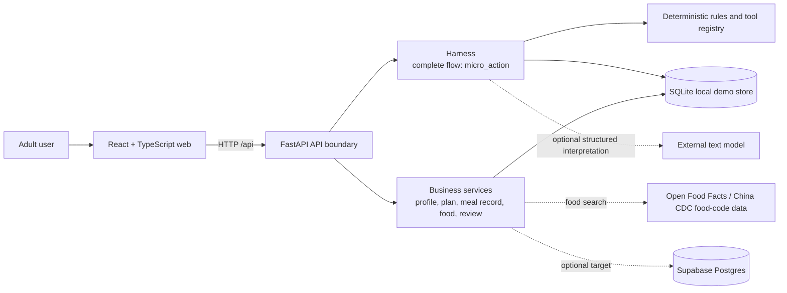
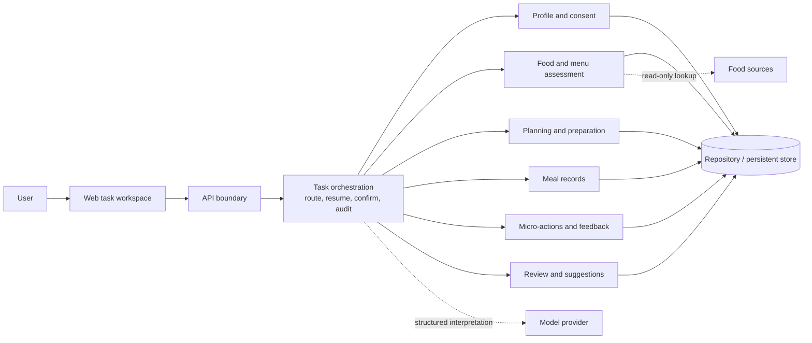
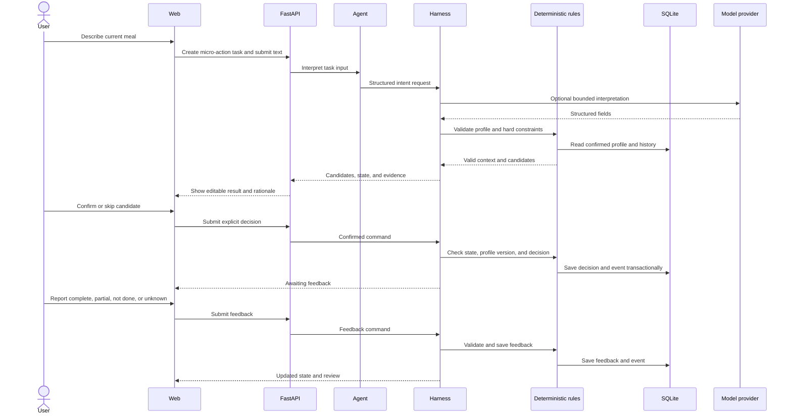

# Assignment 2 Design Baseline

This document separates the current implementation from the intended direction. It uses the 14 use cases in the Assignment 1 submission as the requirements baseline.

## Current Architecture

Current scope: a modular monolith. Micro-action has the complete Harness-controlled context, candidate, decision, feedback, and review path. Quick log and planning create linked task records through their business endpoints. Food search and comprehensive review run through dedicated services and API routes. Postgres/Supabase support exists in the repository, but local demo operation uses SQLite; managed Postgres write and authenticated browser workflows remain unverified.

## Target Direction

Target status: cross-task resume points, context snapshots, and common orchestration policies require further design and validation. The diagram describes a direction, not a claim about current implementation.

## Deployment Baseline and Decisions

| Decision | Current choice | Reason | Cost or condition to revisit |
|---|---|---|---|
| D1: Application shape | Modular monolith: React client, one FastAPI service, Python domain modules | Small team, one deployable unit, direct local integration testing | Shared release and process failure domain; split only when independent scaling or ownership is demonstrated |
| D2: Demo persistence | SQLite on the API host | No cloud account required; supports repeatable local demos and transactional tests | Single-host use; use a deliberately configured shared database for multi-user deployment |
| D3: Model boundary | Model interprets and explains; deterministic services enforce constraints and writes | Safety rules, calculations, and business state need reproducible behavior | More explicit user steps; measure completion and correction burden |
| D4: Food data | Provenanced external/local sources; unknown critical fields require confirmation | Available sources have different coverage and freshness | No claim of complete catalog or guaranteed product safety; measure coverage before expanding recommendation claims |

The Assignment 2 deployment view for the presentation is: browser on the user's device -> FastAPI on the demo machine -> SQLite file on that machine; optional model and food lookup are outbound dependencies. Supabase/Postgres is a separate target deployment pending authenticated browser and repository write verification.

## Core Interaction

For a plan or quick log, use the corresponding service flow in the presentation and label it as a service-managed task linked to the task history. Do not imply it follows the same full Harness state machine as micro-actions.

## Assignment 1 Use Case Mapping

Status describes current repository evidence, not production readiness.

| UC | Assignment 1 use case | Current module or route | Status | Evidence or limitation |
|---|---|---|---|---|
| UC-01 | Manage goals, preferences, and constraints | `profile_workflow.py`, `/api/profile/*`, Settings | Partially implemented | Preview/confirm and consent model exist; authenticated browser lifecycle needs verification |
| UC-02 | Identify food and check labels | `sources.py`, `food.py`, `/api/foods/search` | Partially implemented | Source lookup and unknown handling exist; image recognition and product label coverage are incomplete |
| UC-03 | Query nutrition and compare foods | Food assessment and FoodScreen | Partially implemented | Same-basis values can be compared; coverage, freshness, and source failures limit results |
| UC-04 | Parse menus and recommend meals | Food services and task interpretation | Partially implemented | User-entered options and constraints work; complete menu parsing/recommendation is not established |
| UC-05 | Create and edit day/week plans | `planning.py`, `/api/plans/*`, PlanScreen | Implemented locally | Preview, confirmation, saved plans, and replacement rules exist; cloud deployment not verified |
| UC-06 | Generate preparation and shopping lists | `planning.py`, `/api/plans/{id}/shopping-list` | Implemented locally | Confirmed plan aggregation and inventory difference exist |
| UC-07 | Record and correct actual meals | `meal_records.py`, `/api/meal-records/*`, quick-log routes | Implemented locally | Preview, confirmation, versioned edit, and soft delete exist |
| UC-08 | View comprehensive review | `comprehensive_review.py`, `/api/reviews` | Implemented locally | Deterministic day/week/month summaries; UI and consent path need current browser verification |
| UC-09 | Generate and adjust micro-actions | `harness.py`, `tools.py` | Implemented for current flow | Context checks and deterministic candidate generation are covered by service tests |
| UC-10 | Decide on micro-actions and report execution | `harness.py`, decision/feedback routes | Implemented for current flow | Explicit decision, feedback correction, and unknown state are represented |
| UC-11 | Resume and continue tasks | task list, linked task objects, session drafts | Partially implemented | Quick-log/plan restoration exists; complete cross-task resume point and history remain open |
| UC-12 | Confirm current dietary context | profile workflow and micro-action context flow | Implemented for current flow | Profile version and allergy confirmation gate micro-action candidates |
| UC-13 | Manage consent and personal data | profile workflow, auth, export/delete routes | Partially implemented | API and UI paths exist; end-to-end authenticated browser and account isolation need verification |
| UC-14 | Maintain basic ingredient inventory | `planning.py`, `/api/inventory` | Implemented locally | Manual update, version conflict, and plan-linked inventory difference exist |

The Assignment 1 requirements remain the product scope. Partial implementation records sequencing and coverage; it does not change the original use-case baseline.

## State Ownership

| Object | Authoritative meaning | Main transitions | Related objects |
|---|---|---|---|
| `Task.state` | Progress of one interaction/task | created, context/candidates, awaiting confirmation, adopted/feedback, done/cancelled/stopped | Links to domain objects; does not prove a meal occurred |
| `Plan.status` | State of a proposed or confirmed future plan | draft, confirmed, cancelled/superseded | Shopping list derives from a confirmed plan |
| `MealRecord.status` | User-reported actual meal record | active, updated by version, deleted | May reference a confirmed plan item; reference does not replace self-report |
| `Action.decision` | User's choice about a proposed action | adopt, skip, replaced | Belongs to a micro-action task |
| `Action.execution` | User's report of what happened | unknown, complete, partial, not_done; corrections append history | Used in review with the period boundary |
| `Profile.version` and consents | Confirmed user constraints and data permissions | preview, confirm, revoke/change | New versions invalidate assessments made against older constraints |

The domain object owns the business fact. `Task.state` owns interaction progress. A plan-to-record prefill creates a draft; only explicit meal-record confirmation creates an actual record. Cancelling a task must not silently confirm a plan or create a meal record.

## Consistency and Validation Risks

| Risk | Current design evidence | Required design/PoC action |
|---|---|---|
| Business object saved, task update fails | Plan and quick-log routes call service writes and Harness task updates in sequence | Keep both writes in one transaction where the store permits; otherwise specify idempotent retry/reconciliation and test failure between writes |
| Postgres connection failure switches data store | `auto` mode may fall back to local SQLite | Make cloud deployment fail visibly on cloud-store failure; reserve fallback for explicit local/demo mode |
| Food-source coverage is too low or stale | Open Food Facts may fail; China CDC data is mainly classification/code data | Treat results as sourced reference candidates; measure query hit rate, critical-field completeness, and partial-source recovery on a representative set |
| UI evidence is inconsistent across reports | UX log has earlier browser passes; final QA records browser testing blocked in its environment | Maintain one run table with date, commit, environment, workflow, result, and limitation |
| Engineering tests are mistaken for user evidence | Unit/API tests establish system behavior, not user comprehension or health outcomes | In Part III test plan-vs-actual understanding, unknown-allergen explanation, and manual continuation after model failure |
| Model budget is mistaken for monetary cost | Local call units and token usage do not provide complete actual-cost accounting | Report token usage where returned; mark currency cost unknown until provider pricing and accounting are implemented |

## Verification Baseline

| Evidence | Reported result | Scope limit |
|---|---|---|
| UX refinement log, 2026-11-04 rounds | Python tests and browser/API regression reported passed at different rounds | Historical rounds do not establish the final handoff commit's complete browser coverage |
| Final QA report | Python 227 passed; web build passed; browser regression marked blocked in that environment | Authentication, end-to-end workflow, automated axe, and latest visual screenshots remain unverified there |
| Supabase project check | HTTPS REST reads and table availability reported | No Python Postgres repository write test; 5432 connection timed out |
| Food lookup smoke check | One local food-code result; external source failure was isolated | Does not establish catalog coverage or reliable nutrition data |

For the presentation, quote one test run at a time with its date and scope. Keep unavailable checks in the open-risk slide.

## Part III PoC Questions

1. Can users distinguish a planned meal from a reported meal after using plan prefill?
2. When allergy or ingredient evidence is unknown, do users understand why the system asks them to verify before recommending?
3. Can users continue manually after model failure without losing the task or submitting an unintended write?
4. Across representative local food queries, what fraction returns usable, current source and critical-ingredient fields?
5. If a write succeeds and the task-state update fails, does retry produce one consistent business result?

Measure task success, completion time, correction/error count, and a short comprehension check. These measures assess the workflow; they do not establish health outcomes.
