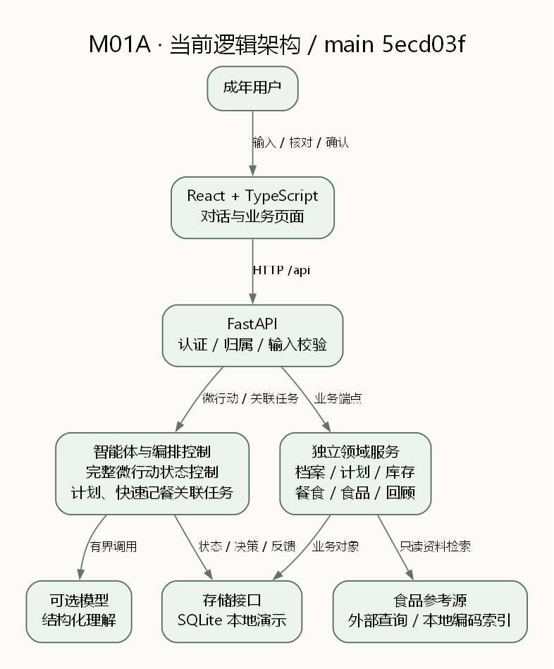
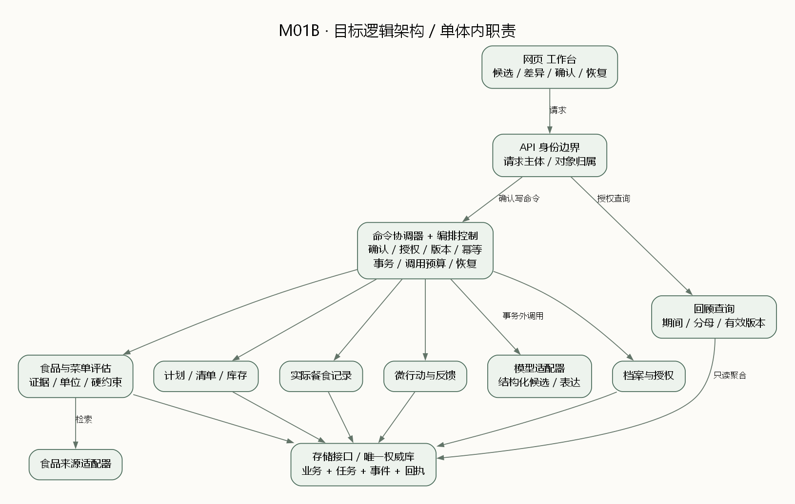
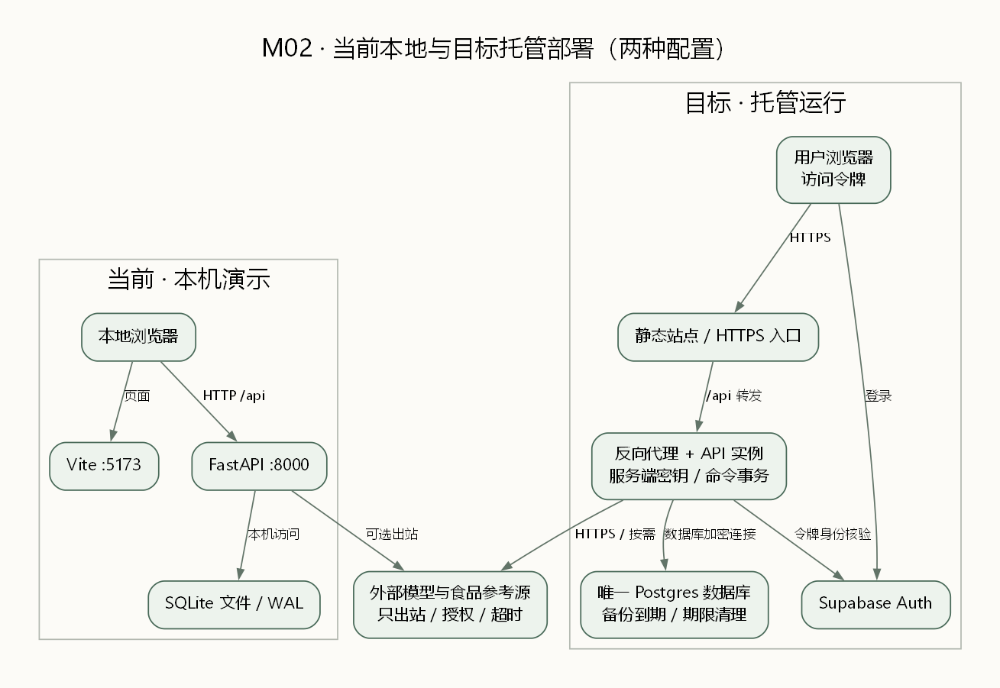

# 架构与关键设计决策

版本 0.2 · 2026-11-17 · 当前实现参照 main `5ecd03f`。本章描述当前架构及面向原 SRS 的目标设计；目标设计中的接口、对象和机制尚待实现验证。

## 1. 业务驱动与系统边界

DietLens 面向一般成年人在食堂、外卖、便利店和居家场景中的饮食管理。系统把“现在如何选择”“以后如何准备”“实际吃了什么”“小行动是否执行”连接起来，共享用户已确认的目标、预算、过敏和授权。每条业务链既能独立使用，也能通过显式引用连接。

贯穿模型的示例：用户对花生过敏，计划明天两人午餐吃番茄鸡蛋面。系统先核对配料和预算，用户确认后保存计划；采购量由两人所需食材减去已确认库存计算。次日用户从计划预填记录，实际只吃了一碗且份量未知，可以修改并确认。若另行采纳“饮料换成白水”，行动进入待反馈；餐食记录保存不会将该行动标为完成。

系统不提供诊断、治疗和药物建议；医学请求停止相关建议并提示专业咨询。图中的外部模型负责字段候选和表达，食品参考源提供带来源资料。

优先质量属性为约束安全、业务状态一致、异常可恢复和可追溯；随后为可用性、交互负担、延迟和可维护性。原 SRS 的具体指标见需求追踪表。

## 2. 逻辑架构

当前客户端为 React/TypeScript；FastAPI 验证身份及对象归属，调用 Harness 或领域服务。微行动由 Harness 完整控制；计划、库存、餐食记录和综合回顾由独立服务处理。计划和快速记餐再通过 Harness 更新关联任务。所有业务服务共用 Repository 接口。

目标设计在 API 与领域服务之间增加统一命令协调职责：确认、当前授权、版本、幂等和事务是公共策略；具体计算和状态迁移仍由各领域服务拥有。协调器为单进程内模块，不引入额外网络服务。只读探索和回顾走查询路径，按授权读取；微行动继续使用有界状态机。

| 模块 | 责任 | 拥有的事实 |
|---|---|---|
| Web 工作台 | 对话、表单、候选、差异预览、确认、恢复入口 | 临时交互草稿；不拥有权威状态 |
| API / 身份边界 | Token 验证、用户主体、资源归属、输入结构与错误响应 | 当前请求身份 |
| 命令协调 / Harness | 任务路由、确认绑定、预算、事务、恢复、事件 | 任务进度与命令结果 |
| 档案与授权 | 目标、预算、硬约束、软偏好、用途授权 | 档案版本和授权事件 |
| 食品与菜单评估 | 来源检索、字段核对、单位兼容、硬约束 | 食品观察及证据版本 |
| 计划、清单与库存 | 日周计划、配方需求、清单差额、手动库存调整 | 独立的计划、清单、库存版本 |
| 实际餐食 | 自述记录、预填、修改和删除 | 有效餐食记录版本 |
| 微行动与反馈 | 单步候选、用户决策、执行自述、反馈调整 | 行动决策和执行历史 |
| 回顾 | 期间聚合、覆盖率、来源与下一步 | 可重算视图，不反写业务事实 |

## 3. 部署架构

**当前本地模式：**浏览器访问本机 Vite 开发服务（5173），经 HTTP 调用 FastAPI（8000）；API 在演示机上访问 SQLite 文件。模型和食品资料检索是服务端出站连接。`demo` 身份模式用于本地单用户演示。

**目标托管模式：**浏览器经 HTTPS 访问静态站点及反向代理后的 API，使用 Supabase Auth 的访问令牌；API 验证身份后访问唯一配置的 Postgres 数据库。数据库凭据和模型密钥只在服务端。浏览器不直接写业务表。食品和模型依赖故障进入手动/部分结果路径；云库不可用时明确报错，禁止自动创建另一份本地权威库。

目标部署另需期限清理作业及备份到期策略；生产副本数、连接池与硬件由 第三部分 负载测试确定。初始设计以单应用实例完成一致性验证，再评估扩容。

## 4. 技术架构

| 层 | 当前选择与目标 | 备选与取舍 |
|---|---|---|
| 客户端 | React 19、TypeScript、Vite；结构化卡片和专用页面 | 相比单一聊天界面，表单更便于核对日期、份量和差异；需要同步草稿和服务器版本 |
| API / 领域 | Python 3.11+、FastAPI、Pydantic；进程内领域模块 | 相比拆微服务，降低跨服务事务成本；各模块仍需明确接口 |
| 结构校验 | Pydantic 请求校验、JSON Schema 工具输入输出校验 | 结构有效后仍须业务校验；模型 JSON 合法不等于事实可靠 |
| 存储 | SQLite/WAL 本地；Repository 隔离的 Postgres 托管路径 | 本地无账户依赖；托管路径承担身份、连接和运维验证 |
| 模型 | Stub 或可配置模型适配器 | 不固定未经核验的型号和价格；按结构质量、延迟、预算及数据传输条件选型 |
| 食品资料 | Open Food Facts 适配、中国食物编码索引、用户标签/菜单 | 编码索引用于分类检索；当前产品配料、份量和价格需核对 |
| 建模 | Graphviz 可编辑 DOT、SVG、PNG | 保留精确对象名及箭头；正式报告可直接嵌入 |

版本依据仓库声明，部署时需锁定依赖。官方技术依据与注释参考文献将在下一阶段核查补齐。

## 5. 决策记录

以下均为本次设计决定；“已有基础”不代表完整机制已经通过验收。

| ADR | 问题与选择 | 备选、理由与代价 | 验证与重审条件 |
|---|---|---|---|
| 01 模块化单体 | 单 API 进程内划分领域服务 | 比较微服务；小团队、共享对象和事务使单体更易形成一致命令。代价是共享部署与故障域 | 验证 20 并发延迟；独立扩容或团队所有权形成后重审 |
| 02 双部署、单权威库 | 本地明确 SQLite，托管明确 Postgres | 比较自动故障切换；避免云库故障把业务分散到本地。需要显式配置、备份和启动健康检查 | 注入数据库断连；不能产生另一份提交成功结果 |
| 03 受控 Agent | 模型生成结构化候选，Harness/服务控制校验与写入 | 比较开放式模型执行循环；明确交接点有助于约束预算、恢复和安全。代价是更多显式确认和契约维护 | 30 权限/确认场景及坏 JSON、越权工具测试；按完成负担调整交互 |
| 04 业务状态独立 | 计划、清单、库存、记录、行动决策/执行独立保存 | 比较由计划、打卡或对话推断事实；独立对象保证修改和统计有确定归属。代价是显式引用和跨模块清理 | AT-20 跨模块场景；任一对象更新不得隐式写入其他事实 |
| 05 同库原子命令 | 业务对象、任务、事件、回执同事务 | 比较顺序提交和补偿；当前单库可优先消除失败窗口。外部模型/检索放在事务外，提交时复核版本。代价是协调层改造 | 每个提交点注入故障、100 次同键和 10 路并发；跨库需求出现再考虑 outbox/对账 |
| 06 证据约束推荐 | 配料、过敏、预算和可获得性进入统一评估；未知只阻止受影响操作 | 比较餐名关键词过滤和来源直接采信；餐名不能覆盖隐藏配料，新增食物也须重查。代价是可推荐项减少和核对负担 | 60 个安全案例；任何错误放行阻止扩展推荐 |
| 07 分层记忆 | 确认档案、版本化情境、临时任务、待确认偏好分层 | 比较对话全文作为唯一记忆；来源、授权和删除能按对象处理。代价是快照、失效和期限管理 | 撤销/删除/恢复组合测试；数据期限由用途变化时重审 |
| 08 确定性回顾 | 用户时区、自述执行日期、最新有效反馈、清晰分母 | 比较创建日/反馈录入日计数；与 SRS 北极星定义一致。代价是历史结果随修正重算并需显示更新时间 | 跨周迟到反馈、同 ID 修正、分母未知；禁止用记录条数替代覆盖餐次 |

## 6. 当前代码与目标设计的差距

| 编号 | 当前证据 | 目标处理 | 影响需求 |
|---|---|---|---|
| GAP-01 | `api_server.py` 计划确认、快速记餐先保存业务对象再更新任务 | 同库命令事务，统一回执 | FR-010/020、NFR-015/026 |
| GAP-02 | `tools.py:filter_options` 按餐名过滤；候选可加蔬果、蛋白质等新内容 | 已核对配料的候选才能进入餐食推荐；新增食物逐项校验；排序前检查历史授权 | FR-003/008/016 |
| GAP-03 | `PlanItem` 仅一个 ingredient_id/quantity；清单直接相加 quantity | 计划餐次包含多条食材行；明确数量基准及人数换算 | FR-017/018、NFR-024 |
| GAP-04 | `inventory_diff` 未登记库存当作 0 | 区分已核对零库存与未核对；未知差额显示待核对 | BR-003、UC-14 |
| GAP-05 | `validate_plan` 接受 1 至 days×3 条餐次 | 显式选择全餐计划或指定餐次，展示缺口；不自动补造 | FR-017、NFR-023 |
| GAP-06 | 综合回顾按行动创建日筛选、期间截止日截断反馈；北极星为餐食记录条数 | 采用 SRS 自述执行日所属周、最新修正、用户时区及去重完成行动数 | FR-007/009；SRS 3.4 |
| GAP-07 | 覆盖率以记录条数除以计划条数 | 用户确认预期餐次槽位作分母，分子按日期/餐次去重 | BR-024、NFR-022 |
| GAP-08 | `MealRecordService.prefill` 将计划数量直接带入记录，source 为 plan_prefill | 保留预填来源和独立 evidence_type=user_self_report；默认不推断个人实际摄入 | FR-006/014/020 |
| GAP-09 | ToolSpec 含超时和重试元数据，`invoke` 只做权限与结构检查 | 调用执行器落实超时、白名单重试和总预算；工具版本/错误码契约补齐 | NFR-010/020 |
| GAP-10 | Harness 用实例字段 `_active_user/_active_task` 传递调用上下文 | 使用每请求不可变调用上下文，禁止并发任务共享可变主体 | NFR-012/015/018 |

这些是代码检查结果与拟议机制，本阶段未修改产品代码。验证计划与指标将在风险章节展开。
