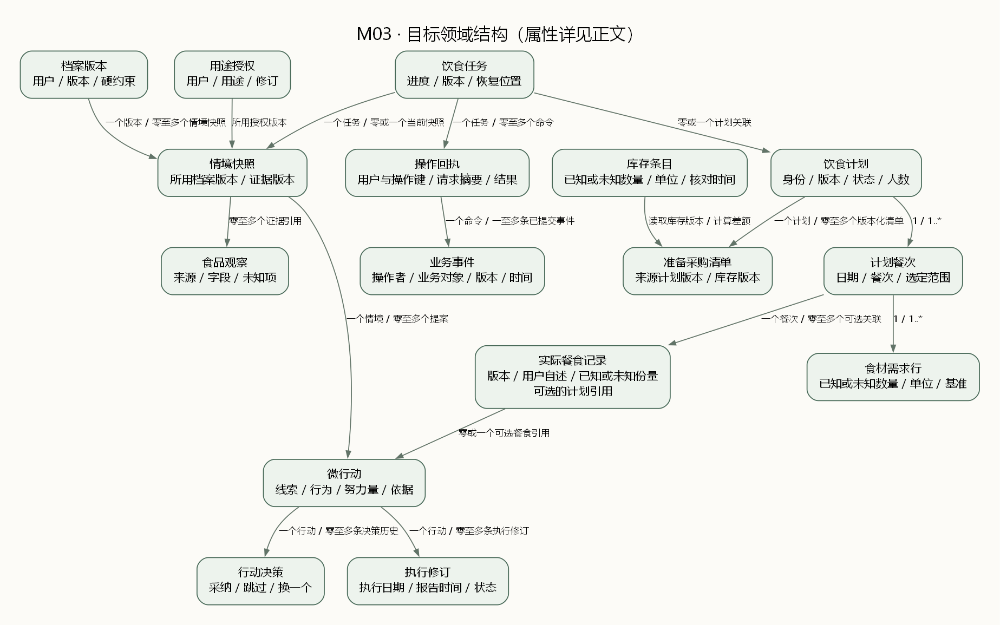
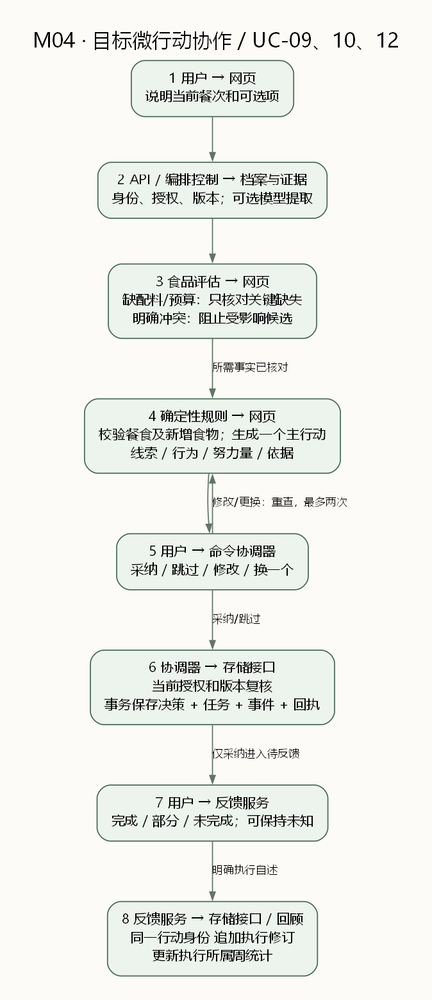
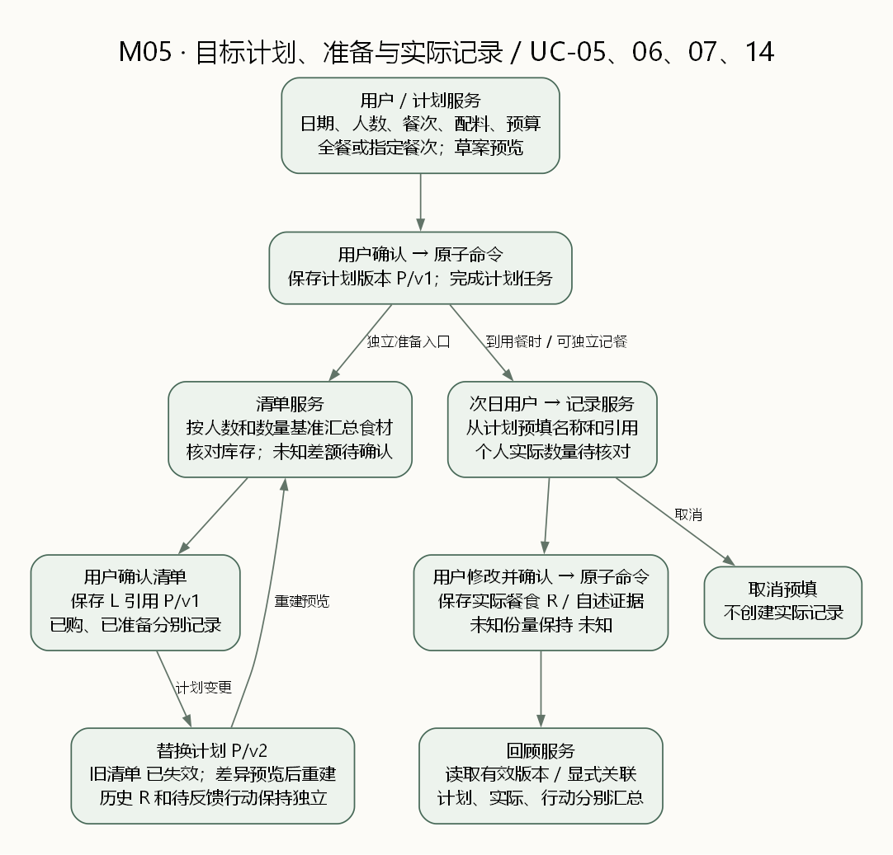
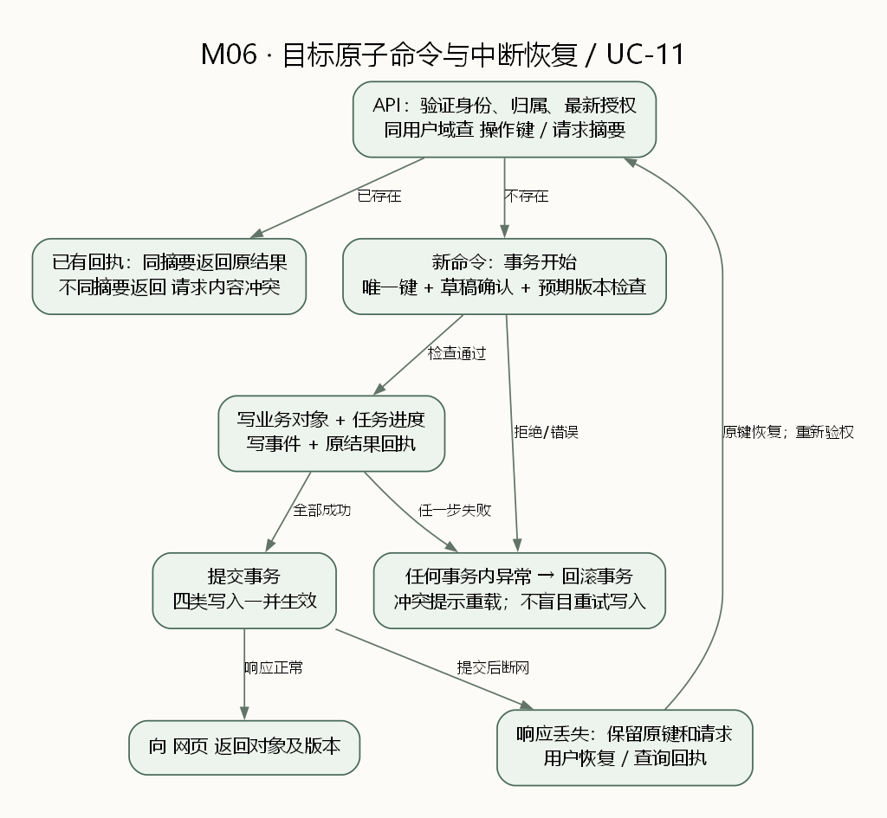
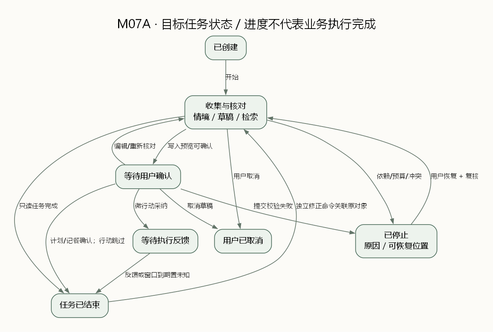
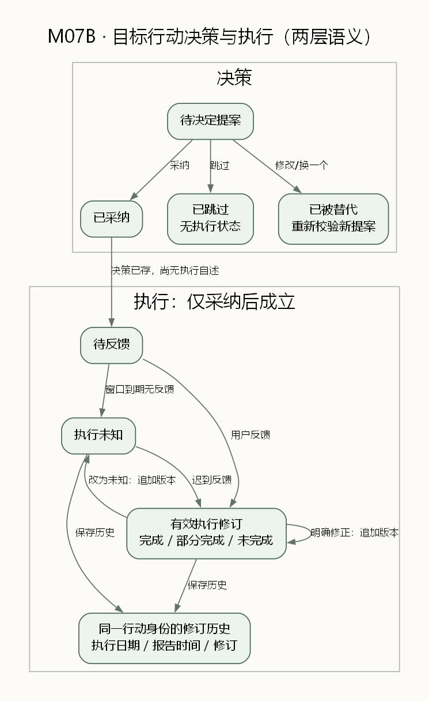

# 领域、交互与状态设计

版本 0.2 · 2026-11-17。除 M01A 之外，本阶段图稿均为目标设计。图是业务设计模型，具体存储字段需通过迁移与契约验证后落地。

## 1. 领域模型与聚合边界

| 聚合 / 对象 | 关键属性、关联与约束 |
|---|---|
| ProfileVersion / Consent | user_id、version、goal、budget_per_person_per_meal、allergies、hard_avoids、dislikes；授权按用途单列，读取和提交重新检查 |
| Task / ContextSnapshot | task_id、type、state、version、resume_point、profile_version、consent_revision、linked_objects；情境含日期、餐次、人数、预算与可获得性。任务只拥有交互进度 |
| FoodObservation | observation_id、source_id、retrieved_at、规格、逐字段原值/核对值/单位/未知、evidence_version；相似名称不自动合并商品 |
| Plan / PlanMeal / IngredientLine | plan_id、version、status、日期范围、人数、选定餐次；每餐 1..n 食材行，quantity 可未知，unit、quantity_basis（per_person/total）明确 |
| ShoppingList | plan_id+plan_version、inventory_revision、status；需求、需购、自述已购、自述已准备分别保存；失效版本不继续展示为当前差额 |
| InventoryItem | ingredient_id、quantity 或 null、unit、confirmed_at、version；未登记不等于已确认 0；手动入库/调整命令独立 |
| MealRecord | record_id、version、status、个人自述日期/餐次/quantity、input_origin、evidence_type、可选 plan_id/item_id/version；源于计划也须重新确认个人实际情况 |
| Action / Decision / ExecutionRevision | action_id、情境引用、cue/behavior/effort/rationale、decision；执行修订含执行日、reported_at、status、note、revision；当前代码 Action 合并这些字段，目标逻辑上分离其职责 |
| OperationReceipt / Event | 用户域内命令键、规范化请求摘要、结果对象 ID/版本、提交时间；事件含 actor、task、entity、version、operation_key。事件用于审计，业务对象仍是有效事实来源 |

跨聚合关联用 ID 与版本表达，不以级联更新改写历史自述。图中 `0..1` 表示显式关联可选；Action 可以从独立情境发起，不强制绑定餐食记录。删除将引用转为已删除提示，并使相应派生结果失效；不将残留对象升级为事实。

## 2. 数量与餐次的业务规则

对示例两人午餐，番茄每人 150g、鸡蛋每人 1 个、面条总量 200g：先将 per_person 行乘人数，再按标准食材及兼容单位归并，得到 300g、2 个、200g。已确认库存分别为 100g、1 个和未知，需购为 200g、1 个和待核对。原计划保存和清单勾选都不改变库存。

单位转换仅在已知等价关系内进行，例如 kg→g、L→mL；个/份/包需明确规格，g↔mL 需可靠密度。缺量不补 0。相同食材多餐需求可汇总，但不把整个两人餐次数量预填为用户个人摄入。

计划创建时显式选择“全餐计划”（1 日 3 餐/7 日 21 餐）或“指定餐次”。全餐模式缺项时保持草案并提示缺口；指定餐次模式仅检查用户选择的槽位。重复槽位以日期+规范餐次识别；一个槽位允许多食材行。替换同一范围生成新版本，冲突日期先提示，不静默覆盖既有计划。

## 3. 微行动流程

先读取当前授权的档案，确认有关过敏、预算及可获得性。模型可提取候选字段，确定性服务检查证据和硬约束。若“番茄鸡蛋面”配料尚未核对，不据餐名排除花生风险；用户核对后才能推荐受影响餐食。推荐“加水果”等引入新食物的动作同样检查配料与条件。

微行动一次聚焦一个低负担行为，例如“拿饮料时换成白水”。卡片展示线索、行为、努力量、依据和仍未知的信息。采纳保存决策并进入待反馈；跳过结束该提案；修改或换一个重新校验并受最多两次更换限制。反馈 complete/partial/not_done 为用户自述，unknown 独立保留。修改执行结果追加同 action_id 的修订历史。

## 4. 计划、清单与实际记录

计划保存前核对日期、人数、餐次、食材和限制；确认后才可生成正式清单。生成过程可以计算预览，确认保存清单为独立操作。计划替换使旧清单 stale；重新生成时显示新旧需求差异，已购/已准备信息需用户核对后迁移。

次日从计划进入记餐，仅预填名称和计划引用；个人实际数量保持待核对。用户可以改餐名、时间、份量，亦可保持未知；取消不保存记录。确认时校验原计划引用仍有效，发生变化提示重载或明确保留历史引用。餐食记录以自述保存，原始输入来源另记为 plan_prefill。已采纳行动不随计划替换、餐食取消或新提案跳过而消失。

## 5. 原子提交与恢复协议

目标写命令信封包含 authenticated_user、task_id、command_type、operation_key、expected_task_version、expected_entity_version、draft_revision、payload。规范化后计算 request_hash。确认绑定确切草稿版本，编辑后旧确认失效；浏览器传来的 confirmed=true 不能单独授权任意写入。

1. API 验证身份、归属和当前授权；查询同用户域的操作回执。同键不同摘要返回 operation_conflict；同键同摘要返回已提交的原结果，不重新执行写入。
2. 在数据库事务中，约束 `(user_id, operation_key)` 唯一；锁定命令/版本，重新校验草稿及引用，比较预期版本。
3. 写业务对象、任务进度、事件及结果回执，一并提交。外部模型、检索不在锁持有期内调用；它们的候选在提交时重新核验版本和证据。
4. 事务中任一步失败全部回滚；授权/版本/业务冲突不自动重试。事务已提交但响应丢失时客户端沿原键查询或提交原请求，返回原回执。读回执接口为目标设计，当前 API 尚未提供统一端点。
5. 恢复入口展示当前任务和关联对象版本，重新检查最新授权；过期草稿需要重新预览。若用户要改变已提交内容，创建新的修正命令及操作键，引用当前版本。

身份检查先于回执返回，避免跨用户读取旧结果。用户删除数据后回执中的业务内容同步清除或最小化，不允许旧回执重新泄露已删除资料。当前单库优先原子提交；若未来跨库，将业务提交与待处理事件同库保存，再设计幂等消费与对账。

## 6. 任务状态与业务状态

目标通用任务状态为 created、collecting、awaiting_confirmation、awaiting_feedback、completed、cancelled、stopped。只读 explore/reflect 可从 collecting 完成；quick_log/plan 确认后完成；micro_action 采纳后等待反馈。needs_clarification、dependency_failed、conflict 作为可恢复的 reason/resume_point 保存，不复制一组业务事实状态。

当前 TaskState 为 created/context/candidates/awaiting_confirmation/adopted/feedback/review/done/stopped/cancelled；CareState 是用户界面陪伴阶段。目标图是按用户任务语义归纳后的协议，后续迁移须保留旧值映射；不能把 plan/quick_log 当前 CREATED 草稿视为尚无草稿，也不能把 Task.DONE 理解为行动已完成。

行动决策为 proposed→adopted/skipped/superseded；执行在 adopted 后才有 pending_feedback。窗口到期无反馈转 unknown，用户可迟到报告，complete/partial/not_done/unknown 间修改均追加修订。跳过没有执行状态。当前代码将待反馈表示为 execution=None，目标以显式状态和窗口截止时间替代歧义。

## 7. 记忆、工具和护栏契约

事实记忆存确认档案和来源，情境快照存当时版本，任务临时态存恢复点和候选，偏好信号存待确认的调整线索。历史分析关闭后候选只使用当前情境；长期偏好更新独立确认。任务临时态 7 天、业务对象 180 天及图片 24 小时等期限沿用 SRS，并由目标清理作业落实。

| 工具类别 | 典型输入 → 输出 | 权限与故障规则 |
|---|---|---|
| profile.read / context.validate | 用户、用途、版本 → 允许使用的确认字段及缺失 | 读前检查当前授权；不按模型猜测补全 |
| food.search / assess | 关键词/条码、证据、硬约束 → 来源、unknown_fields、适用/阻止操作 | 外部读取限时；瞬时只读错误最多重试一次；失败保留已核对字段 |
| plan.preview / shopping.preview | 日期、人数、餐次、食材基准、库存版本 → 草稿和差异 | 可持久化临时草稿，但不形成已确认计划/清单 |
| meal.confirm / action.decide / execution.report | 确认信封、预期版本、payload → 已提交对象与回执 | 显式用户操作；事务、幂等、版本检查 |
| review.query | 期间、时区、用途 → 数量、分母、覆盖度、来源、更新时间 | 确定性聚合；模型只整理已有结果 |

以上工具名为目标契约。当前 registry 实际注册 build_context、save_decision、save_feedback、review、save_profile；其他领域服务目前由 API 直接调用。工具注册新增 schema_version、错误类别、权限、预算；执行器负责落实超时与重试。每步模型最多两次、工具最多三次、总时长 15 秒，周计划最多三步/45 秒。调用次数预算和费用预算独立；费用缺配置时不进行付费调用。

食品/菜单文字、来源内容和模型结果均作为不可信数据，不能修改工具权限或成为用户确认。错误结构、未知工具、超预算和医学请求分别进入明确的停止或手动路径。上下文按请求传递，模型不能访问数据库凭据。

## 8. 回顾的业务定义

北极星为“每周用户自述已完成的去重微行动数”。按用户时区的周一至周日、执行自述日期归周；只统计符合当时约束且最新有效执行状态为 complete 的 `(user_id, action_id)`。迟到反馈或修正更新执行所属周，标注 reported_at 和统计更新时间。原周期截止时的快照如需提供，另标 as_of，不替代最新修正版统计。

反馈覆盖率沿用 SRS 3.4 的结束窗口队列：E 为行动窗口结束时间落在所选周、截至统计时已结束的去重采纳行动集合；R 为 E 中有有效 complete/partial/not_done 自述的集合，D 为 R 中 complete 集合。反馈覆盖率为 |R|/|E|，已反馈者完成比例为 |D|/|R|。未知保留在 E，待反馈单列；提前反馈但窗口尚未结束的行动暂不进入 E。迟到反馈更新原结束窗口队列。两项比例与按执行日期归周的北极星分别计算。

餐食覆盖度分母为用户明确确认的预期餐次槽位；分子为已有有效记录覆盖的去重槽位数。多条食物记录属于同餐时只计一个槽位；额外餐次单列。分母为零或未知显示不适用/未知。

营养覆盖只在来源值、单位和个人份量均可核验时计算。计划营养与实际自述营养分开展示；当前无足够营养数据时保持未知。删除或修正使相关期间重新聚合，不由模型生成缺失数字。
