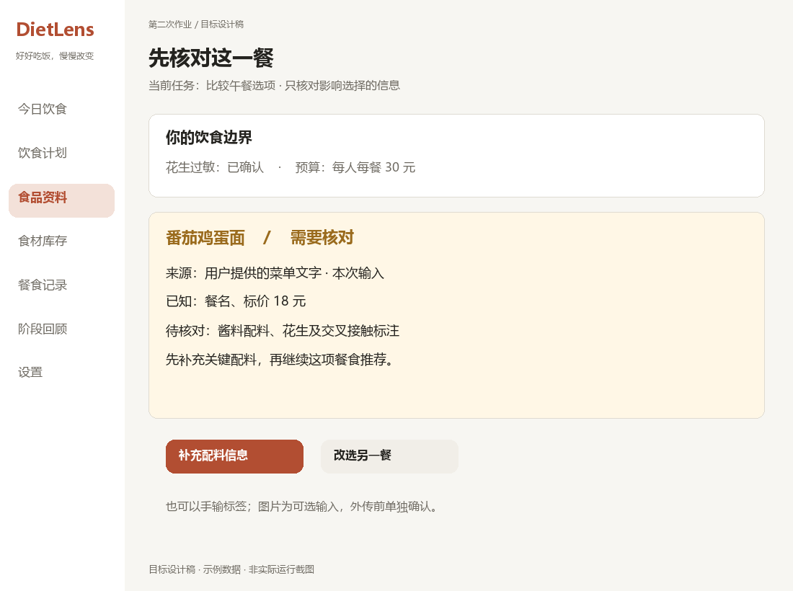
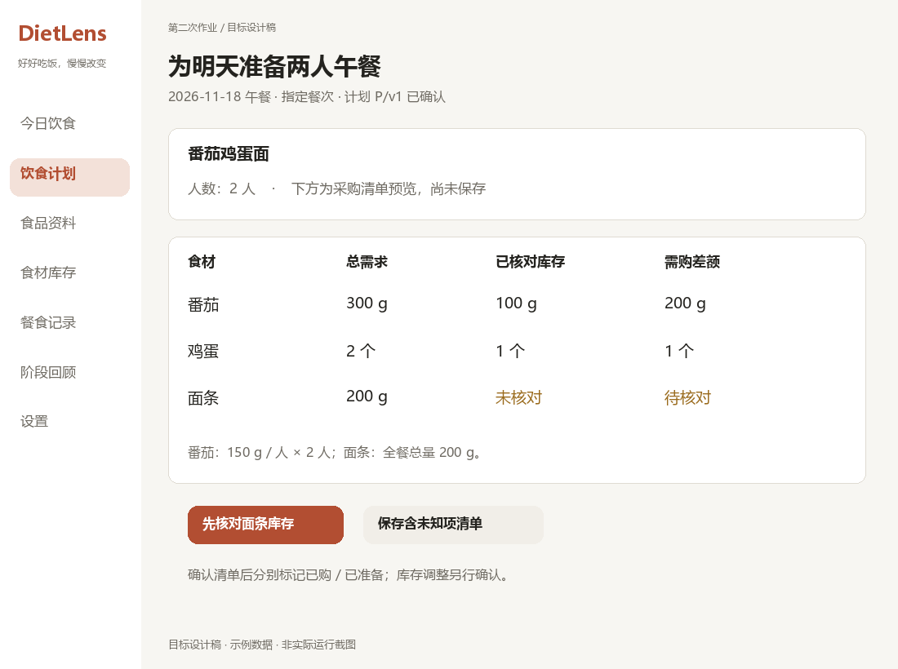
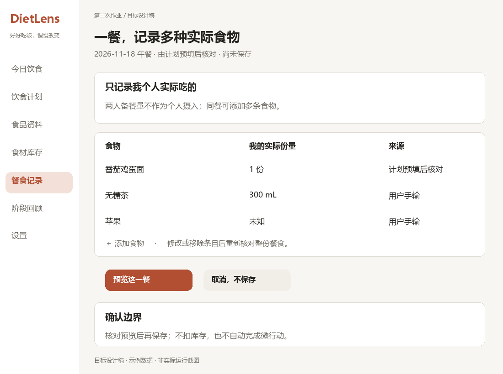
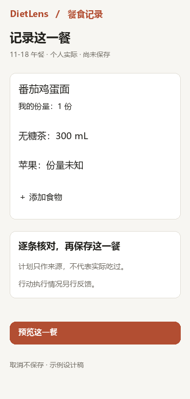
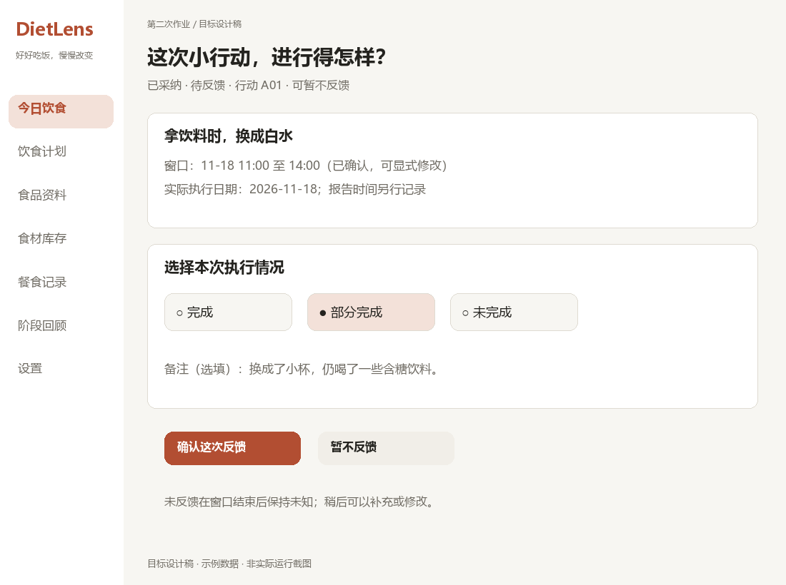
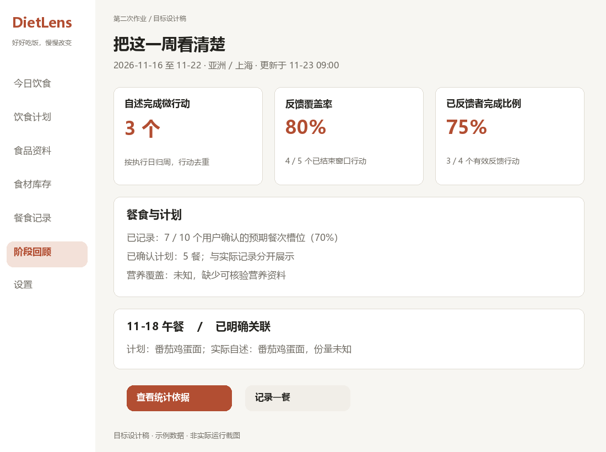
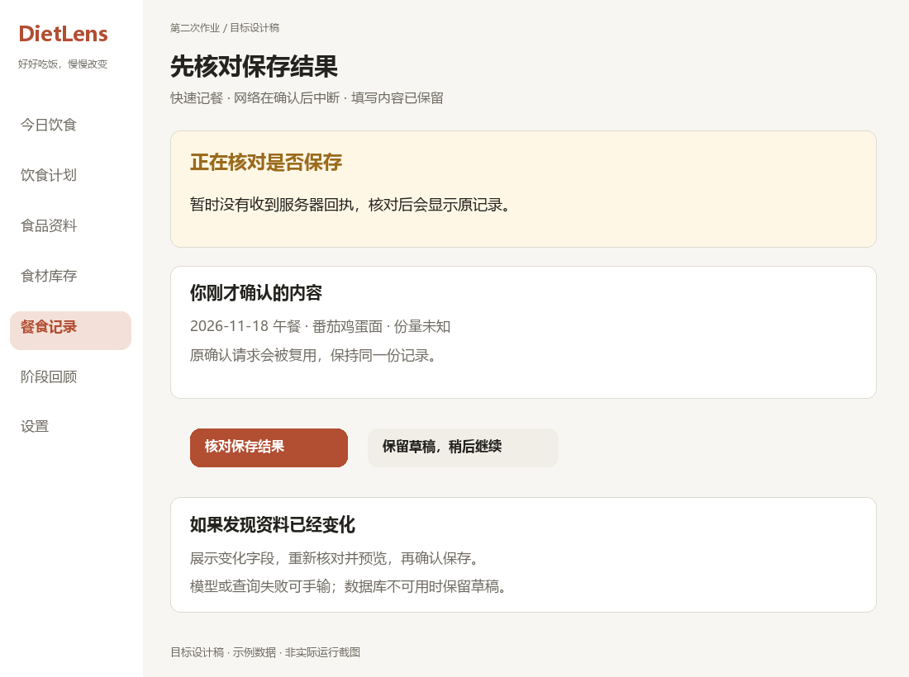
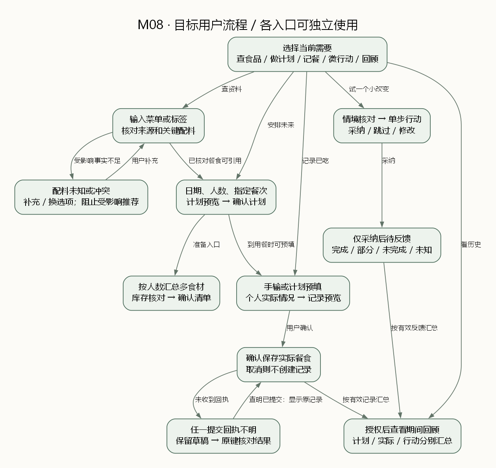

> 本文为早期支撑稿。正式整合说明见final/DietLens_Assignment2_Design.md；界面源已同步多食物记餐与窗口确认。

# 界面与用户体验设计

版本 0.3 · 2026-11-17。以下为目标界面设计稿，使用示例业务数据；不作为已运行产品或用户测试证据。图中的按钮表达交互意图，图稿本身不可点击。

## 1. 界面方向与现有基础

沿用当前 Web 的暖米背景、陶土色主操作、低饱和绿色状态和独立业务页面。对话负责发起意图，表单/卡片负责核对具体字段；计划、食品、库存、记录、回顾和设置保留独立入口。比较过“全部放进对话”和“仅表单”两种方式：前者不利于检查数量、版本和多字段差异，后者增加重复录入；本设计沿用对话加结构化卡片。

代码依据：FoodScreen 已区分 safe/blocked/needs_confirmation，PlanScreen 已有预览与确认，MealJournal 已展示未知份量，WorkbenchScreen 已区分计划时间线与实际记录，SettingsScreen 已有授权与删除对话框。目标稿补充多人数量基准、确认绑定草稿版本、明确统计口径和统一恢复。

## 2. 关键界面

### U01 配料核对（UC-02/03/04/12）

当前档案显示花生过敏已确认。示例菜单名称可识别，但酱料配料未知；卡片标记“需要核对”，列出原始输入来源和受影响操作。主操作是补充配料，次操作是改选另一餐；已有的非安全字段仍可查阅。上传图片为可选输入，外传前说明接收方、用途和保存期限并单独确认。只有用户核对且确定性校验通过后，才开启受影响推荐。

食品 status=safe 在界面写作“未发现已知约束冲突”，同时显示证据范围和日期；blocked 显示具体冲突，needs_confirmation 显示需要核对的关键字段。未知营养显示“未知”，不显示 0；不同来源不无提示拼成一条食品事实。

### U02 两人计划与清单预览（UC-05/06/14）

示例为已确认的两人午餐计划 P/v1，页面下半部是尚待保存的清单预览。番茄每人 150g 转为总量 300g，已核对库存 100g，需购 200g；面条库存未核对，差额保持未知。主操作核对未知库存，再确认清单；用户也可明确保存带未知项清单，未知项不能生成确定需购数量。清单保存后才出现已购/已准备控件，库存调整单独确认。

计划编辑页明确选择全餐或指定餐次。全餐模式缺项提示剩余餐次并保持草案，指定模式只安排选定槽位。修改已保存计划生成新预览；确认时展示受影响旧版本和清单，旧清单失效。日期范围冲突提供重载或调整范围，不自动覆盖无关日期。

### U03 个人实际记餐（UC-07）

从计划只带入餐名和引用。顶栏明确“记录我实际吃的”，个人数量默认待核对；两人备餐量不进入个人份量。用户可以填数值和单位，或保留“份量未知”。名称、日期、餐次修改后需重新预览；主操作“确认保存这一餐”仅确认当前草稿版本。取消回到原入口，不新增实际记录。确认成功再展示记录编号与修改入口。

来源拆为“由计划预填”和“用户确认的实际自述”。食物来自计划也不证明按计划执行；相关微行动仍单独反馈。

移动端采用单列、顶部返回和底部主操作区；操作区避开系统安全边距，内容末尾留出足够空间。份量未知及计划引用位于保存前可见位置，长字段自然换行。

### U04 微行动与执行反馈（UC-09/10）

图示阶段为已采纳、等待反馈，显示“拿饮料时换成白水”的线索、行为及努力量。完成、部分完成、未完成是互斥自述选项，选择后再“确认这次反馈”；备注可选。“暂不反馈”保留待反馈，到窗口结束再转未知；不把按钮点击自动当作执行完成。

候选阶段主操作为采纳，次操作为修改、换一个、跳过。采纳不增加完成数。修改或新增食物重查限制，达到本步调用预算后提供手动继续。已反馈行动显示“修改反馈”，追加原行动修订；不创建第二个行动。

### U05 周回顾（UC-08）

上方标注用户时区、周期间和更新时间；三项指标分别说明分母。示例北极星为 3 个自述完成的去重行动；结束窗口队列 5 个采纳行动、4 个有效反馈，反馈覆盖率 80%，其中 3 个完成，已反馈者完成比例 75%。这组示例假设三个完成行动的执行日也都落在所选周，实际系统分别按两种日期归属计算。

餐食覆盖率示例为 7 个已记录槽位/10 个用户确认预期槽位。计划 5 餐单独展示；营养覆盖因缺资料保持未知。时间线区分已明确关联、同餐次待核对、计划外、待记录；“按计划记一餐”只打开草稿。历史分析未授权时显示授权说明及“先记一餐”入口，不预先请求历史。

### U06 中断恢复（UC-11）

图示为记餐确认后断网、回执尚未查明。提示“正在核对是否保存”，保留原稿；主操作“核对保存结果”沿原操作键查询，不创建新记录。查到已提交则显示原记录和版本；无提交回执且服务器确认未提交后，才允许以原键重试。

发现档案、授权或对象版本变化时，提示具体变化和“重新预览”。模型或食品服务失败与数据库故障分开表达：前两者可手动继续；数据库不可用不能显示“已保存”。不同意外传仍可手输，退出当前任务不取消已保存的其他任务。

## 3. 用户流程 M08

流程图串联三个业务段：饮食核对与选择、未来准备与实际记餐、行动反馈与回顾。每段可独立进入；跨段引用只做关联。记录入口不强制先建立计划，微行动也不强制先记餐。

## 4. 控件与错误语义

| 状态 | 展示与允许操作 | 业务效果 |
|---|---|---|
| 草案 | 可编辑，预览后确认；显示当前版本 | 可保存临时态；不成为确认业务事实 |
| 待核对 | 指明字段、来源和原因，补充或换选项 | 仅阻止受影响候选 |
| 待反馈 | 已采纳与执行选项分开；可暂不反馈 | 完成数不变 |
| 未知 | 文字标识、灰色辅助，不默认选为未完成 | 保留在适用分母中，分子按指标定义处理 |
| 保存中 | 主操作禁用，状态读屏可感知 | 同一命令键；不依赖前端禁用保证幂等 |
| 回执不明 | 核对结果与保留草稿 | 不盲目创建新命令 |
| 版本冲突 | 显示过期字段及重载差异 | 用户再次核对；旧确认失效 |
| 来源故障 | 已确认字段保留；手输、部分结果 | 不虚报检索成功 |
| 已保存 | 明确对象、时间、版本；可修改 | 修正是新命令，关联原对象 |

## 5. 授权、删除与无障碍

设置按历史回顾、图片外传和提醒分项展示用途、当前状态和撤回入口。关闭提醒不改变行动决策或执行。撤销授权后恢复任务也需检查最新权限；导出说明对象范围。删除对话框展示当前用户、对象范围和影响，取消默认获得焦点；提交后显示处理中/完成/失败，不以关闭弹窗宣称已删。外部副本与备份期限在删除说明中列明。

沿用当前侧栏与移动端导航，不要求用户为核心任务进入多个深层菜单。核心按钮触控目标至少 44px；表单均有可见标签，键盘焦点顺序按内容再到主操作，弹窗支持 Escape、焦点限制和关闭后焦点恢复。错误就近关联字段并向读屏播报；状态兼用文字与色彩。320/390/1440px 布局、文字缩放和 WCAG AA 对比度目标均列入 PoC-06 检查，本轮仅完成静态图稿。
