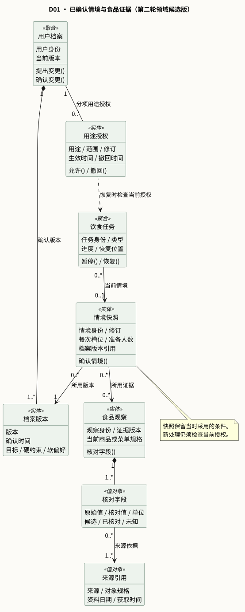
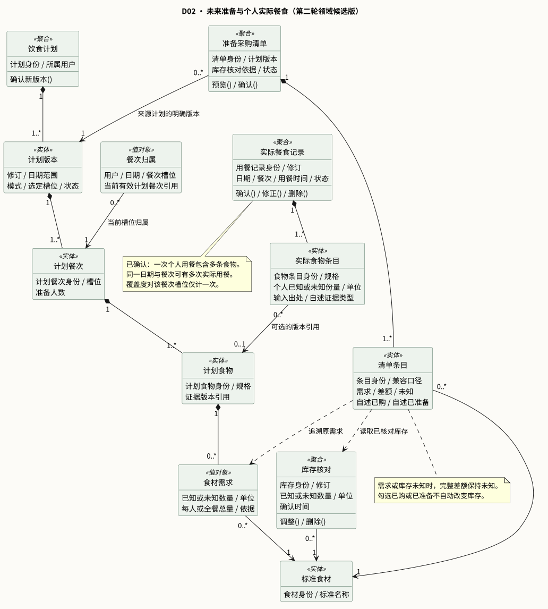
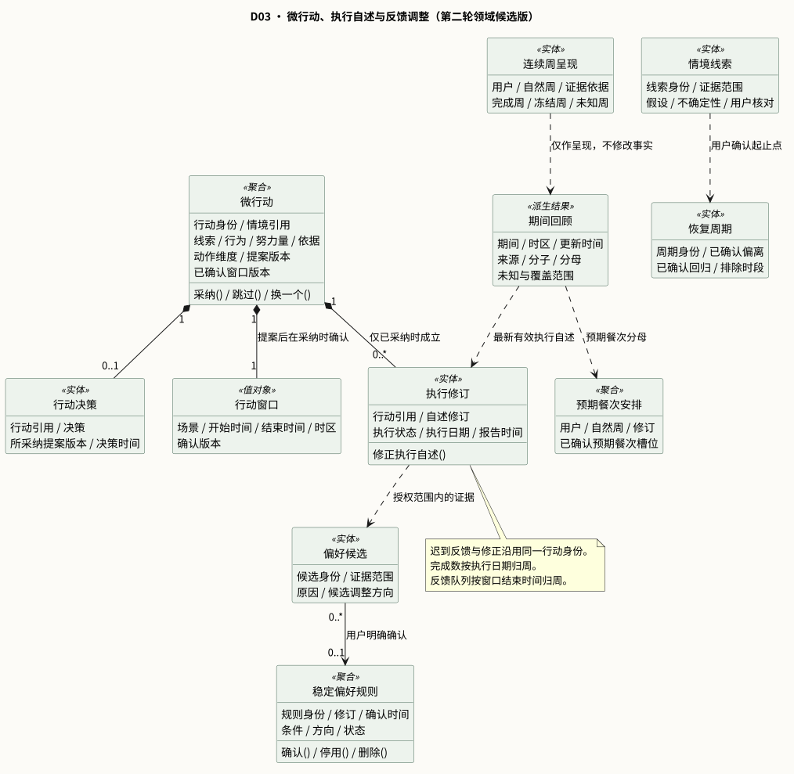
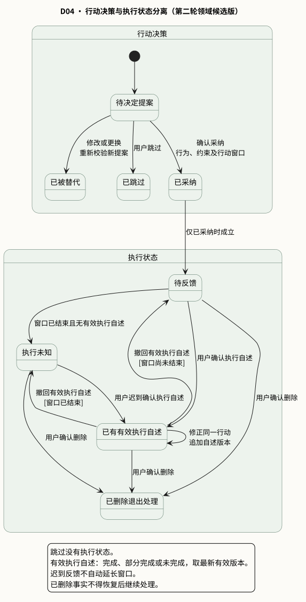

# DietLens 领域模型

版本 R2-P2 · 2026-11-17 · 状态：用户在成果展示及中文化后要求“继续”，本版沿用为P3基线。

需求来源为[已确认需求](../../specs/001-dietlens-design/spec.md)，术语以[词表](../../GLOSSARY.md)为准。原SRS的事实边界及已确认计划模式直接继承；本章不确定表结构、网络接口或部署方案。

## 1. 建模目标与业务分区

DietLens围绕同一个人连接六组业务：档案与授权、食品与菜单证据、未来计划与准备、实际用餐自述、微行动与反馈、基于证据的回顾。分区表示业务责任，不表示要拆成六个服务。

重点区分三个层次：未来安排、用户确认的实际事实、系统依据事实形成的观察与候选。用户确认一个层次，不自动确认其他层次。任务只表达用户目前进行到哪里，不能代替“吃过”“买过”或“行动完成”。

## 2. 实体、身份和所有权

下表为目标领域概念。身份是业务上持续识别同一对象的依据，版本表示同一身份的有效内容修订。所有个人对象均属于本人；跨对象引用必须指向同一用户、明确版本及允许使用的内容。

| 对象 | 业务身份 / 核心内容 | 行为和关系 | 需求 |
|---|---|---|---|
| UserProfile 用户档案 | 本人身份；当前确认档案版本 | 提出变更、确认、复用；含目标、预算、硬约束、软偏好，不混入推测 | FR-001 |
| ProfileRevision 档案版本 | 档案身份+版本；字段值、来源、确认时间 | 确认后语义固定；旧情境保留当时引用，新任务读取当前有效版本 | FR-001/020 |
| ConsentRecord 用途授权 | 用户+用途；允许范围、生效/撤销时点、修订 | 历史分析、逐图外传、提醒分别控制；旧授权快照不放行新处理 | FR-011 |
| DietaryTask 饮食任务 | 任务身份；类型、进度、暂停位置和关联对象 | 发起、暂停、恢复、取消；关联零至多个业务对象 | FR-010/013 |
| ContextSnapshot 情境快照 | 情境身份/版本；餐次、人数、预算、可获得性及档案/证据引用 | 核对后形成当次上下文；影响结果的变更需新快照及复核 | FR-003/012 |
| FoodObservation 食品观察 | 观察身份；当前商品/菜单条目、规格与证据版本 | 同名不同规格不自动合并；逐字段核对、保留未知与冲突 | FR-012/015/016 |
| Ingredient 食材 | 标准食材身份及名称；不代表某菜完整配方 | 连接准备需求、库存与清单；未知配方不按餐名补造 | FR-018/019 |
| DietPlan 饮食计划 | 计划身份；当前确认版本 | 创建/编辑草案、确认新版本；范围含1/7日、完整/指定模式 | FR-017 |
| PlanRevision 计划版本 | 计划身份+版本；日期范围、选定餐次集合、状态 | 一次确认覆盖明确范围；旧版本及清单失效处理显式展示 | FR-017/020 |
| PlannedMeal 计划餐次 | 计划版本内餐次身份；槽位、准备人数 | 包含一至多个计划食物；完整模式槽位齐全、指定模式只验选定槽位 | FR-017 |
| PlannedFood 计划食物 | 餐次内食物身份；食物名/规格、评估引用 | 可有零至多项已知食材需求；可替换且重查限制 | FR-003/017/018 |
| PreparationList 准备采购清单 | 清单身份；计划版本及库存核对依据 | 草案、确认、已失效；需求/差额与已购/已准备分别维护 | FR-018 |
| PreparationLine 清单条目 | 清单内标准食材+兼容口径 | 汇总所引用需求，可编辑并保留来源；采购自述与准备自述独立 | FR-018/019 |
| InventoryObservation 库存核对 | 用户+标准食材+口径下的库存身份、有效版本 | 用户核对数量/未知及日期，预览调整/删除；不随计划或勾选变动 | FR-019 |
| MealRecord 实际餐食 | 一次个人用餐身份；时间、餐次、自述和有效版本 | 手输/预填后确认、修正、删除；每次用餐含一至多条实际食物，Q2已确认 | FR-014/020 |
| ReportedFood 实际食物条目 | 用餐内条目身份；食物、个人份量、出处及证据 | Q2已确认：条目随餐食整体确认/修订；删除最后条目不隐式记录“零摄入” | FR-014/015 |
| MicroAction 微行动 | 行动身份；情境、维度、线索、行为、努力量、依据 | 提案、更换、采纳、跳过；采纳固定所选提案的含义 | FR-004/005 |
| ActionDecision 行动决策 | 关联行动身份；采纳/跳过/被替代及时间 | 未采纳没有执行事实；换一个形成新提案，不重写旧行动 | FR-005/020 |
| ExecutionRevision 执行修订 | 行动身份+修订序号；执行状态、实际日期、报告时间和备注 | 仅已采纳行动可报告；修正追加历史，同一行动只有一个有效结果 | FR-006/007 |
| PreferenceSuggestion 偏好候选 | 候选身份；关联授权证据范围、类型和原因 | 可接受、拒绝、到期；未确认不成为长期档案 | FR-008 |
| PreferenceRule 稳定偏好 | 规则身份/版本；确认的条件、方向和适用范围 | 确认后生效，可停用/删除；不修改硬约束或原始执行 | FR-001/008 |
| ContextClue 情境线索 | 线索身份；观察范围、触发依据、待核对假设 | 用户核对或忽略，可关闭/删除；确认的是特定情境而非诊断 | FR-008/009/011 |
| CalibrationResponse 校准回答 | 本人、题目版本及确认答案 | 至多三题，可跳过/删除；可成为确认交互偏好，不生成心理标签 | FR-001/011 |
| ReminderHistory 提醒历史 | 已采纳行动、实际提醒时点及用户是否回应 | 仅订阅时处理，用于提示退避；未响应不产生执行未完成 | FR-008/011 |
| RecoveryEpisode 恢复周期 | 周期身份；用户确认的偏离、回归和排除区间 | 起止可追溯才计算；缺端点保留未闭合，不估算 | FR-009 |
| ExpectedMealSchedule 预期餐次 | 用户确认的所选周及预期槽位版本 | 独立确认或明确从计划导入；未经确认不把计划数当覆盖率分母 | FR-009 |
| WeekPresentation 周呈现 | 用户、自然周；完成/冻结/未知及依据 | 基于事实重算，冻结属于展示决定，不修改完成事实 | FR-009/011 |

当前代码把部分概念合在同一对象，目标模型按业务责任分开；实体名不会自动要求“一对象一张表”。

## 3. 值对象与派生结果

| 值对象/结果 | 含义及约束 |
|---|---|
| MealSlot 餐次槽位 | 本地日期+规范餐次；同一午餐可有多次用餐记录，但覆盖槽位最多计一次 |
| Quantity 数量口径 | 已知值+单位或未知；非负有限量；份/包/个转重量需要具体规格，g与mL无依据不互换 |
| QuantityBasis 准备数量基准 | 每人用量或本餐总量，必须与人数、食材行一起解释；同一量不能重复乘人数 |
| SlotAssignment 当前计划归属 | 本人、日期、餐次所对应的有效计划版本与计划餐次；一次槽位至多一项当前安排，历史引用不变 |
| IngredientRequirement 食材需求 | 食材引用、数量、基准、来源、配方版本/覆盖；不完整配方只标已知部分 |
| SourceReference 来源引用 | 来源、对象/规格、材料时间、获取时间、核对状态；原出处与自述证据类型分开 |
| VerifiedField 字段事实 | 原始值、核对值、单位、未知/冲突和来源；未知不补0，核对记录不抹除来源 |
| ActionWindow 行动窗口 | 场景、开始/结束时点与所用时区；结束时间和采纳关联，Q3已确认：按行动提出，采纳时确认，可显式修改 |
| VersionedReference 业务版本引用 | 对象身份+所用版本，可指历史有效事实，不表示源对象今后不变 |
| ConstraintAssessment 约束评估结果 | 对特定候选/证据/约束版本的通过、拦截或待核对；指明受影响操作 |
| PeriodSummary 期间回顾 | 已授权有效对象的派生结果，含期间、分子分母、来源、未知和更新时间；可重算，不反写源事实 |

## 4. 领域关系与基数

图中的组合表示内容属于该整体的业务生命周期，不代表数据库删除级联；带身份的关联表达可选引用。删除和保留期限另按授权处理。

| 关系 | 基数及含义 |
|---|---|
| 用户档案→档案版本 | 1→1..*；每时刻至多一个当前有效版本 |
| 情境快照→所用档案版本 | 每快照恰1个，多个快照可用同版本 |
| 情境快照→食品观察 | 0..*；纯手输微行动不要求食品库命中 |
| 计划→计划版本 | 1→1..*；草案可存在，确认后有明确有效范围 |
| 计划版本→计划餐次 | 1→1..*选定槽位；完整模式3/21，指定模式等于用户选定集合 |
| 计划餐次→计划食物 | 1→1..*；一道面、饮料可在同餐中分别表达 |
| 计划食物→食材需求 | 1→0..*；外卖没有完整配方也可保留“配方未知”，清单不能伪造食材 |
| 清单→计划版本 | 每清单恰1个版本；同源版本重提不产生重复有效结果 |
| 清单条目→食材需求 | 一个条目可汇总多餐需求；每个被采用需求均可追溯 |
| 库存核对→清单差额 | 同食材和兼容口径可被多个清单读取；读取本身不预留/扣减库存 |
| 实际餐食→实际食物 | Q2已确认1→1..*；确认记录不可没有食物，空草稿可取消 |
| 实际食物→计划食物 | 0..1显式版本引用；计划食物可对应0..*个人实际条目 |
| 微行动→当前情境 | 恰1个已确认快照；可选关联计划餐次或实际餐食，均可为空 |
| 微行动→决策 | 尚未决定为0，已决定有有效决策；被替代提案不覆盖已采纳行动 |
| 微行动→执行修订 | 0..*，仅已采纳时成立；最新有效一项参与统计 |
| 偏好候选/情境线索→证据 | 1..*授权范围内引用；权限撤回后停止使用相应证据贡献 |
| 回顾→各类事实 | 授权读，不拥有事实；修正删除后重新派生 |

## 5. 事实边界与不变量

| 规则 | 约束与反例 | 来源 |
|---|---|---|
| INV-01 本人所有权 | 计划、记录、行动引用不能跨用户；两人备餐不替另一人记录摄入 | FR-011/020、NFR-012 |
| INV-02 确认建立事实 | 草案和候选可保存临时进度，只有用户确认才成为对应业务事实 | FR-001/005/014/017 |
| INV-03 证据按字段评估 | 知道餐名或热量，不能解除未知酱料对过敏推荐的影响 | FR-003/012/016 |
| INV-04 变化需重查 | 档案、证据、替代食物或可获得性变化，受影响评估不可沿用 | FR-003/010 |
| INV-05 准备量不等摄入 | 两人每人番茄150g，总需求300g；不把300g预填为用户吃下的番茄 | FR-014/018/020 |
| INV-06 未知独立存在 | 未登记库存、配方缺项和份量未知均非零；不完整量只报已知部分 | FR-015/018/019 |
| INV-07 清单与库存独立 | 自述已购或已准备不自动增加/减少库存，也不新增用餐或执行完成 | FR-018/019/020 |
| INV-08 版本引用不改历史 | 新计划使旧清单差额失效，不重写历史个人自述或已采纳行动的含义 | FR-017/020 |
| INV-09 决策不等执行 | 采纳只待反馈；跳过无执行，未响应不等未完成 | FR-005/006/007 |
| INV-10 同行动修正 | 晚报和修正保留action身份；同一行动只一个有效执行结果 | FR-007、BR-013 |
| INV-11 窗口不等提醒 | 到期未知由确认窗口决定，不随提醒计数或发送结果自动改变 | FR-007/008 |
| INV-12 两种周归属 | 完成数归执行日周；反馈率归已结束窗口队列；录入时间仅说明何时报告 | FR-009、SRS3.4 |
| INV-13 覆盖按槽位 | 同午餐多食物/多次用餐仍最多覆盖一个已确认预期槽位，额外餐次单列 | FR-009、BR-024 |
| INV-14 派生不改原述 | 偏好、线索、恢复周期、冻结只解释或呈现，不能把未知改完成或改硬约束 | FR-008/009、BR-023..027 |
| INV-15 当前授权优先 | 快照证明当时使用什么，恢复/回顾/外传仍检查当前用途授权 | FR-010/011 |
| INV-16 唯一有效结果 | 重复提交不重复对象/数量；并发修正只一个有效结果，冲突明确重载 | FR-010、NFR-015 |

执行反馈是对原已采纳行动的事实修正，不能因为当前档案变化而拒绝记录真实自述。原行动所用约束快照用于解释当时依据；当前约束用于新候选、新采纳和修改行为的重新评估，二者分别处理。

## 6. 数量、配方与采购差额

对每条已知食材需求：每人基准乘该餐准备人数；全餐总量直接采用。按标准食材及有依据的兼容单位汇总。若同食材还有未知需求，不将已知小计标成完整总量。

示例：两人番茄150g/人、鸡蛋1个/人、面条200g/本餐，需求为300g、2个、200g。确认库存为100g、1个、未知时，采购差额为200g、1个、未知。差额仅在需求及可用库存均已知时计算 max(需求−库存,0)。自述已购保留在清单状态，不代替库存核对。

外卖“番茄鸡蛋面”可有已核对限制条件，但没有原料克数。此时可以保留餐食安排及配方缺口，准备清单只列可追溯已知部分，不能从菜名自动生成完整配方。缺失安全关键配料时，仍按INV-03停止受影响推荐。

**领域提案：多个计划重叠时，以日期+餐次检查冲突，用户差异预览并确认替换受影响范围；未涉及槽位保留。** 当前代码按整个日期范围替代/拒绝，与两种计划模式需要的细粒度范围不同，后续架构和数据设计应按本阶段确认结果处理。

## 7. 生命周期与守卫条件

### 7.1 计划、清单与记录

| 对象/变化 | 触发与允许条件 | 结果及失败处理 |
|---|---|---|
| 计划草案→确认版本 | 用户确认当前草稿；本人、选定槽位、人数及受影响约束校验通过 | 新版在明确范围生效；缺项/冲突返回核对，不动旧确认内容 |
| 确认计划→新草案 | 编辑或替换 | 原确认版仍可读取；新稿取消保留旧版 |
| 新版确认→旧版受替代 | 用户核对变更范围 | 仅受影响范围失效；旧关联可作为历史来源读取，不当作当前推荐 |
| 清单草案→有效 | 引用确认计划版本，库存和差额范围已核对，用户确认 | 未知项显式保留，不能宣称完整采购量 |
| 有效清单→失效 | 来源计划变化 | 旧差额不可继续当当前值；提供重建差异 |
| 清单已购/已准备变化 | 用户自述、版本有效 | 分别保存；计划/库存/记录/行动不变 |
| 库存有效→修订/删除 | 用户预览确认，数量及单位有效、版本无冲突 | 更新库存与相关差额；冲突重载；历史清单自述不改写 |
| 实际草稿→有效自述 | 用户确认本人实际餐食，时间/餐次有效，至少一项食物 | 形成记录身份及版本；取消不新增记录 |
| 实际记录→修订 | 用户明确改动、预期版本匹配 | 同记录新有效版；只改一项食物不另算一次餐次 |
| 实际记录→删除 | 用户确认范围 | 退出后续回顾与偏好证据；派生结果失效 |

计划部分范围替代在业务上以SlotAssignment表达当前槽位归属；版本确认内容固定，当前剩余生效范围可据归属关系计算。只有全部原槽位均已替代时，旧版才整体显示被替代。物理保存形式后续确定，不修改历史确认内容掩盖变化。清单重建不自动迁移“已购/已准备”为新事实：保留旧自述供差异核对，用户明确确认后才建立新清单的相关状态。

### 7.2 行动决策与执行

| 当前状态→结果 | 触发与守卫 | 业务后果 |
|---|---|---|
| 提案→采纳 | 确认具体行为、当前约束、行动窗口 | 固定所选行动含义，进入待反馈，完成数不变 |
| 提案→跳过 | 用户选择不采纳 | 无执行结果；可降低当前提示优先级，不记失败 |
| 提案→被替代+新提案 | 用户修改/换一个，次数允许，新内容重查 | 原提案保留决策归属；不影响其他已采纳行动 |
| 待反馈→完成/部分/未完成 | 本人对已采纳action报告并确认，日期和当前版本可核对 | 追加ExecutionRevision，更新同一行动有效结果 |
| 待反馈→未知 | 已确认窗口结束，仍无有效执行自述 | 独立未知状态，保留在适用结束队列分母 |
| 未知→执行自述 | 用户迟到报告 | 同行动追加修订，回填执行周与原结束队列 |
| 已有自述→修正 | 用户确认更正，同版本竞争无冲突 | 新有效修订替代统计贡献；若撤回为不确定，窗口未结束回待反馈，已结束则未知；不新增行动 |
| 任一执行状态→删除 | 本人确认删除范围 | 执行与派生贡献退出处理，不能由旧回执恢复 |

采纳后若要改行为，提出新行动并重查，不把已采纳行为悄悄替换。迟到反馈不会自动延长窗口；提醒发送和无响应也不修改执行状态。执行日期与情境显著不符时先核对，不静默搬移日期。

### 7.3 行动窗口与修改

Q3已确认按行动提出结束时间，用户采纳时一并确认，可修改；本阶段不新增统一24小时等默认值。开始不得晚于结束，采纳时结束点应尚可尝试且可向用户解释；过去实际执行的补记走执行自述核对，不通过“采纳一个已过期未来行动”伪造流程。

候选阶段修改窗口属于草稿变化，需重新核对。采纳后主动修改窗口为显式修正，记录旧值、新值、确认时间及原因，不另建行动；必要时重查情境与可获得性。晚报和提醒不自动改窗口。窗口跨周修正后，应按最新确认窗口更新原/新结束队列，并标统计更新时间；执行日期及有效自述不被搬移。

待反馈与未知按“当前有效执行自述+确认窗口+统计时点”判定：有完成/部分/未完成自述时采用最新有效结果；没有有效执行自述且窗口未结束为待反馈，已结束为未知。因明确修正窗口而重新进入待反馈必须展示变更依据，不用于补造完成。

### 7.4 偏好、线索与连续周

| 对象 | 触发及状态 | 边界 |
|---|---|---|
| 校准回答 | 未填写→用户确认→可删除 | 跳过中性默认，不生成心理分数 |
| 情境线索 | 授权记录→待核对→确认特定情境/忽略/删除 | 确认不等于医疗或心理因果结论 |
| 稳定偏好 | 候选→用户确认→有效/停用/删除 | 内环排序信号和长期规则分开；删除重算派生贡献 |
| 恢复周期 | 确认偏离→待回归→确认回归后可计算 | 缺起止或记录不足不估算；不由间隔推断误餐 |
| 周呈现 | 依据有效完成事实或确认冻结生成 | 完成、冻结、未知分别标注，不改完成数 |

## 8. 统计对象、日期与身份

北极星去重键为用户+行动身份，不是执行修订身份。当前有效完成自述的执行日归属所选周；报告时点仅作溯源。反馈率的结束队列按确认窗口结束时点归周，取截至统计时已经结束的采纳行动，迟到反馈更新原队列。

个人一餐可包含多种食物，其营养可计算性逐条判断。餐次覆盖度则按确认预期槽位去重：同一天午餐有两条记录只覆盖一个槽位；未在预期集合的餐次另列。分母是用户确认的ExpectedMealSchedule，不直接取计划行数。

本次沿用需求指定的Asia/Shanghai显示及自然周语义，不新增旅行时区自动重分组。每条自述保留当时的业务日期/时间依据，未来若支持改时区，须单独确认历史重归属规则。

## 9. 当前代码映射与重设计影响

| 当前实现证据 | 目标领域含义 / 差异 |
|---|---|
| models.Profile及内嵌consents | 档案版本与用途授权职责分开，旧快照不替代当前授权 |
| PlanItem同时含餐名、单ingredient_id及quantity | PlannedMeal→PlannedFood→IngredientRequirement，支持真实多食材和未知配方 |
| planning.validate_plan允许少量餐次且整日期范围冲突 | 显式完整/指定范围；槽位冲突与差异确认 |
| MealRecord只有一个name/quantity | Q2已确认提升为一次用餐聚合，多项食物分别份量及证据 |
| MealRecordService.prefill带入计划quantity | 实际份量独立核对；出处plan_prefill与自述证据分开 |
| Action的decision/execution/feedback_history | 行动决策与执行修订职责独立，采纳版本固定，窗口明确 |
| reminders.BACKOFF为1/3/7/14天 | 原SRS为两次未响应后24小时起指数退避且最多7天；目标以需求为准，窗口与提醒分开 |
| preferences.suggestions完成或障碍≥2即产线索 | 当前算法阈值只是实现；不自动作为已确认长期规则或原SRS固定参数 |
| comprehensive_review按创建日/录入截止截断 | 执行日周与结束窗口队列分开；最新有效修订回填；按槽位覆盖 |

## 10. 待确认与交付边界

- Q2已确认（2026-11-17）：一份餐食记录包含多条食物，同日期/餐次可有多次实际用餐、各有记录；覆盖按槽位去重。
- Q3已确认（2026-11-17）：按具体行动提出结束时间，采纳时一并确认且可修改，不设所有行动通用固定时长。
- 其他本阶段提案：计划冲突按槽位处理；清单重建迁移须再次确认；Asia/Shanghai语义保持，不新增多时区产品范围。已随用户“继续”沿用进入P3，后续修改须记录变更。
- 记录索引、表字段、删除的物理策略、事务实现、网络端点在P3–P5设计。本章实体关系不直接生成业务数据库，也不引入微服务、队列或新部署。
