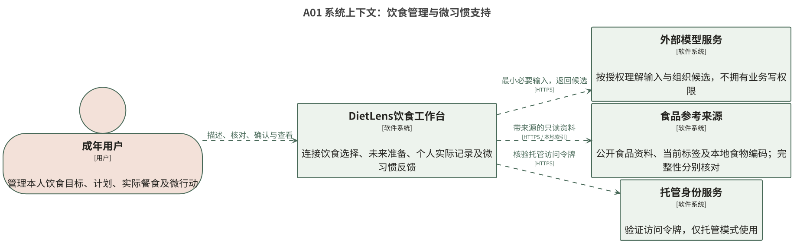
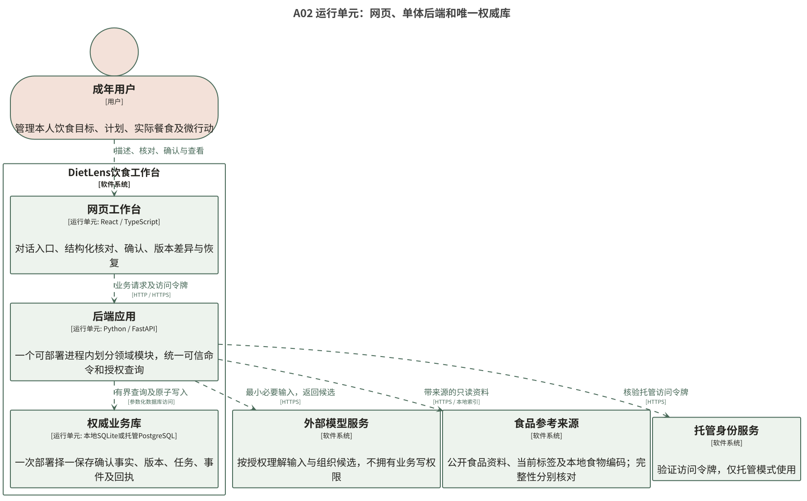
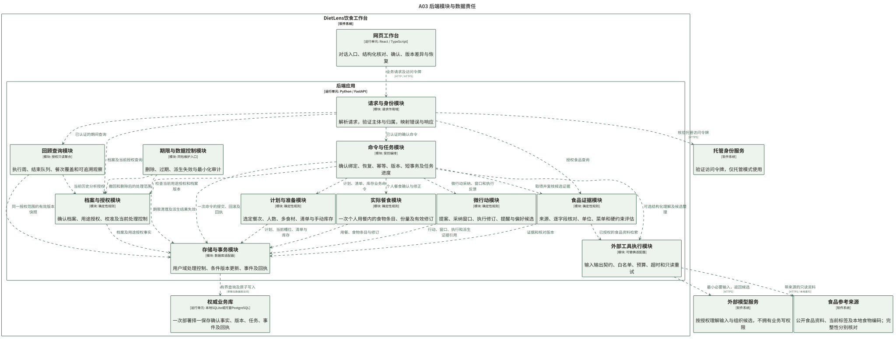
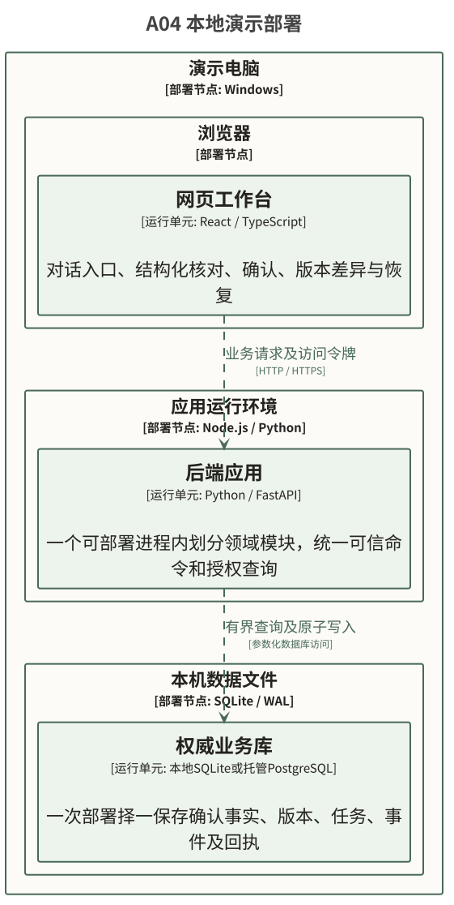
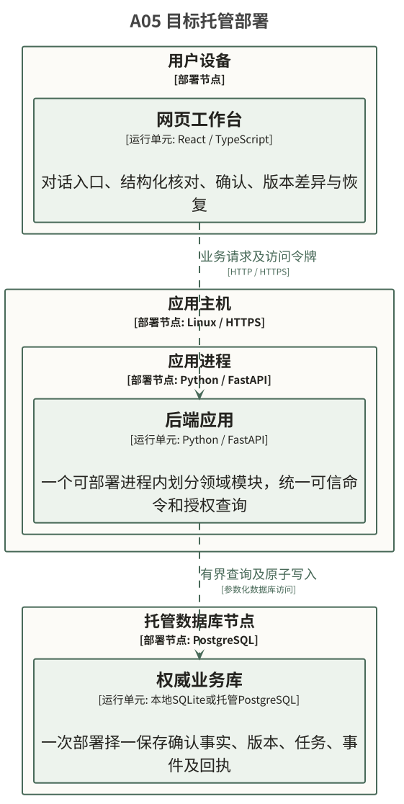
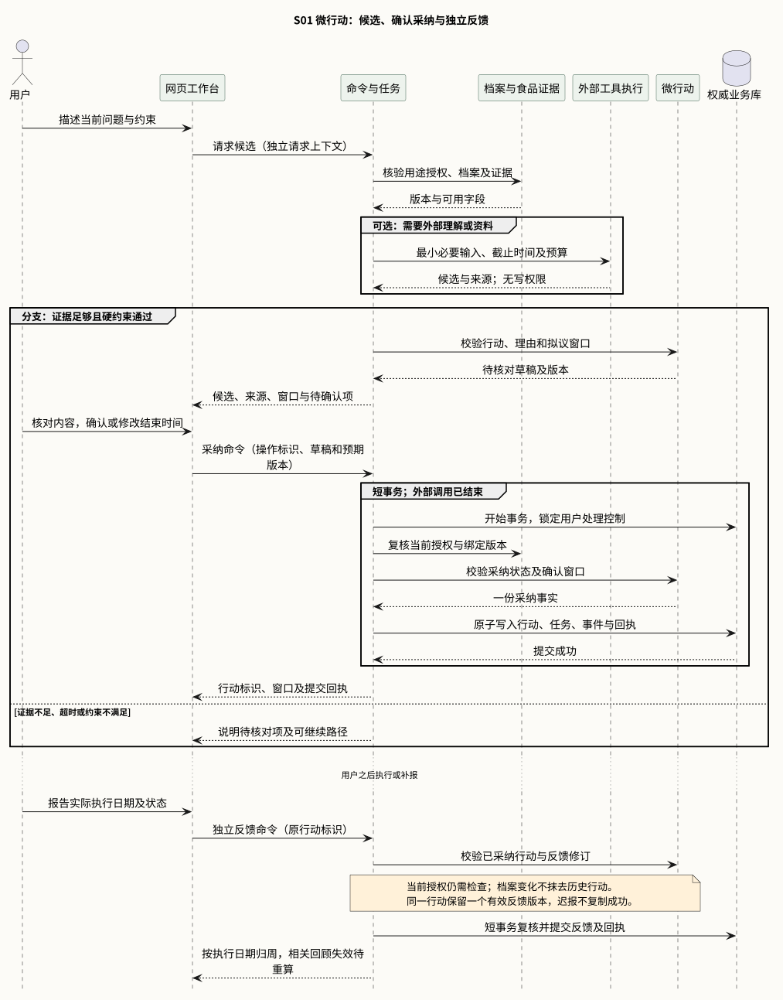
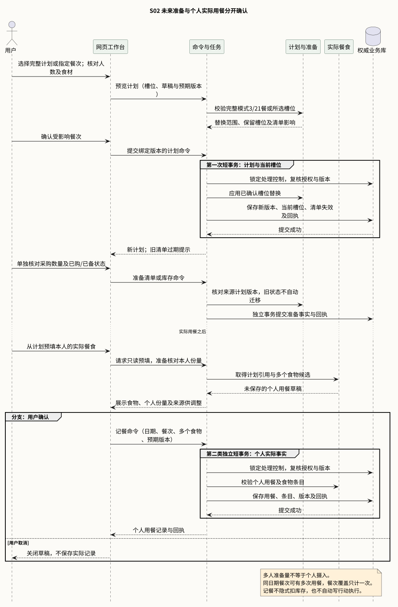
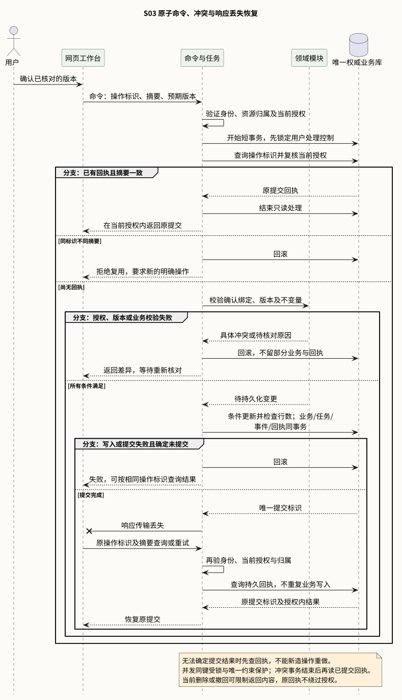

# 系统架构

版本 R2-P3 · 2026-11-17 · 状态：用户在成果展示后要求“继续”，沿用本版进入P4。

用户在领域阶段中文化后要求“继续”，本轮以已确认[需求](../../specs/001-dietlens-design/spec.md)及[领域模型](03-domain-model.md)为基线进入架构设计。本文是目标架构；当前main实现、拟议变更及未执行验证分别说明。

## 1. 业务驱动和方案比较

DietLens的核心是把一次饮食任务自然接到准备、自述与小行动反馈，同时维持各自事实。架构优先保证硬约束与授权、唯一一致提交、事实可追溯和故障可继续，再验证交互负担、延迟与维护成本。

| 方案 | 优点 | 代价与适配判断 | 本轮建议 |
|---|---|---|---|
| 模块化单体、统一命令策略 | 一次跨对象提交可在同库完成；业务规则集中、部署数量少 | 模块共用进程与发布，需要明确接口和容量上限 | 采用，待P3确认 |
| 各业务拆成微服务 | 可独立扩容与发布 | 当前团队和规模下增加跨库一致性、网络故障、恢复及删除对账成本 | 等出现独立扩容/所有权证据再重审 |
| 模型统一决定工具、状态和写入 | 对话流程较自由 | 无法满足确认、安全、预算、可回放及统计的确定性要求 | 不采用 |
| 以完整事件流重建业务事实 | 可重放历史变化 | 删除、修订、授权排除和事件迁移更复杂，当前无全事件溯源需求 | 采用确认事实及版本为主、审计事件为辅 |

## 2. 架构三视图

### 2.1 系统上下文

成年用户只操作本人资料。DietLens提供饮食与微行动能力；外部身份服务验证托管登录，食品来源提供候选资料，模型提供结构化理解和表达。模型、食品来源不拥有业务写权限。外传图片按用途、接收方及期限单独确认。

### 2.2 逻辑运行单元与模块

运行单元为网页工作台、一个后端应用、唯一权威库。后端内部分业务模块；清理维护入口随同一个后端包提供，首轮不增加消息队列、分布式缓存或独立后台集群。

统一命令入口承担跨模块的授权、确认绑定、幂等、版本与提交策略；领域模块拥有对象状态及计算。模型调用和来源查询由外部工具执行模块统一约束。只读回顾从有效版本派生，不经模型计算分母。

### 2.3 部署视图

本地以浏览器、Vite开发资源服务、FastAPI及本机SQLite/WAL演示；演示身份仅用于本地单用户。文件位于本机磁盘。源代码已有的`auto`回退行为不作为托管策略。

目标托管采用HTTPS静态网页与业务入口、一个后端实例和PostgreSQL权威库；沿用Supabase身份接入作为候选。访问令牌由后端核验主体，浏览器不直接写业务表。密钥及数据库凭据只在服务端，原图片不进入普通日志。数据库失败返回不可用，禁止静默切换到本地库继续写。托管方案只设计，本轮不创建云资源。

## 3. 模块接口和数据所有权

表内“接口”包含输入、前置条件、顺序、结果、错误与预算，不只是函数签名。各入口调用少量用例操作，内部隐藏版本、来源和状态细节；不让网页或路由自行串接多次保存。

| 模块 | 对外职责与结果 | 拥有的数据与规则 | 禁止转移给调用方的复杂性 |
|---|---|---|---|
| 请求与身份 | 认证请求主体、资源归属及输入结构；返回统一结果或错误 | 当前请求身份，不拥有餐食事实 | 不能相信浏览器自报user_id作为身份 |
| 命令与任务 | 创建/恢复任务、预览、确认命令、查询提交结果 | 任务进度、草稿确认关联、命令结果 | 路由不逐个保存业务对象、任务和事件 |
| 档案与授权 | 查询允许字段，预览/确认档案与用途变更 | 档案版本、授权、校准回答、用户处理状态 | 不能拿历史授权快照代替当前许可 |
| 食品证据 | 检索/核对/比较/评估，返回来源、未知及受影响操作 | 逐字段证据、规格、单位和硬约束 | 不能把名称匹配或模型置信度视为配料核对 |
| 计划与准备 | 预览/确认计划、清单、库存变化 | 计划版本、槽位归属、多食材需求、采购差额及独立准备状态 | 人数换算、槽位冲突与旧清单失效集中处理 |
| 实际餐食 | 预填草稿、确认一次个人用餐、修正/删除 | 用餐聚合与食物条目、个人份量、有效版本及出处 | 不能用多人准备量代替个人摄入 |
| 微行动 | 提案、采纳/跳过/替代、窗口修正、执行报告 | 行动含义、采纳版本、窗口修订、反馈、提醒和偏好候选 | 决策、执行、提醒和排序贡献分开处理 |
| 回顾查询 | 查询指定期间事实、覆盖、未知、线索和下一步 | 可重算视图；来源仍由各业务模块拥有 | 执行周/结束队列、槽位去重和分母由此统一计算 |
| 外部工具执行 | 在许可及预算内调用模型/食品来源，返回校验后的候选 | 适配配置、调用记录及截止时间 | 调用方不直接处理任意工具名、无限重试或失败伪成功 |
| 存储与事务 | 在同一命令作用域读取/条件更新/提交回执 | 持久化映射及事务，不决定业务状态 | 数据库差异、唯一性和并发更新不能散落路由 |
| 期限与数据控制 | 受控导出、撤回后的派生失效、删除与过期维护 | 处理范围、清理进度、最小化审计 | 删除不得只清主表或前端缓存 |

领域规则在模块内以可替换依赖测试；应用命令接收不可变的请求上下文，包含主体、操作意图、确认版本与调用预算。禁止共用`_active_user/_active_task`等实例可变字段传递并发用户身份。

### 3.1 实际存在差异的替换点

| 替换接口 | 当前可见或确有需要的适配 | 接口统一的含义 |
|---|---|---|
| 业务持久化与事务 | 本地SQLite、托管PostgreSQL | 原子范围、预期版本、唯一回执、读取隔离语义一致 |
| 模型提供者 | 本地桩、远程结构化模型 | 统一候选结构、用量、超时/取消及失败类别 |
| 食品来源 | 公开产品资料、本地编码索引、用户材料 | 字段来源、规格、时效、未知与失败分别返回 |
| 身份核验 | 本地演示主体、托管令牌主体 | 演示显式配置；托管身份核验失败时拒绝请求 |
| 时间提供者 | 当前时间、固定验证时点 | 窗口、跨周和保留期限可重复验证 |

不为每个领域对象制造一个仅转发的抽象层。数据库访问按领域用例暴露必要操作，共享事务范围由命令统一提供；不能每个仓储方法各自提交。

## 4. 技术架构

| 层 | 候选选择与依据 | 主要成本或待验证条件 |
|---|---|---|
| 网页 | 现有React 19、TypeScript 5、Vite；对话加结构化确认卡 | 草稿与服务端版本同步，不能在客户端计算权威差额或完成状态 |
| 后端 | Python 3.11+、FastAPI、Pydantic及JSON Schema | 同步/异步执行必须有明确并发和超时策略，结构校验后仍需领域校验 |
| 本地存储 | SQLite/WAL，本机单实例 | WAL仍只有一个写者；短事务、忙错误处理及检查点需验证 |
| 托管存储 | PostgreSQL，配合明确身份方案 | 版本条件更新和共同锁保护跨对象不变量；普通事务本身不防止业务丢失更新 |
| 外部模型 | 桩提供者默认可运行，真实模型按配置接入 | 无计费配置不付费；以实测结构质量、延迟及账单决定型号 |
| 食品资料 | 保留来源适配；配方、营养、价格分别核对 | 编码索引只证明分类/编码命中，不证明当前商品完整配料 |
| 架构模型 | Structurizr DSL作为C4唯一源，导出Mermaid/PlantUML；交互用PlantUML | 导出视图与正文共同校验；源模型和渲染记录保留 |

上述版本来自现有依赖声明和本机工具检查，不是新安装或上线记录。性能验收沿用需求的单2vCPU/4GB、20并发等条件；达到指标前不宣称扩容能力。

## 5. 统一确认命令协议

命令包含用户主体（来自认证）、任务/业务对象引用、操作键、规范化请求摘要、预期版本、所确认草稿版本和操作内容。确认绑定具体内容及影响，编辑后旧确认失效。

1. 请求入口验证身份与资源归属；查看当前用途许可和处理状态。
2. 非写步骤形成草稿与证据引用，必要外调在写事务外完成。候选具备来源、约束版本和未知，不产生业务确认。
3. 确认时开启短事务，按统一顺序锁定该用户处理控制、相关对象及版本；再次检查用途、删除状态、草稿、证据和约束是否变化。
4. 在用户域内对操作键实施唯一性；同键同摘要返回原提交结果，同键异摘要返回冲突。并发重复不能只依赖一次“先查后写”。
5. 领域模块验证状态并计算变更；以预期版本作条件更新，确认只有匹配的版本成功。业务对象、当前槽位关联、任务进度、审计事件和回执同库提交。
6. 事务任一步失败整体回滚；业务冲突返回核对信息。若提交成功但响应丢失，沿原键查询结果，不创建第二份记录。

本地SQLite采用短写事务及明确忙状态处理；托管PostgreSQL采用一致锁顺序和条件更新。本项目初始选择按用户串行化确认写命令，从而让计划替换、授权撤回、删除和反馈共享一致顺序；不同用户仍可独立处理。后续若同一用户高并发成为瓶颈，再缩小锁粒度并补足跨对象证明。

## 6. 关键交互时序

### 6.1 微行动：情境、候选、采纳和反馈

按当前授权读取档案与必要情境，模型仅输出候选字段；确定性评估检查配料、预算和可获得性。用户确认行动含义及具体窗口后才保存采纳，执行状态仍待反馈。后续完成/部分/未完成报告追加原行动修订，回顾按原领域定义重算。

旧行动的真实执行自述可以修正；当前档案变化只影响新推荐/新采纳及新行为，不因此拒绝历史自述。新增食物或替代候选必须重新检查限制。

### 6.2 计划、采购与个人实际用餐

计划按完整/指定模式检查槽位，替换只变更用户确认的受影响范围，保留其他餐次。旧清单差额失效后展示差异；已购状态不自动迁移。个人记餐只预填名称与版本引用，允许多食物分别核对个人份量，确认保存一次用餐；不自动扣库存或完成行动。

### 6.3 回执不明与恢复

恢复先检查当前主体、授权、删除状态和对象版本。提交后断网返回原回执，未提交则保持原草稿。旧回执不绕过删除和授权；无权或已删除时返回受控状态，不返回历史敏感内容。

## 7. Agent、工具与记忆

Agent职责为意图、澄清、候选整理和说明。命令与任务模块选择许可工具和流程；领域模块决定硬约束、数值、状态和是否可提交。来源内容和模型文本属于不可信数据，不能成为系统指令、授权或用户确认。

记忆分为确认档案、情境/证据版本、临时任务草稿、待确认偏好及原始自述。历史分析关闭后停止读取相应历史与排序贡献；只用当前允许信息继续。上下文不把完整对话作为唯一事实存储，模型无直接数据库连接。

工具契约声明版本、输入输出结构、读写权限、超时和错误类别。每步骤高层工具调用最多3次、模型最多2次，瞬时只读重试最多1次，所有尝试和重试累计入预算；内部规则函数和数据库查询不伪装成独立模型工具调用。周计划最多3步/45秒，每步15秒；中间只保存草案进度，确认生效范围明确。

外调适配器落实连接/读取超时及总截止时间；达到截止后不再发起新调用，晚到结果丢弃，提供手动或已有结果。仅给线程套等待超时不能证明底层请求停止。写命令不进入只读重试循环，回执不明查原键。输入/输出计费量、费率版本、已知费用和未知项分别记录；80%预算提示、100%停止付费调用。

## 8. 授权撤回、删除与并发

确认写入、用途变更、删除共享用户处理控制的并发顺序。事务内检查当前许可和删除状态后再写，避免检查后权限变化仍落入业务事实。用户删除进入待清理后，不再接收需使用被删数据的新命令；清理范围包括档案、计划、库存、记录、行动、回执中的个人内容、派生结果和临时文件。

外传在发送前检查当前逐图/用途许可，最小化发送内容。撤销后尚未开始的外调取消，晚到结果不用于后续生成；已经发送或完成的外部传输须按事前说明处理，数据库回滚不撤销已发送内容。回顾结果发出前检查相关授权修订是否变化，变化则丢弃结果或重新限定范围。

定期维护按明确期限处理图片、临时任务和业务对象。首轮可在单实例内运行维护入口，记录处理进度、可重试范围及备份到期策略；不会把删除成功简化为前端清空。物理表、外键、保留策略及备份例外在P4细化。

## 9. 回顾与派生一致性

回顾基于同一授权范围、统计时点和有效版本集合读取，返回输入数据修订标记；跨查询版本变动时重新读取或提示刷新，不能拼接不同时点的分子分母。首轮直接确定性聚合，不建设独立投影数据库或长期个人缓存。

修正执行日期、反馈或窗口时，能够定位原/新执行周和结束队列；删除同样撤回相应贡献。餐食覆盖按确认预期槽位去重，营养按可计算食物条目覆盖。模型解释只能使用已产生的聚合值，不能填补未知数字。冻结周、情境线索和恢复周期保持派生/确认观察身份，不反写原自述。

## 10. 故障、容量与可观测性

| 关注点 | 架构响应 | 计划验证 |
|---|---|---|
| 无可靠食品证据 | 对受影响操作待核对/阻止，其他查询可继续 | 60限制案例及来源覆盖 |
| 模型/来源超时 | 执行器总截止、部分结果、手输/规则路径 | 1/10/15/30秒延迟及10分钟故障 |
| 数据库繁忙/不可用 | 有界等待、明确忙/失败；不跨库降级写入 | 20/100并发、恢复与无重复扫描 |
| 同用户并发/删除竞争 | 共同处理控制、一致锁序、版本条件更新 | 10同版本并发、撤回/删除交错 |
| 回执丢失 | 原操作键与请求摘要、同事务回执 | 提交前后断连及100次重提 |
| 隐私与追溯 | 业务事件含主体、对象版本和时间；普通日志仅必要元数据 | 删除链、日志和用途负例 |
| 运维度量 | 步骤延迟、队列/连接占用、锁争用、错误类别、计费用量 | 分开内部错误/策略拒绝/外部失败 |

主线程并发、连接池、数据库忙等待和每用户命令等待都有上限；具体数值根据P7性能方案实测配置，不用无限排队达成“最终成功”。外部请求等待不占数据库写事务。初始单实例存在共同进程故障域，明确接受其简化成本并通过恢复验证降低影响。

## 11. 需求到架构责任

| 需求范围 | 主要模块及验证位置 |
|---|---|
| FR-001/011 | 档案与授权、期限与数据控制；授权/删除交错验证 |
| FR-002/003/012/015/016 | 食品证据、外部工具执行、请求模块；单位/未知/替代安全 |
| FR-004/005/006/007/008 | 微行动、任务编排、回顾；决策与执行、窗口和偏好不变量 |
| FR-009 | 回顾、档案授权；两个周口径、槽位和有效版本 |
| FR-010/013 | 命令与任务、工具执行、存储；断连、预算、恢复 |
| FR-014 | 实际餐食、命令与存储；多条食物一次确认及修正 |
| FR-017/018/019/020 | 计划与准备、实际、微行动和统一事务；版本、数量及跨对象边界 |

## 12. 关键决策与现有代码改造位置

决策详见[ADR-001](adr/001-modular-monolith.md)、[ADR-002](adr/002-atomic-commands.md)、[ADR-003](adr/003-authoritative-store.md)、[ADR-004](adr/004-facts-and-review.md)，已随用户“继续”沿用进入P4。

主要改造位置为`api_server.py`的顺序写入、`Harness`的共享调用上下文、`Repository`的事务/版本语义、`PlanItem`及`MealRecord`的领域粒度、提醒与回顾口径。已有目录和适配器可复用，新增职责不要求立即搬迁所有文件。

P4再确定字段、主外键、索引及删除策略，P5再定HTTP路径与错误载荷。本阶段[模块交互契约](../../specs/001-dietlens-design/contracts/module-contracts.md)仅定义用例级输入、结果与失败语义，不替代后续OpenAPI。

## 13. 证据与下一阶段门槛

官方资料与选型研究见[研究记录](../../specs/001-dietlens-design/research.md)。C4由本地已安装Structurizr命令解析、校验与导出，渲染用本地PlantUML；工具版本、退出码、源摘要、共享工作区保护记录随图保存。工具验证只覆盖模型和文件；性能、安全及业务PoC按计划另行执行。

本阶段架构取舍随用户“继续”沿用进入P4；数据库映射见05-database-design.md，保留原需求及领域规则。
