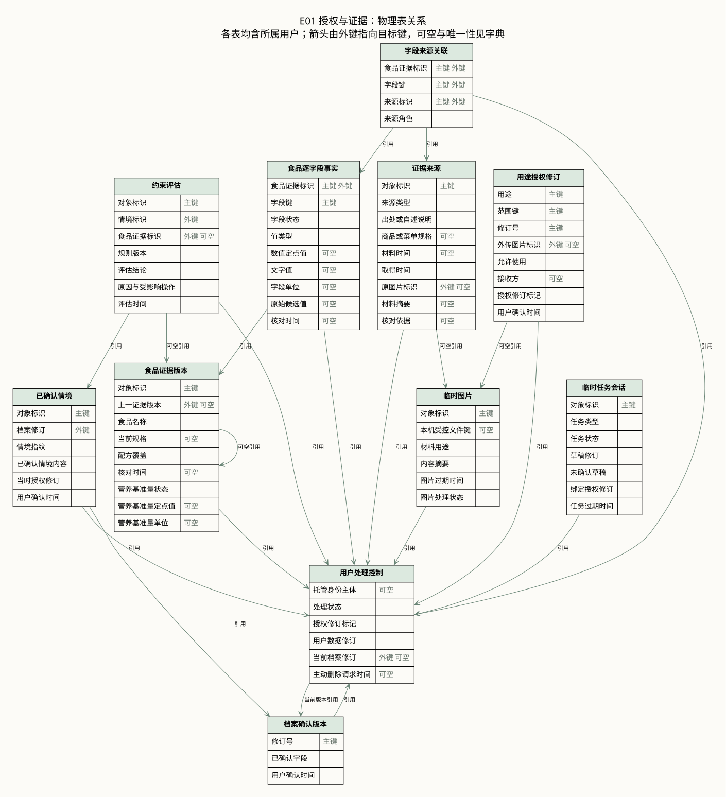
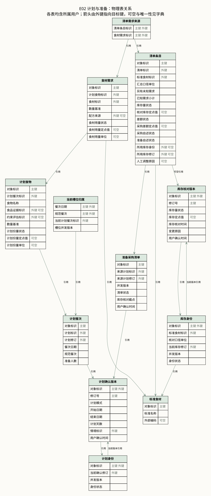
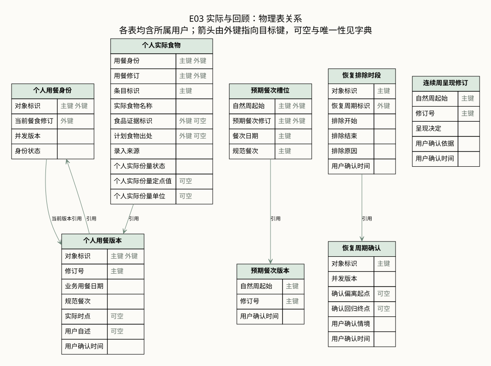
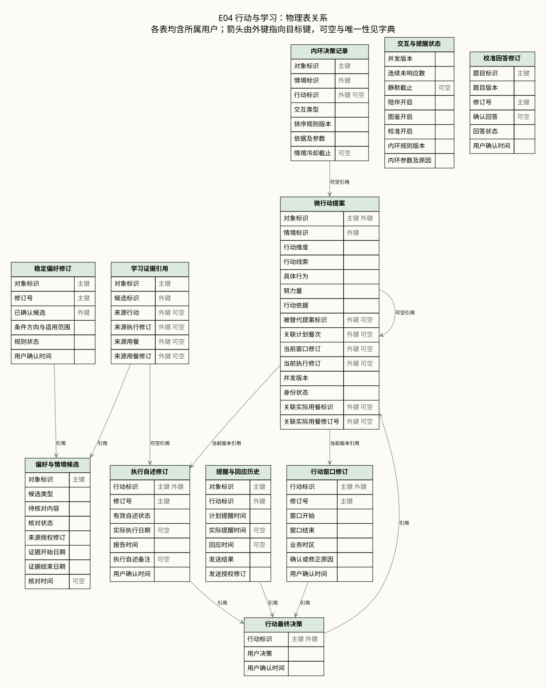
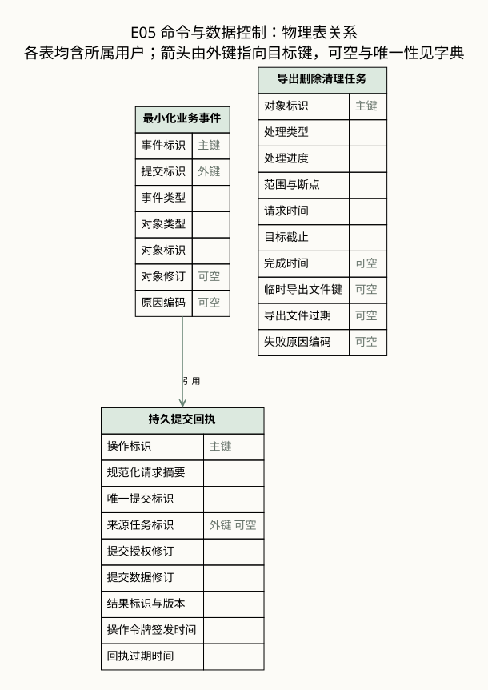

# 数据库设计

版本：R2-P4 · 日期：2026-11-17 · 用户在成果展示后要求“继续”，沿用为P5基线。

用户在P3架构展示后要求“继续”，本阶段沿用[架构基线](04-system-architecture.md)、[领域模型](03-domain-model.md)与[正式需求](../../specs/001-dietlens-design/spec.md)，仅完成设计产物。数据库的表数来自业务事实、版本和关系的拆分；不表示增加用户功能或拆分服务。

## 1. 设计入口与权威关系

| 文件 | 作用 |
|---|---|
| [PostgreSQL设计SQL](../../database/schema.sql) | 托管模式的完整字段、主外键、检查、索引与延迟版本引用 |
| [SQLite设计SQL](../../database/schema.sqlite.sql) | 单机演示等价设计；时间与JSON为受校验文本，数量为定点整数 |
| [数据字典](../../database/data-dictionary.md) | 逐字段类型、可空、默认值、约束及业务含义 |
| [结构元数据](../../database/model.json) | 两份SQL、字典及分区ER的共同结构来源，由生成脚本维护 |
| [中文ER展示投影](../../database/schema.diagram.sql) | drawDB导入用的中文表/字段投影，不含完整检查和延迟语义 |
| [drawDB可编辑备份](../../database/drawdb-model.json) | 实际工具导出，包含全部设计表、字段和复合关系 |
| [drawDB导出SQL参考](../../database/drawdb-export-reference.sql) | 工具导出留证，不替代完整设计SQL，不作为迁移脚本 |
| [静态检查记录](../../database/validation.json) | 解析器、结构核对、工具往返比对、文件摘要与图稿记录 |

每种部署只选一个业务权威库。数量、分母、状态不会根据数据库模式采用不同业务定义。现有仓库迁移文件作为当前实现证据保留；本设计不覆盖或执行这些迁移。

## 2. 领域到表的映射

| 领域责任与需求 | 主要表 | 拆分理由 |
|---|---|---|
| 档案、用途、校准；FR-001/011 | user_control、profile_revisions、consent_revisions、calibration_revisions | 当前处理控制与历史确认内容分开；三个校准题是可配置题库，回答不作心理分数 |
| 情境、食品、菜单及限制；FR-002/003/012/015/016 | context_snapshots、food_observations、food_fields、field_sources、source_references、constraint_assessments、media_assets | 食品证据按版本和字段核对；配料、营养、价格和可获得性分别有依据；情境与食品通过评估关联 |
| 日周计划；FR-017/020 | plan_heads、plan_revisions、planned_meals、planned_foods、slot_assignments | 计划确认内容固定，当前日期餐次归属单独维护；部分替换不重写旧内容 |
| 多食材准备与库存；FR-018/019 | ingredients、ingredient_requirements、preparation_lists、preparation_lines、preparation_sources、inventory_heads、inventory_revisions | 多食材需求按口径汇总，采购/准备自述与库存核对互不代写 |
| 个人实际；FR-014/020 | meal_heads、meal_revisions、reported_foods | 一次用餐含多种食物，修订整份餐食；同一槽位允许多次用餐 |
| 提案、决策及执行；FR-004/005/006/007 | micro_actions、action_decisions、action_windows、execution_revisions | 行动含义固定；窗口、决策和实际执行分别保存；未知由时点和有效修订派生 |
| 障碍、排序与稳定偏好；FR-008 | interaction_settings、interaction_events、reminder_events、learning_candidates、learning_evidence、preference_rule_revisions | 提醒无回应不算执行失败；候选核对后才成为稳定规则；证据关联到明确版本 |
| 期间回顾；FR-009 | expected_schedules、expected_slots、recovery_episodes、recovery_exclusions、week_presentations | 保存用户确认的分母、恢复起止和冻结决定；完成数、反馈率等直接从有效事实计算 |
| 恢复、失败与数据控制；FR-010/011/013 | task_sessions、command_receipts、audit_events、data_control_jobs | 临时进度、提交结果和数据清理分开；回执与业务同事务 |

45张表中包含关联表和历史版本表；并非45个独立聚合。一个领域聚合可以覆盖身份、版本和内容子表，一个事务也可协调多个聚合。

## 3. 标识、版本与归属

所有个人表带user_id，所有私有外键也包含user_id。对象标识由服务端生成；托管认证主体只在user_control映射，不存访问令牌或口令。复合外键能拒绝把甲用户的记录指向乙用户的计划；查询和写入仍必须在后端验证主体、用途与资源归属。数据库只对后端开放，浏览器不直接获得表读写权限。

计划、库存、餐食以身份表的current_revision指向历史版本表；行动分别指向当前窗口和执行修订；档案由处理控制指向当前确认版本。它们的复合外键确保指针指向同一身份的真实版本。身份与版本相互引用，完整设计使用DEFERRABLE INITIALLY DEFERRED：创建身份和首个版本、更新指针均在同一短事务内完成，提交时必须完整。PostgreSQL先建表再补循环引用；SQLite在建表时声明对应外键。普通主键和唯一约束仍即时生效。SQLite的每个连接必须显式启用PRAGMA foreign_keys=ON并核验开启；事务模式和WAL由未来的连接初始化配置，保存本设计SQL不会自动启用它们。

用途授权按用户、用途和范围键逐次追加；稳定偏好、校准回答、预期餐次及周呈现也取同身份最大修订号为有效版本。不能按“最新有效状态”过滤后再取最大号，否则会复活已撤销或已删除状态。读旧版本仅用于当前允许的溯源。

内容确认后不原地覆盖；允许改变当前指针、生命周期元数据及为删除/期限处理进行的脱敏。删除源事实时必须同时解除其派生贡献，旧版本不享有无限保留。

## 4. 数量、未知和时间

数量采用BIGINT定点值，实际值乘1000000保存；数据库分别校验非负、范围和SQLite整数存储类型，避免两种库在小数比较上产生不同结果。计算用受控整数或十进制，汇总先检查溢出；换算结果不在中途按定点精度回写舍入，仅最终展示按需求保留一位小数。单位不互换，份/包/个换重量需要当前规格；克与毫升无密度依据不互换。超过六位小数的输入先展示规范化值请用户核对，不静默截断。

已知数量必须有值和单位；未知数量的值必须为空，可保留已知单位。库存为零是明确已知零。清单保存已知需求小计及“另有未知需求”标记：只要有未知需求或库存未知，完整差额就不能标已知。人工改量必须保留原因和来源，计算值由模块重算，不接受客户端任意填入差额。

食品逐字段表区分已核对、待核对、未知和冲突；数值与文字值互斥。营养基准量已知时必须大于零，具体营养字段是否可用还需核对状态、来源及单位兼容。配方覆盖不是营养覆盖，编码命中也不补齐配料。

时点统一UTC；SQLite采用固定24字符格式，例如2026-11-17T08:00:00.000Z，PostgreSQL采用TIMESTAMPTZ。SQLite另有格式检查，模块仍须验证真实日期、输入时区及业务合理性。用餐和执行另存经用户核对的Asia/Shanghai业务日期；周一为自然周起点。统计周按业务日期或窗口时点换算，不能按报告时间归周。

## 5. 关系与基数

| 关系 | 基数与约束 |
|---|---|
| 用户→档案版本/任务/各业务身份 | 一对多；每行恰属一个用户 |
| 身份→内容版本 | 一对多；有效身份当前指针恰指一个真实版本，首个版本同事务创建 |
| 计划版本→计划餐次→计划食物 | 一对多、一对多；提交时每层至少一项，版本内日期餐次唯一 |
| 日期餐次槽位→当前计划餐次 | 每用户槽位零或一项归属；外键同时匹配餐次日期与类型 |
| 计划食物→已知或未知食材需求 | 零对多；无配方不能伪造食材 |
| 清单→条目→需求来源 | 一对多、多对多；同食材兼容单位汇总，来源保留到具体需求 |
| 食材和口径→库存身份→版本 | 每用户食材口径至多一个身份，身份有多次人工核对 |
| 用餐身份→版本→实际食物 | 一对多、一对多；不对用餐日期餐次设唯一键 |
| 行动→最终决策 | 零或一；采纳/跳过/替代后不得再把含义改写 |
| 采纳行动→窗口/执行修订 | 各自零对多；采纳必须有当前窗口，执行只有一个当前有效修订 |
| 学习候选→证据 | 一对多；每条只指向餐食或行动执行中的一种明确版本 |
| 用户自然周→预期餐次版本→槽位 | 一对多、一对多；以最大版本的槽位作为已确认分母 |

至少一项、完整计划3/21餐、指定集合相等、仅采纳后可写执行、跨行数量一致等规则需要在统一命令事务内校验。普通CHECK不能表达跨表计数，本设计不把它们冒充为已由DDL保证。

### 中文ER分区图

图中省略重复的所属用户及通用时间字段；跨分区关联以数据字典和完整SQL为准。箭头从引用方指向目标键，可空与唯一性决定具体基数。

## 6. 不变量的实际保障位置

| 领域规则 | 数据库保障 | 命令/查询仍需保障 |
|---|---|---|
| INV-01 本人归属 | 所有私有外键带user_id | 认证主体、当前用途授权、禁止越权响应 |
| INV-02 确认事实 | 确认时间、版本身份 | 草稿绑定、内容变更使旧确认失效；取消不写事实 |
| INV-03 字段证据 | 字段状态、逐字段来源关联 | 关键配料缺失时阻断相关推荐 |
| INV-04 变化重查 | 档案/情境/评估版本引用 | 提交前复核当前版本和来源适用性 |
| INV-05 准备不等摄入 | 准备与个人餐食分表、数量基准 | 按人数只乘一次；个人份量重新核对 |
| INV-06 未知不等零 | 状态和值联合检查、非负定点值 | 完整覆盖判定、兼容单位换算 |
| INV-07 清单库存独立 | 采购、准备各自字段及库存版本 | 勾选不触发库存/记餐/执行写入 |
| INV-08 历史不改 | 版本键和显式来源 | 历史内容不可被新计划覆盖；旧清单标失效 |
| INV-09 决策不等执行 | 决策表与执行修订表分开 | 执行写入须采纳；提醒未响应不填失败 |
| INV-10 同行动修正 | 同一行动修订键、当前执行外键 | 乐观版本检查；同一行动只贡献一次 |
| INV-11 窗口独立 | 窗口修订表和起止检查 | 到期未知派生；提醒不改窗口 |
| INV-12 两种周 | 执行日期、窗口结束、报告时间分别保存 | 依有效版本分别计算执行周和结束队列 |
| INV-13 槽位覆盖 | 预期槽位主键去重；实际允许同槽多次 | 对实际有效槽位做集合交集，分母不取计划数 |
| INV-14 派生不改原述 | 学习证据指向版本；冻结单独存 | 线索待核对、冻结不补完成、低覆盖不推趋势 |
| INV-15 当前授权 | 用途修订与处理控制标记 | 发送、提交、恢复、响应前重新核对 |
| INV-16 唯一结果 | 操作键/提交标识唯一、当前指针、槽位唯一 | 请求摘要一致、预期版本条件更新和完整回滚 |

## 7. 索引、规范化和容量

主键按用户和身份/版本组织，外键逐项具备可用的主键、唯一键或辅助索引前缀。另按实际查询增加用餐日期餐次、执行日期状态、窗口结束、食品名称、情境指纹、提醒调度、清理期限等索引。同来源计划版本只有一份有效清单，使用带状态条件的唯一索引；失效旧清单可保留。

核心对象、子项和多对多来源按第三范式拆分。JSON用于确认档案的可扩展字段、情境属性、临时草稿、规则参数及清理断点，不把可查询的餐次、食物、数量、行动状态或跨对象事实埋进大payload。JSON引用由模块校验；核心版本关系和学习证据使用显式外键。派生清单保存核对截点以解释当时差额，当前差额须核对库存版本；回顾指标不另存一套权威事实。

全部索引是设计候选；后续PoC用真实查询计划检查选择率、写放大和180天范围内的扫描量。语法检查不证明达到20并发等性能目标。数据库账号按迁移、服务端和维护职责配置最小权限；数据库所有者或维护账号不交给网页，日志不含完整档案、图像或令牌。

## 8. 原子命令与一致读取

PostgreSQL先锁定user_control当前行，再按固定顺序核对相关身份/槽位和预期版本；SQLite使用有界等待的短写事务，先取得写权限，再读当前处理控制。两种模式都在提交前复核当前用途、删除状态和草稿/证据版本。外部模型及来源请求在事务外完成。

| 命令 | 同事务范围 | 明确失败结果 |
|---|---|---|
| 确认/替换计划 | 新版本、餐次食物需求、仅受影响槽位、旧清单失效、任务、事件、回执及用户数据修订 | 缺餐、越权、限制/版本变化时整体不提交 |
| 记录/更正个人用餐 | 同记录新版本、全部食物子项、当前指针、回顾修订标记及回执 | 至少一项；冲突重载，取消不建记录 |
| 确认库存 | 库存新版本和指针、相关清单标失效或待重算、任务/事件/回执 | 不直接改变旧清单已购自述，不静默覆盖竞争修订 |
| 采纳行动 | 最终决策、确认窗口及当前指针、内环事件、回执 | 结束时间尚可尝试、硬约束与绑定版本通过 |
| 更正执行/窗口 | 新修订、对应当前指针、受影响原/新周失效、回执 | 不新建行动；执行日期与窗口分别处理 |
| 撤回/删除 | 当前授权或处理状态、禁止新处理标记、清理任务及最小化回执 | 清理未完成返回处理中/失败，不能显示已完成 |

同一用户和操作键唯一；同键比较规范化请求摘要，异内容拒绝复用。提交成功却响应丢失时先重新授权读原回执，不能重复执行。回执只存必要结果标识和版本，不存完整敏感响应，旧回执不能恢复已删除内容。

**回执期限与旧请求重放**：首次写入必须对应未过期的服务端任务、草稿版本及该草稿签发的操作标识；用户不能把旧键绑定到新草稿。任务最长7天，回执最长180天，并受主动删除约束。任务清理时置空回执task_id，回执仍可在授权内查询；回执到期后原任务也已失效，旧请求只能返回过期状态。P5细化确认令牌/参数契约，不提供“查不到回执就当新请求”的路径。

回顾在同一数据库读快照内取得当前授权、数据修订及各对象有效版本；若依靠多次查询，PostgreSQL使用明确的可重复读只读事务，SQLite使用单次读事务。读取结束和结果发送前再核对当前授权及处理状态，变化则丢弃或缩减结果。数据修订随事实更正、窗口变更、预期槽位变化和删除共同更新，避免混合不同截点的分子分母。

## 9. 统计查询口径

- 北极星：按micro_actions身份去重，只取当前有效执行修订为完成且执行业务日期在所选周的行动；不按修订数、创建日或报告日计数。
- 结束队列：只取采纳且当前窗口结束落在所选周、截至统计时已经结束的行动E；有完成/部分/未完成有效自述者为R，完成者为D。反馈率为R/E，已反馈者完成比例为D/R；分母为零返回未知。
- 无当前执行，或当前修订为撤回不确定时，根据窗口和统计时点派生待反馈/未知，不写“未知→完成”的后台补值。
- 餐次覆盖：取当前有效个人餐食的日期餐次去重集合，与该周最大已确认预期槽位集合求交；未预期餐次另列。预期版本可为空集合，此时覆盖未知。多食物或同槽多次记录不放大分子。
- 营养按实际条目、已核对食品字段、份量和基准口径计算可计算部分，逐项报告缺口；不以准备量或计划完成率代替摄入。
- 学习候选使用明确来源版本并检查其仍有效、未到期及当前授权；撤回历史分析后不继续使用旧快照排序。恢复排除时段先求区间并集再扣除，不重复扣时；缺起止不估算。

## 10. 保留、撤回、删除与备份

| 数据类 | 期限依据与动作 |
|---|---|
| 临时图片文件 | 取得后最长24小时；先停用外传和处理，清除文件及缓存，再置空storage_key。已核对字段可按自身授权/期限保留；原始图片内容不复制进来源说明 |
| 图片最小元数据 | 记录材料已清理状态及受控摘要供来源解释，按业务期限清理；不保留可恢复图片的文件键 |
| 临时任务与草稿 | 建立后最长7天；恢复先查期限，过期不提交。回执中的可选任务引用先解除，再清理任务 |
| 确认业务及学习数据 | 初次保留不超过180天；续期由用户明确确认范围、影响及新截止，记录renewed_at和最小化审计；每次延长期同样受180天上限约束 |
| 主动删除 | 立即标记不再参与新处理，最迟24小时完成请求范围的在线事实、派生、文件和缓存清理；失败持续展示，不用软删除代替清理完成 |
| 回执与事件 | 最长180天，随业务删除清除敏感内容；事件先于被引用回执清理。不能以审计为由无限保留 |
| 导出文件 | 本阶段提出24小时临时下载有效期，作为技术候选；下载每次核验身份，过期或主动删除立即清理文件键 |
| 备份 | 最长30天到期，禁止向在线业务提供已删除历史；恢复前先重放最小化删除/到期清单，再开放访问 |

DDL将图片、任务、回执和业务保留的上限写入相应时间检查；运行时还必须按当前时钟排除过期对象并执行文件/数据库清理。查询排除即刻生效，物理清理可通过有断点的data_control_jobs继续；只过滤state不算完成物理清理。

**删除依赖顺序**：采用NO ACTION并延迟检查，防止误删某行时悄悄级联抹掉用户实际历史。清理任务先计算授权范围内的依赖闭包与派生影响，再按以下规则执行：

1. 先禁止相应处理、取消未发送外调与提醒、使草稿/候选和回顾失效；移除学习证据贡献。
2. 只删除计划或证据时，可选历史出处解除并标注到期/已删，保留用户独立确认的实际名称、份量与执行自述；不能重新引用已清理内容。必需引用的从属内容按聚合范围清理。复制过的敏感内容也纳入源到期范围，不靠复制重置期限。
3. 餐食、行动或计划聚合整体清理时，同时删子项和版本；删除行动先处理学习引用、提醒、当前执行/窗口指针，再删决策与行动。删除当前槽位、清单来源、条目后再删计划子项和版本。延迟外键使同事务解除循环引用成为可能。
4. 档案或情境到期时，清理依赖它的未确认结果；必需历史依赖若无法解除，展示影响并一并退出处理，或由用户明确续期依赖范围。独立实际事实只解除可选出处；不因早期准备计划到期而删除本人用餐自述。
5. 用户全量删除将档案当前指针置空、清理个人表和文件、清除external_subject，最终仅保留受控随机用户标识与删除时点等最小清理标记，最长到相关备份30天到期；此时状态为已清理待备份到期，不参与业务。备份清除后再清除该标记。

删除/到期清单在备份控制文件中加密保存到相应备份到期，不含餐食、档案或对话内容；它仅阻止旧备份复活数据，不作为第二业务权威库。恢复先重放清单并核对期限、文件、指针及派生来源，核对通过才开放服务。未完成清单留存/恢复验证时不宣称备份删除流程通过。

## 11. 工具使用与验证边界

在本地drawDB的独立画布导入中文展示投影，保存中文模型名，实际导出JSON和SQL副本。表、字段、主键及99条复合关系已与共同结构源逐列核对。工具提示身份/当前版本引用造成循环依赖，本设计以延迟外键和事务顺序显式处理；工具导出副本未保留完整检查与延迟语义，因此不能直接执行为正式迁移。

完整PostgreSQL SQL由pglast解析；SQLite SQL由SQLGlot按SQLite方言静态解析，检查无未解析的通用命令。另核对所有外键的目标唯一键、字段类型、用户归属、支持索引及图稿摘要。没有连接数据库、执行DDL、迁移、插入测试数据或运行引擎级约束/并发验收。

下一轮实施验证必须覆盖：跨用户引用拒绝；当前指针不存在回滚；同键双提/同键异内容；同版本竞争；提交丢响应；完整/指定计划缺项；人数与未知差额；多食物整份修订；跨周迟报及窗口修正；同槽多记录覆盖；删除/到期清理、文件失效与备份恢复。这些在P7转为可执行验收任务。

## 12. 阶段衔接与后续细化

本阶段新增技术取舍为：复合归属外键、身份与版本表、延迟当前版本引用、六位定点数量、回执和草稿的有效期衔接、明确期限与可恢复清理；导出文件24小时有效期是候选方案。沿用既有业务事实和授权要求。

TBD：校准三题的具体题目/稳定题目标识、排序权重与外环汇总周期仍待后续交互/验证阶段确定；此处不硬编码题目或算法常数。实际部署的数据库版本、加密密钥及备份介质在实施计划明确，不以示例配置代替已部署事实。

用户已要求继续进入P5。接口候选见[接口设计](06-api-design.md)，其中补充了删除后只查询本次进度的短期凭证及最长7天的最小任务状态；它属于清理控制元数据，不保留原餐食、档案或对话内容。该细化待P5确认，不改变业务数据24小时退出处理和备份30天到期要求。仍不进入业务实施。

数据库语义依据：[PostgreSQL约束说明](https://www.postgresql.org/docs/current/ddl-constraints.html)、[SQLite外键说明](https://www.sqlite.org/foreignkeys.html)、[SQLite类型说明](https://www.sqlite.org/datatype3.html)。项目如何组合约束、事务与模块校验，是基于已确认需求作出的设计选择。
