## 1 设计摘要

DietLens面向希望在日常饮食选择中逐步改善习惯的成年用户，将食品核对、日周计划、准备采购、个人实际记餐和微行动反馈连接起来。作业一已形成14个用例、20项功能需求和26项非功能需求。本次从这些需求出发，重点解决三类设计问题：不完整食品资料如何支持可靠选择，多人准备如何与个人实际摄入分开，以及采纳、执行、未知和修订怎样保持可解释的一致结果。

系统以“处理眼前这一餐”为主要场景：复用已确认档案，从用户的一句话中整理食物、时间和数量，只追问会改变判断的缺口；在预算、可获得性与食品证据允许的范围内，提出一个可尝试的微行动。用户可修改或跳过，随后用简短反馈说明结果或障碍。近期反馈调整同类情境的候选，稳定偏好经确认后保存。核心验证依次关注食品约束、录入负担、行动可行性和反馈后的调整价值。

设计采用受控编排的模块化单体。网页提供对话入口与结构化核对，后端按档案授权、食品证据、计划准备、实际餐食、微行动和回顾划分职责。外部模型负责理解、候选整理和表达，确定性模块决定硬约束、数量、状态和是否允许提交。写入必须绑定用户核对的具体内容、影响和版本；业务事实、任务进度、事件与回执在同一权威库提交。外部调用在写事务之外，故障后可手动继续，响应丢失则查原回执。

相对作业一，本次明确了完整日周计划和指定餐次两种模式；将一次个人用餐细化为多条食物，允许同一餐次多次真实用餐；行动结束时间按具体行动提出，由用户采纳时确认并可修订。这些细化回应了原验收口径与现实行为之间的空隙。计划按日期餐次替换，未受影响范围保留；库存未知不填零，准备清单的已购状态不代写库存或摄入。执行完成按实际日期归周，反馈覆盖按已结束窗口队列计算，迟报更新原行动，避免重复计数。

本版重新设计了网页端界面：以“晨光餐盘”视觉语言、左侧常驻工作台导航、一句话复合入口和每页一个主动作的层级，替换上一版以表格为主的界面，业务规则保持不变。本报告包括架构三视图及备选方案、核心领域与交互模型、需求变更和追踪、新版网页端界面（设计系统与10个核心工作台界面）及用户流程、风险和第三部分PoC方案、AI反思、注释参考文献与团队分工。数据库和接口的完整设计作为可编辑附件，正文只保留影响关键决策的内容。已执行模型渲染、接口规范和静态契约检查；并发容量、真实外部资料覆盖、用户理解与删除恢复留待第三部分验证。

## 2 架构与关键决策：系统边界

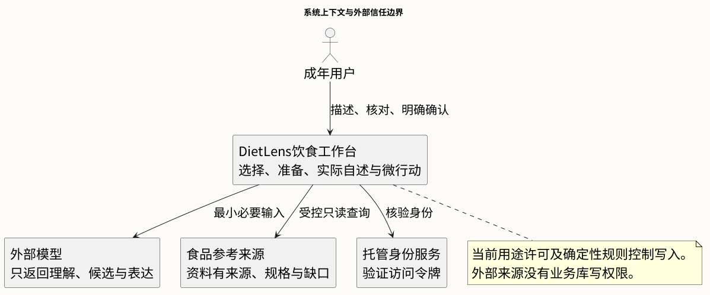

系统处理本人确认的目标、约束、记录和反馈，不替其他用餐者登记摄入。典型场景是为两人准备午餐，再由本人记录实际食物并尝试一个低负担行动。食品名称、配料、价格和营养值分别核对；关键配料未知时停止受影响推荐。

## 2.1 逻辑职责与可信边界

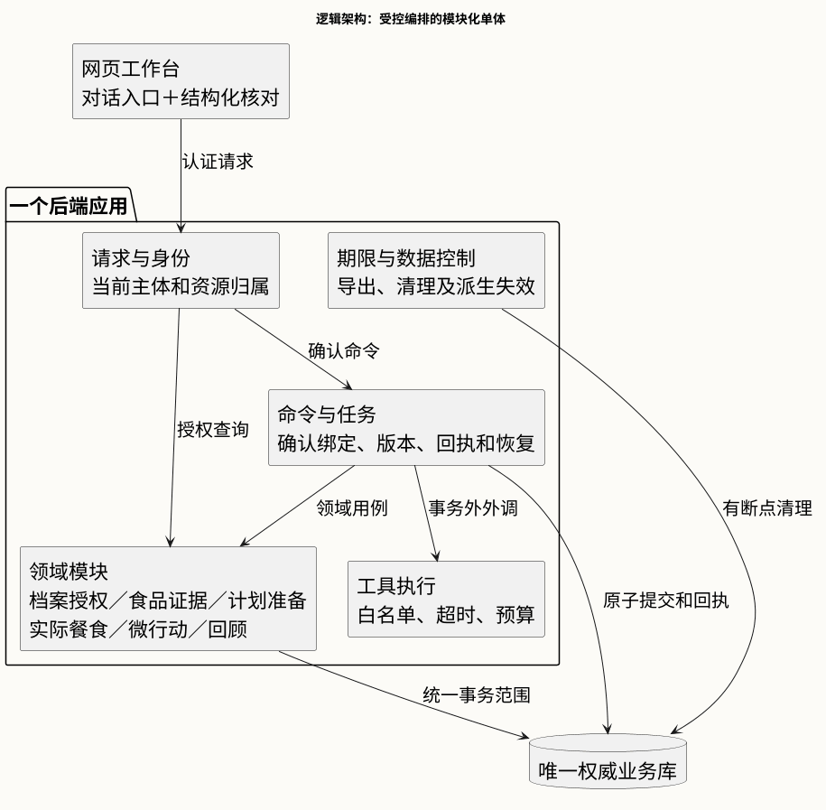

后端包含请求与身份、命令与任务、档案与授权、食品证据、计划与准备、实际餐食、微行动、回顾查询、外部工具执行、存储与事务、期限与数据控制11项职责。领域模块拥有业务规则，命令入口负责跨模块确认、授权、版本与原子提交；查询读取当前允许的有效事实。

外部适配器只取得必要输入，不占用数据库写事务。数据控制维护入口与后端同包，首轮不增独立消息队列或统计数据库。不同用户可独立处理，同一用户的写入先按统一控制顺序协调。

## 2.2 关键选择、备选与代价

| 决策 | 比较及理由 | 代价与重审条件 |
|---|---|---|
| 模块化单体 | 比较微服务与单体。当前跨对象确认多、团队规模小，优先同库一致提交和清晰领域接口。[1] | 模块共用进程及发布；有独立扩容或团队所有权证据时再拆。 |
| 受控编排 | 比较开放式模型循环与受控流程。模型只做理解和表达，规则决定安全、数值和状态。[6] | 自然语言自由度受到约束；用手动路径和局部候选保留灵活性。 |
| 唯一权威库 | 本地演示SQLite/WAL，托管PostgreSQL。每次部署只选一个，禁止云库失败后写另一库。[2][3] | 需核对两种适配器的事务语义；WAL仍只一个写者。 |
| 事实与回顾分开 | 比较聊天摘要直接统计与版本化事实派生。采纳、执行、准备、个人实际分别拥有事实。 | 增加版本与来源管理；收益是迟报、修正和删除可追溯。 |
| 预览及原子回执 | 比较分散确认接口与统一命令策略。确认绑定内容和影响，提交后响应丢失查原回执。[3][4] | 多一步明确核对；把草案和确认合并展示以控制负担。 |
| 对话＋结构化卡片 | 比较纯聊天与纯表单。聊天发起意图，卡片核对数量、来源和差异。 | 需同步草稿版本；版本变化展示差异并重新核对。 |

### 技术架构

| 层次 | 选择与职责 |
|---|---|
| 网页 | 沿用React、TypeScript、Vite，显示候选、核对、回执与恢复。 |
| 后端 | Python、FastAPI、Pydantic；先结构校验，再领域校验。 |
| 模型与食品服务 | 适配器可替换；模型型号、真实价格和食品覆盖按PoC选择，不以工具可用性直接决定。 |
| 接口与建模 | OpenAPI描述公共边界；C4表达架构，UML表达核心结构、时序与生命周期。 |

## 2.3 部署与质量属性

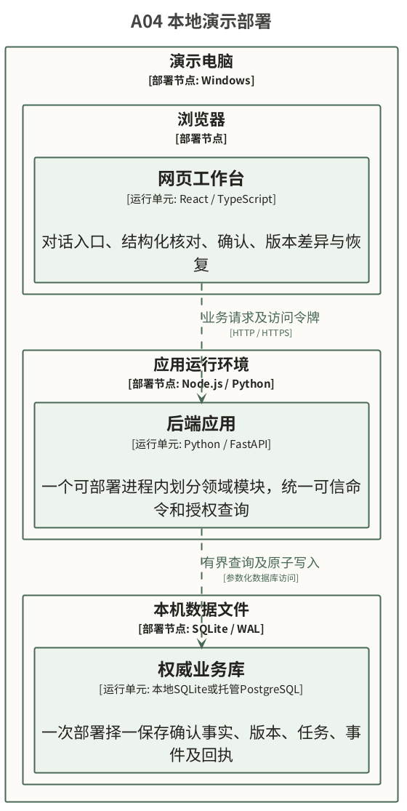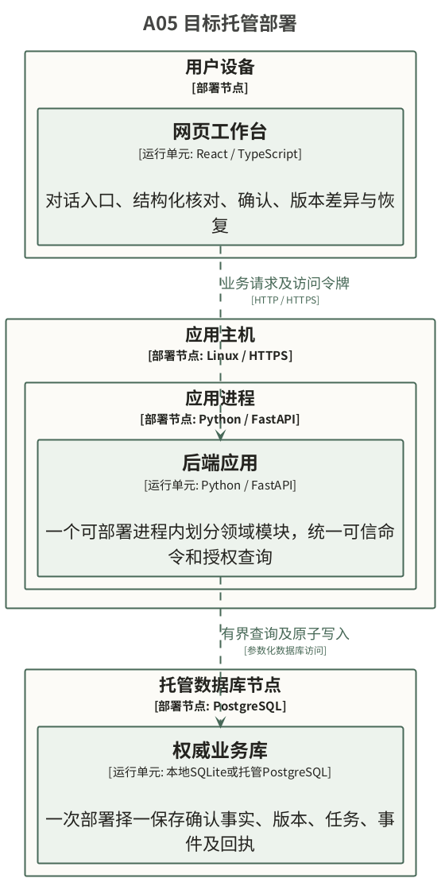

*图3 本地演示与目标托管部署。它们是两种独立部署，不同时充当权威库。*

本地演示在一台电脑运行网页、后端和本机SQLite文件；托管目标由加密入口提供静态资源并转发给一个后端实例，连接PostgreSQL与身份服务。浏览器不直写业务表，凭据只在服务端。目标部署未在本次上线。

| 优先质量属性 | 架构响应与验证 |
|---|---|
| 一致性及可恢复性 | 同用户处理控制、版本条件更新、同事务回执；以故障注入核对全生效或全回滚。 |
| 安全及隐私 | 本人复合归属、当前用途校验、逐图外传许可；以双账户越权和撤回竞争验证。 |
| 性能及成本 | 短事务，外调无写锁；步骤预算、总截止和有界排队；PoC测P95及锁争用。 |
| 可维护性 | 规则集中在领域模块，存储、模型、资料、身份及时钟为实际替换点；避免仅转发的分层。 |

Harness与确定性领域服务作为同一FastAPI进程内的逻辑模块部署，共享发布和故障域；逻辑分离用于约束职责，不新增网络服务。模型请求使用有界并发与超时，等待期间不持有数据库写事务。进程重启后从已提交任务与回执恢复；外部模型失败仍保留手动路径。仅当慢调用持续影响普通请求且资源隔离措施不足时，再评估独立执行进程。

首轮PoC沿用模块化单体和本地SQLite，验证主闭环。托管数据库迁移、完整费用审计和复杂运维作为后续候选；附件中的表与接口用于检查边界，不要求首轮全部实现。涉及授权、硬约束和数据正确性的原需求继续保留；范围调整须进入变更日志。

## 3 设计模型：核心领域结构

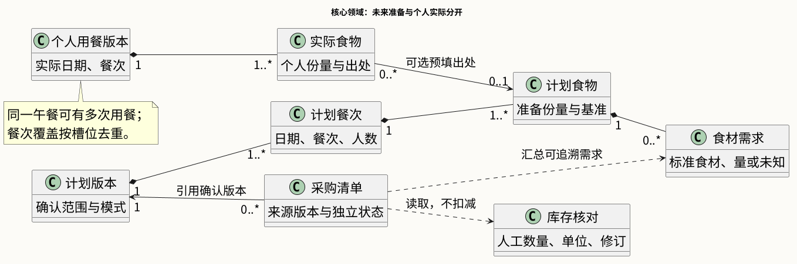

| 不变量 | 对实现的含义 |
|---|---|
| 准备量不等于摄入 | 每人150g、两人准备得300g；个人实际份量另行核对。 |
| 未知不等于零 | 需求或库存未知时完整差额未知；只展示已知部分。 |
| 当前范围不改历史 | 日期餐次归属独立于确认内容；替换后旧清单失效，历史来源不重写。 |
| 一餐含多种食物 | 同一午餐可有多次记录；覆盖按日期餐次去重，营养按条目核算。 |
| 本人归属贯穿引用 | 私有引用包含用户归属；共享备餐人数不赋予替他人登记权限。 |

物理设计以身份表、内容版本及关系表落实这些不变量。当前指针、唯一键和外键约束保护身份关系；跨行计数、来源适用性及状态守卫由统一事务校验。完整字典和SQL留在附件，核心抽象不会按“一对象一张表”机械决定。

## 3.1 食品身份与多来源证据融合

食品服务采用来源适配器模式，分别读取包装商品、本地食物编码和用户提供的菜单或标签；适配层统一字段结构，保留原始来源。业务层再核对身份、单位、加工状态和适用范围，形成当前用途的证据摘要。[7]

| 类别 | 身份与适用范围 | 融合规则 |
|---|---|---|
| 包装商品 | 条码、品牌、规格、配方及标签时间 | 身份一致后比较字段；当前包装用于核对本次商品。 |
| 通用食材 | 来源编码、生熟及加工状态 | 只用于对应状态的参考；食材分类不证明具体商品配料。 |
| 非标准菜品 | 本次菜单、图片或用户自述 | 保存本次描述；参考配方与实际确认配料分别表示。 |

融合流程为：来源记录→身份关联候选→字段证据→冲突处理→当前用途评估。每字段记录值、单位、计量基准、来源、获取时间、适用范围和核对状态。名称相似只产生关联线索；关键字段冲突保留双方证据并要求核对，不按来源数量投票，也不自动以最新抓取值覆盖当前标签。冲突处理策略与来源接入分开，便于分别验证。

例如，同名“燕麦奶”的商品标签列出燕麦及大豆，通用燕麦编码只提供参考营养。两者不能合并为无大豆商品。明确过敏原命中时排除该推荐；配料未知时暂停受影响候选；仅热量缺失时停止热量比较，仍允许保存用户实际用餐自述。180 kcal/100 g与150 g可确定性换算为270 kcal，g与mL无密度依据时分列。

食品证据摘要同时传给计划和微行动服务，包含食品身份、证据版本、约束版本、未知与冲突。行动引入的新食品须单独检查，原餐通过不能替代新增食物的核对。首轮只验证代表性食品样例，不建设完整食品主数据平台。

## 3.2 Agent角色、状态与记忆

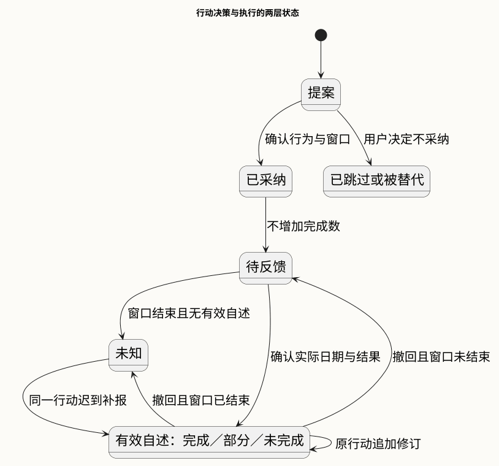

| 责任 | 设计边界 |
|---|---|
| 用户 | 确认硬约束、具体内容、行动窗口和实际自述；可跳过、修改或撤回。 |
| 编排与任务 | 选择许可工具，保存必要草稿、来源和恢复位置；每个请求独立上下文。 |
| 模型 | 结构化理解、候选组织、解释；不拥有业务写权限，不计算权威统计分母。 |
| 确定性模块 | 约束、单位、状态守卫、版本、事务和当前用途校验。 |
| 工具执行器 | 白名单与输入输出结构；每步工具≤3、模型≤2、只读重试≤1、总截止≤15秒。 |

记忆分为确认档案、当前情境及证据、任务临时草案、待确认偏好和原始自述。历史分析关闭后，旧快照不能继续用于排序；稳定偏好必须从候选经用户确认才入档。模型输出和来源文本是待核对数据，不成为系统指令。[6]

## 3.3 用例实现：微行动选择与反馈

微行动分为平替、加法、顺序和时序四类：保留主要餐食，只改变一个可表达的小行为。候选先经过食品硬约束、预算、时间、可获得性及保留条件检查，再按当前目标、已报告障碍、努力量和已授权偏好分层排序；同条件采用稳定顺序，记录规则版本与主要理由。首轮使用可解释规则，不提前确定学习模型或排序权重。[8]

| 午餐场景候选 | 资格与选择依据 | 结果 |
|---|---|---|
| 将含糖配饮换为白水 | 用户希望减少含糖饮品；预算用尽；白水可获得 | 主候选：保留主餐，改变配饮。 |
| 额外购买一份水果 | 新增费用超出本次确认预算 | 排除本次候选。 |
| 换另一款配饮 | 配料未知，影响已确认限制检查 | 待核对，不能直接采纳。 |

默认展示一个主候选及理由，备选可展开。微行动可独立发起，不要求先完成周计划或完整饮食日志。采纳表示愿意尝试；完成数只由后续有效执行自述产生。

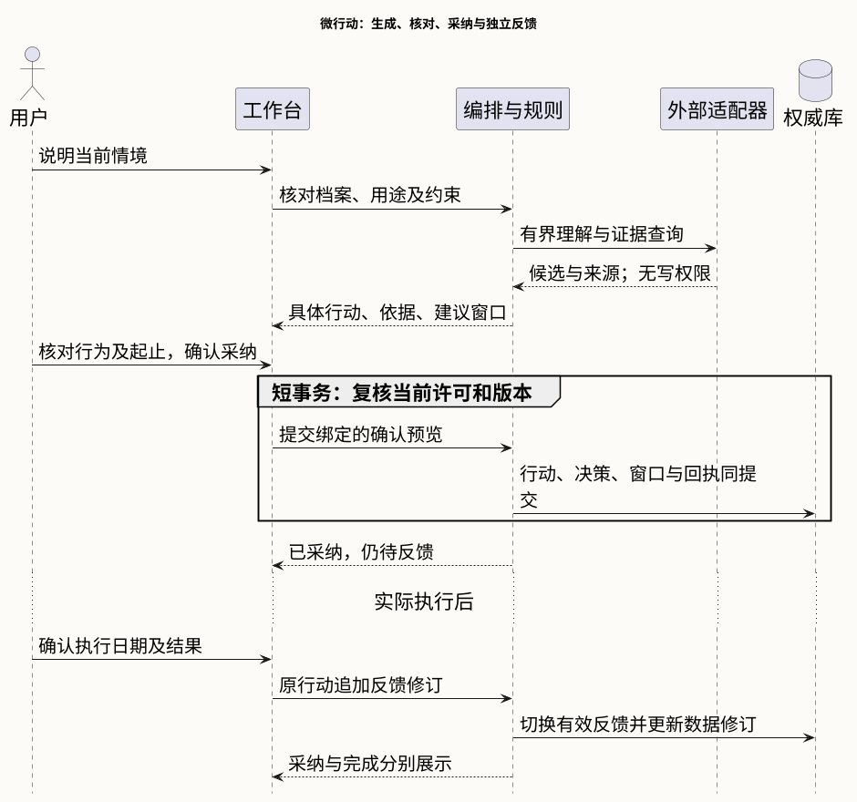

候选包含线索、具体行为、努力量及依据。采纳时确认可尝试的起止时间，后续更改窗口是显式修订。已采纳行动的执行报告保留同一身份；当前档案变化影响新建议，不抹去历史实际自述。

相同情境的候选冷却、提醒退避和外环稳定偏好彼此独立。提醒只有订阅后发送；连续两次无回应后24小时起退避、最长7天，无回应不写执行未完成。

短期调整以用户确认的障碍为依据：时间不足时降低准备步骤，缺少食材时核对可获得的替代项；“换一个”只调整相关候选，“暂不需要”结束当前提案。采纳和执行分别作为观察信号，避免仅因采纳就持续重复同类建议。长期偏好形成可解释提案，用户确认后生效，可停用或重置；未知结果不写成负反馈。

## 3.4 用例实现：计划、准备与记餐

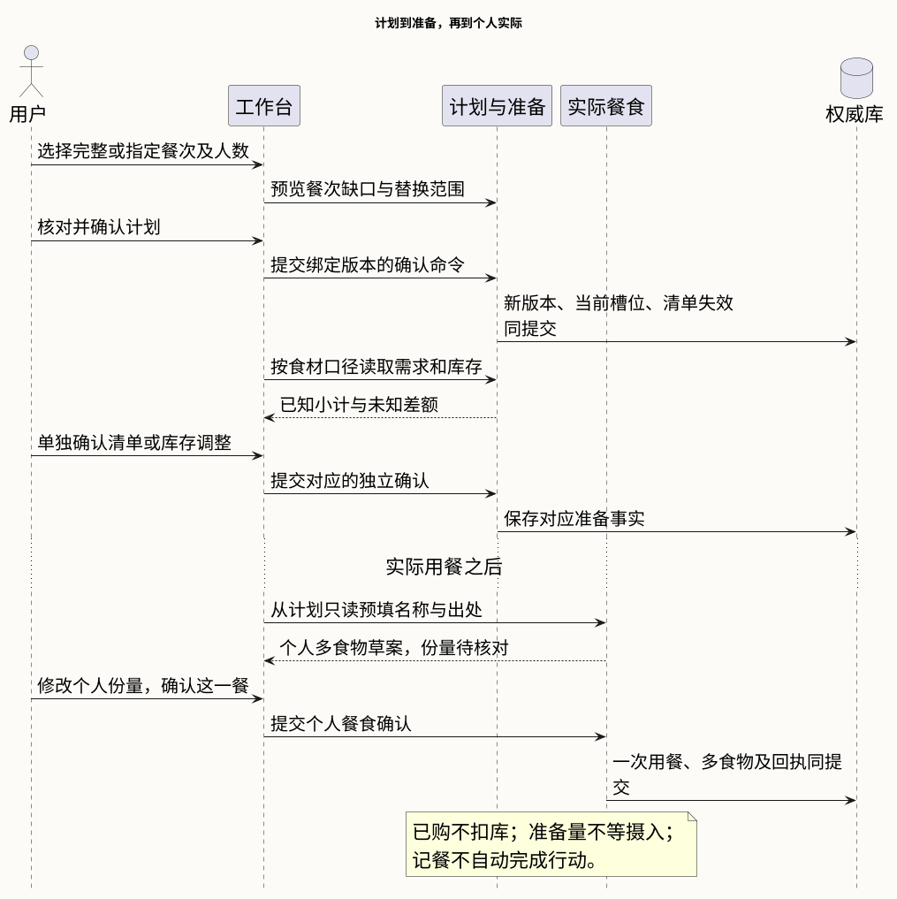

完整模式校验1日3餐或7日21餐，指定模式只校验所选集合。计划按日期餐次替换，保留未受影响槽位。原计划版本被部分替换后，先明确整合范围并确认相应新版本，再重建当前采购清单；旧已购状态不自动迁移。

库存调整展示原值、新值和原因；已购、已准备、实际用餐和行动执行均是独立自述。取消预填不产生用餐记录，删除最后食物不能悄悄变成一条零摄入记录。

## 3.5 用例实现：故障、回执与恢复

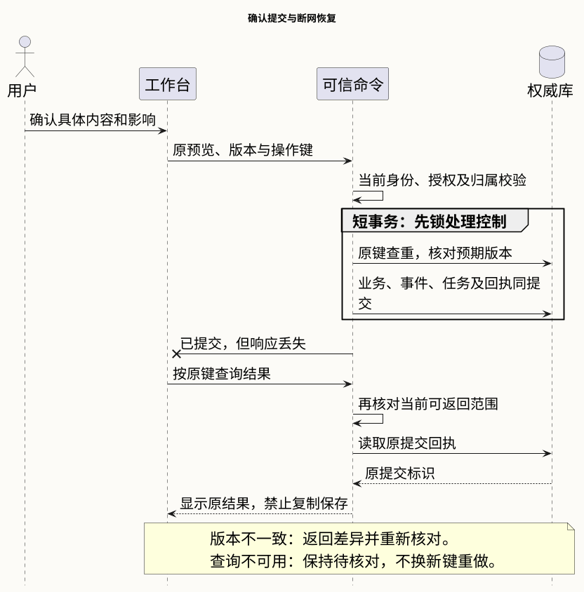

| 接口阶段 | 关键契约 |
|---|---|
| 候选与预览 | 只保存临时核对态。可确认时签发与内容、影响、版本和期限绑定的令牌；变更需新预览。 |
| 确认命令 | 不重传可修改的业务正文。按原操作键查重，复核授权与版本，再统一提交。 |
| 回执与任务 | 同键同摘要返回原提交；同键异内容冲突。查询不可用时保持待核对，不用新键复制写入。 |

确认预览最长15分钟，任务临时态最长7天；这两个技术期限都不替代行动反馈窗口。任务到期不抹去尚可授权查询的原回执。接口结构通过规范校验，真正的并发和断网恢复仍需PoC验证。[3][4]

## 4 更新需求与变更日志

基线为2026年10月22日作业一SRS。保留UC-01至UC-14、FR-001至FR-020及NFR-001至NFR-026，按变化原因分类；当前实现的缺口不会被当作删除需求的理由。

| 细化或变化 | 来源与原因 | 设计影响 |
|---|---|---|
| 完整／指定两种模式 | 原UC-05可指定餐次，但完整验收列3/21餐；用户明确两种均支持。 | 显式模式、选定集合、餐次缺口及槽位冲突检查。 |
| 一次用餐多食物 | 用户确认面条、饮料、水果属于一餐；同午餐可多次真实用餐。 | 餐食整体修订、条目独立份量、槽位覆盖去重。 |
| 按行动确认反馈窗口 | 用户确认按具体行动提出结束时间，采纳时可修改。 | 窗口版本与执行修订分开；结束队列可重算。 |
| 多食材及数量基准 | 原准备与库存需求需表达真实配方；当前单食材结构不足。 | 每人／本餐总量、兼容单位与未知需求标记。 |
| 来源与个人份量 | 预填不证明实际执行，多人准备量不能作为本人摄入。 | 保留来源引用；个人份量默认待核对。 |
| 执行周与结束队列 | 沿用原SRS统计定义，修正创建日或录入时点的实现偏差。 | 按有效修订和正确业务日期计算两个口径。 |
| 原子确认及回执 | 唯一一致保存、避免重复和故障恢复是原要求；实现机制需细化。 | 同库事务、服务端确认绑定、当前授权和版本守卫。 |
| 派生清理与数据控制 | 原授权删除及保留要求延伸到回顾、缓存和排序贡献。 | 清理任务有断点；最小删除进度凭证只用于本次查询。 |

前3项有用户明确答复；其他项主要细化原需求或给出技术机制。六位定点量、确认预览有效期和删除进度机制属于本次设计选择，性能与负担仍需验证。完整变化与来源页码见附件的需求复核记录。

| 新增细化 | 对应原需求 | 原因及影响 |
|---|---|---|
| 字段证据与身份融合 | UC-02/03/04、FR-012/015/016 | 同名与不同加工状态不能直接比较；来源适配与冲突策略分开。 |
| 复用预填与缺口追问 | UC-01/07/12 | 降低重复输入；自动提取为候选，实际记录仍由用户核对。 |
| 候选资格与障碍调整 | UC-09/10、FR-004至008 | 把微行动落实为可行选择；排序及适应规则列为待验证假设。 |

## 4.1 需求覆盖与关键验证

| 用例 | 设计去向 |
|---|---|
| UC-01 档案 | 确认目标、偏好、预算和硬约束；校准可跳过。 |
| UC-02 食品核对 | 图文候选、逐字段来源及手动路径。 |
| UC-03 营养比较 | 同口径、已知份量与营养覆盖。 |
| UC-04 菜单推荐 | 核对现实配料、预算、时效与可获得性。 |
| UC-05 日周计划 | 完整与指定模式，预览替换范围。 |
| UC-06 准备采购 | 版本化多食材需求及未知差额。 |
| UC-07 个人记餐 | 一餐多条食物、整份修订与删除。 |
| UC-08 阶段回顾 | 执行周、结束队列、预期槽位及来源。 |
| UC-09 生成调整行动 | 完整候选、替代重查及情境冷却。 |
| UC-10 决策反馈 | 采纳与执行分开，原行动迟报及修正。 |
| UC-11 任务恢复 | 当前授权、版本、期限和原提交回执。 |
| UC-12 确认情境 | 复用档案，只问影响当前结果的缺口。 |
| UC-13 个人数据控制 | 用途授权、导出删除及期限清理。 |
| UC-14 库存维护 | 人工核对、预览原新值，无隐式扣库。 |

| 功能编号 | 对应模型与判定重点 |
|---|---|
| FR-001/002/003/012 | 图1、2、6；复用档案、多入口、关键未知拦截。 |
| FR-004至008 | 图5、6；完整提案、决策／执行、未知及偏好确认。 |
| FR-009/010/011/013 | 图8、回顾及风险计划；统计、恢复、用途、降级。 |
| FR-014至020 | 图4、7及界面；个人实际、同口径、计划清单库存和独立关联。 |

## 5 UI与UX：网页端新版界面设计

本章给出重新设计的DietLens网页端界面。业务规则保持不变：核对来源，未知不补零，采纳、执行和记录分别确认，断网后先查原回执。本次设计聚焦Web桌面端工作台，视觉与操作路径全面重做，让用户愿意打开，并能在少量点击内看清依据、完成眼前这一餐的决策。全部界面使用虚构数据，为设计稿，不是运行截图。

### 5.1 改版依据与设计目标

上一版网页端界面以米色背景、纯文字卡片和表格为主：业务信息完整，但层级主要靠字号区分，同一屏常有多个同等分量的按钮，数字回顾以表格呈现，视觉吸引力和操作聚焦度不足。新版围绕“好看、好用、可信”三项目标重做，并以十项可用性启发式[9]作为检查清单。

| 维度 | 上一版网页端 | 新版网页端（「晨光餐盘」） |
|---|---|---|
| 视觉识别 | 米色底、陶土色按钮、纯文字表格卡 | 食材绿渐变主卡、陶橙微行动、状态色标签、餐盘与食物图标 |
| 导航与布局 | 左侧文字菜单加表单页 | 左侧常驻图标导航加醒目“记一餐”入口，底部固定当前个人底线；主区左右分栏 |
| 操作层级 | 同屏多个同等按钮 | 每页只有一个实心主按钮，其余为次要或弱化按钮 |
| 状态表达 | 文字为主，局部色块 | 图标、文字、颜色三重表达，未知使用虚线框 |
| 影响预览 | 分散在正文或弹窗中 | 右侧固定影响预览或确认边界卡片，确认前看清后果 |
| 数字回顾 | 表格与文字 | 三口径环形指标加明细追溯列表，每个数字附分母和口径 |

| 可用性原则[9] | 在新版网页端中的体现 |
|---|---|
| 系统状态可见 | 证据状态行、三段删除进度、断网后的三步核对进度，状态始终有文字 |
| 贴近真实世界 | 以“这一餐”“白水”“补充份量”等日常说法组织，食物用图标辅助识别 |
| 用户控制与自由 | 取消、跳过、换一个、暂不反馈在每个写入页面都可见 |
| 一致性与标准 | 同一状态同一图标和颜色：绿色✓已知、琥珀！待核对、红色✕冲突、灰色虚线？未知 |
| 错误预防 | 预览后再保存；未知不填零；采纳页声明“采纳不等于完成” |
| 识别优于回忆 | 左侧栏底部常驻过敏与预算底线；计划预填名称与出处 |
| 灵活高效 | 一句话复合入口、步进器、默认带入日期 |
| 美观与简约 | 每页一个主动作，装饰元素不占用状态与来源信息的位置 |
| 错误识别与恢复 | 中断恢复页给出结论、原内容和唯一的“核对保存结果”主操作 |

### 5.2 视觉语言「晨光餐盘」

新版以“早晨餐桌”为意象：明亮的食材绿承担主操作和“已知”，温暖的陶橙专用于“今天要做的小改变”（微行动与记餐入口），琥珀、绛红、薰衣草紫分别对应待核对、冲突和建议。卡片使用大圆角和柔和阴影，首页主卡以渐变与餐盘图形建立食物感；餐盘图形、食物图标和渐变只出现在首页、计划和记餐等帮助理解“一餐组成”的位置。

<figure>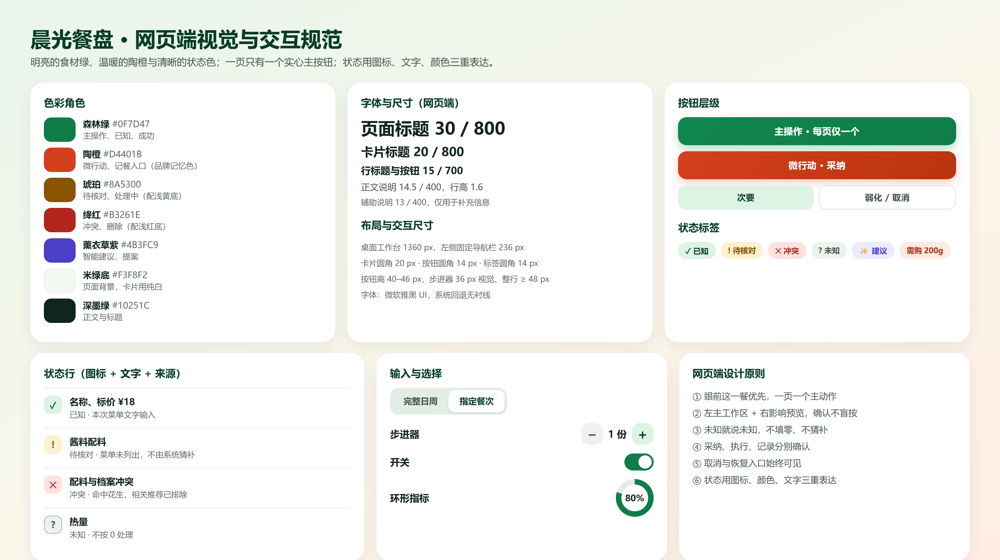<figcaption>图9 网页端设计系统：色彩角色、字体尺寸、按钮层级、状态标签与组件。</figcaption></figure>

文字与底色的对比度按WCAG相对亮度公式计算，结果如下。普通文字的成功准则要求至少4.5:1[5]。

| 位置 | 前景 / 背景 | 对比度 |
|---|---|---|
| 主按钮文字（浅端）（主按钮渐变最浅端上的白字） | #FFFFFF / #118650 | 4.62:1 |
| 主按钮文字（深端）（森林绿底上的白字） | #FFFFFF / #0F7D47 | 5.19:1 |
| 微行动按钮文字（陶橙渐变最浅端上的白字） | #FFFFFF / #D4401B | 4.62:1 |
| 首页主卡文字（主卡渐变最浅端上的白字） | #FFFFFF / #118650 | 4.62:1 |
| 正文（深墨绿字，白卡片） | #10251C / #FFFFFF | 16.11:1 |
| 次要正文（次要说明，页面底色） | #41564A / #F3F8F2 | 7.35:1 |
| 辅助说明（最浅一级说明文字，页面底色） | #5A6D61 / #F3F8F2 | 5.14:1 |
| 已知状态（深绿字，浅绿标签） | #073D27 / #DDF3E4 | 10.56:1 |
| 待核对状态（琥珀字，浅黄标签） | #8A5300 / #FFF0CF | 5.61:1 |
| 冲突状态（红字，浅红标签） | #B3261E / #FFE1DE | 5.32:1 |
| 智能建议（紫字，浅紫标签） | #4B3FC9 / #ECEAFF | 6.23:1 |
| 微行动标签（陶橙深字，浅橙标签） | #A82F10 / #FFE9E1 | 5.84:1 |

上表各组颜色均不低于4.5:1。主按钮与微行动按钮的渐变只在“最浅端”与“最深端”之间变化，表中取最浅端计算，整条渐变均满足。

### 5.3 信息架构与用户流程

<figure>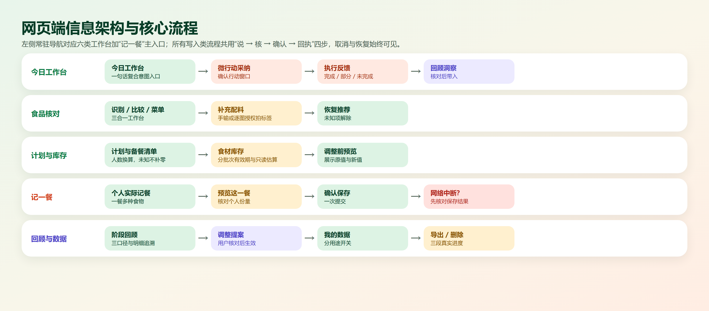<figcaption>图10 网页端信息架构与核心流程：左侧常驻导航对应六类工作台加“记一餐”入口。</figcaption></figure>

所有写入类流程共用“说、核、确认、回执”四步：用户用一句话或少量选择提出意图，系统带出候选并标明来源与未知，用户核对后一次确认，系统返回回执。取消只退出当前草稿；版本或权限变化时展示差异再核对。

<figure>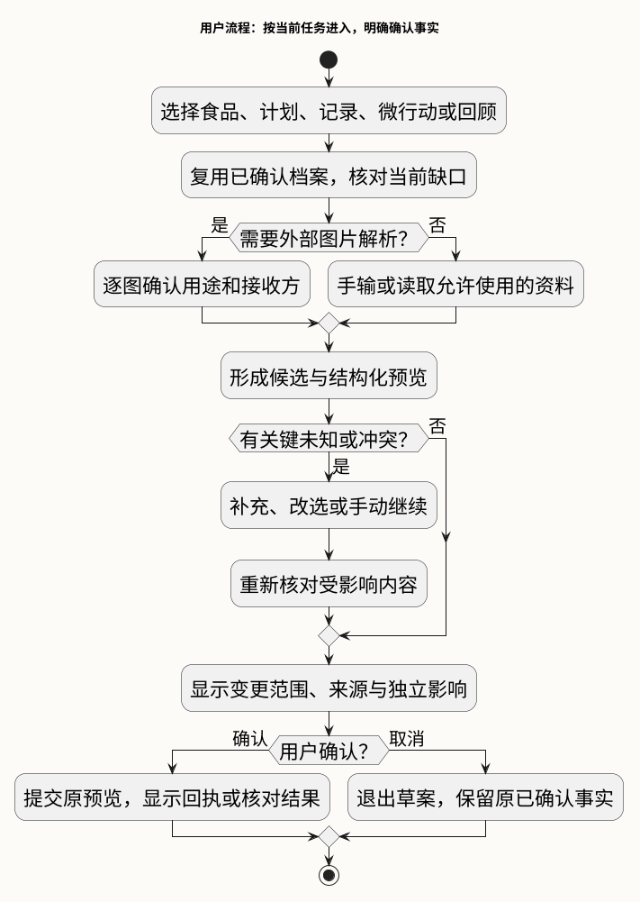<figcaption>图11 食品、计划、记录与行动共享核对原则，各自保留独立业务入口。</figcaption></figure>

任务上下文复用已确认信息，不重复要求输入全部档案。跨任务恢复先查原回执和有效范围，避免返回后再保存一份相同记录。

用户输入“午餐吃了牛肉面，帮我想想今晚怎么安排”，系统带入已确认目标和预算，把复合意图拆成待核对午餐记录与晚餐微行动候选。图片解析可辅助提取标签，需逐图授权；拒绝后文字路径仍可继续。实际用餐可从计划或最近记录选择预填；一次表述可整理成多条食物，份量不清楚时保留未知。采纳行动后，反馈主入口只问完成、部分完成或未完成；日期给出可修改建议，障碍为可选项。下次同类情境明确说明因哪个障碍调整了建议。

### 5.4 网页端界面总览与用例追踪

<figure>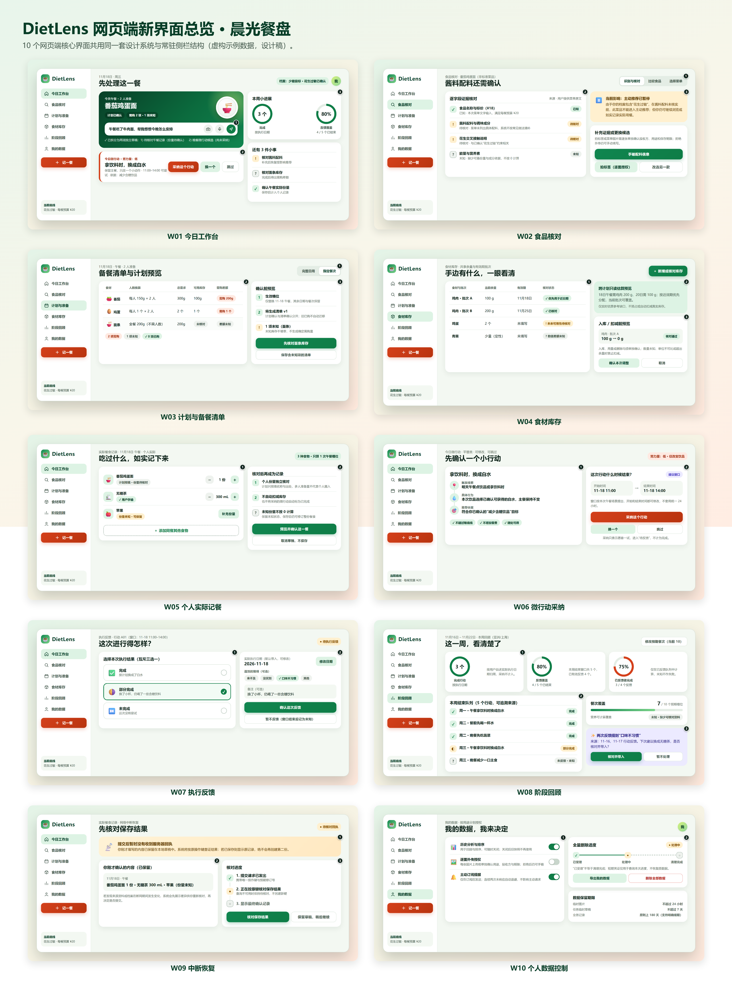<figcaption>图12 网页端十个核心界面总览。</figcaption></figure>

| 界面 | 对应用例 | 要解决的问题 |
|---|---|---|
| W01 今日工作台 | UC-12、UC-09，并连接各工作台入口 | 一句话拆分复合意图，突出今日主餐与一个主微行动 |
| W02 食品核对 | UC-02、UC-03、UC-04 | 识别、比较、选择三合一，证据逐字段可见，关键未知拦截推荐 |
| W03 计划与备餐清单 | UC-05、UC-06 | 人数换算可核对，库存未知不补零，右侧预览生效槽位与版本 |
| W04 食材库存 | UC-14 | 同食材分批次有效期，跨计划只读估算，调整前预览原新值 |
| W05 个人实际记餐 | UC-07 | 一餐含多种食物，步进器调整个人份量，保存前明示边界 |
| W06 微行动采纳 | UC-09、UC-10 | 时间线解释推荐依据，起止窗口由用户确认，采纳不计完成 |
| W07 执行反馈 | UC-10 | 完成、部分、未完成互斥三选一，日期默认带入，障碍可选 |
| W08 阶段回顾 | UC-08 | 完成数、反馈覆盖、已反馈者完成比例分开显示，明细可追溯 |
| W09 中断恢复 | UC-11 | 断网后保留草稿并回显内容，沿原操作键查证，不重复保存 |
| W10 个人数据控制 | UC-13 | 用途授权独立开关，导出与全量删除展示三段真实进度与期限 |

### 5.5 W01 今日工作台：先处理这一餐

<figure>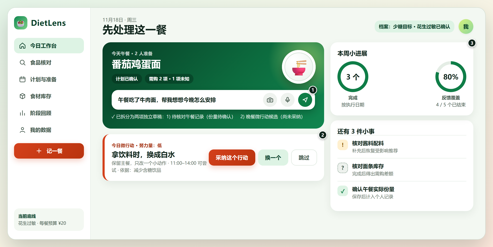<figcaption>图13 今日工作台。虚构数据，网页端设计稿。</figcaption></figure>

首页聚焦“眼前这一餐”，将自然语言复合意图拆分为独立可确认的草稿，并把主微行动与本周待办同屏呈现。
<ol class="mks wide"><li>1
<b>一句话复合入口</b>：支持文字、语音和可选图片；系统把复合意图拆成“餐食记录草稿”和“晚餐微行动候选”，两项独立确认、互不捆绑。
</li><li>2
<b>主微行动卡片</b>：只展示一个主候选，“采纳”为唯一实心主按钮，“换一个”“跳过”弱化并排，避免视觉干扰。
</li><li>3
<b>本周进展与待办</b>：右侧固定展示本周完成数、反馈覆盖率与待核对小事，点击即可跳转对应工作台。
</li></ol>

首页只放当下最需要的三类内容：这一餐、一个主微行动、本周进展与待办。需购与未知以状态标签直接显示在主卡上，提醒、陪伴和图鉴可独立关闭，关闭附加功能不阻断核心饮食任务。

### 5.6 W02 食品核对：未知就说未知

<figure>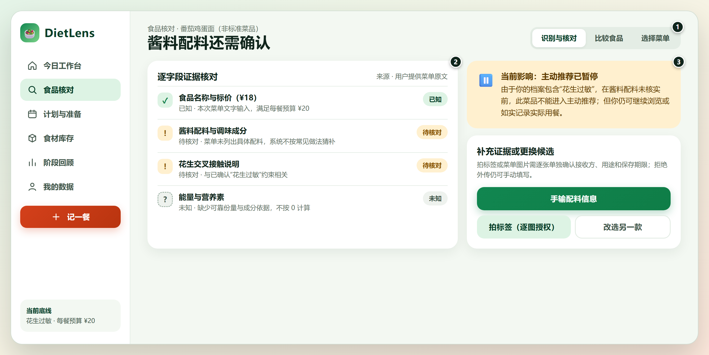<figcaption>图14 食品核对工作台。虚构数据，网页端设计稿。</figcaption></figure>

把“安全限制、价格、营养”三类判断拆成逐字段证据行，明确区分“不能推荐”与“可以记录”。
<ol class="mks wide"><li>1
<b>三合一工作台</b>：顶部一键切换“识别与核对”“比较食品”“选择菜单”，共享同一份食品证据与来源记录。
</li><li>2
<b>四态证据流</b>：已知 ✓、待核对 !、冲突 ✕、未知 ?，状态同时用图标、颜色和文字表达，不依赖单一颜色。
</li><li>3
<b>受影响范围说明</b>：明确提示仅“主动推荐”受影响而暂停，不阻断浏览或如实记录；手输路径与逐图授权拍照并列。
</li></ol>

当前档案花生过敏，酱料配料未知时，用户能看到未知字段、受影响推荐及补充方式，也可以改选，不要求先上传照片。

| 场景 | 界面反馈 |
|---|---|
| 加载与分析 | 立即显示处理状态；达到截止则显示已取得部分结果、停止原因及手输入口。 |
| 已发现冲突 | 明确列出冲突依据，阻止相关推荐；用✕图标和文字表达，不只用红色区分。 |
| 尚未核对 | 保留未知或冲突，不填零；不给出误导性的确定结论。 |
| 图像外传 | 逐图说明用途、接收方和期限；拒绝后文字路径仍可继续。 |

### 5.7 W03 计划与备餐清单：人数与未知看得见

<figure>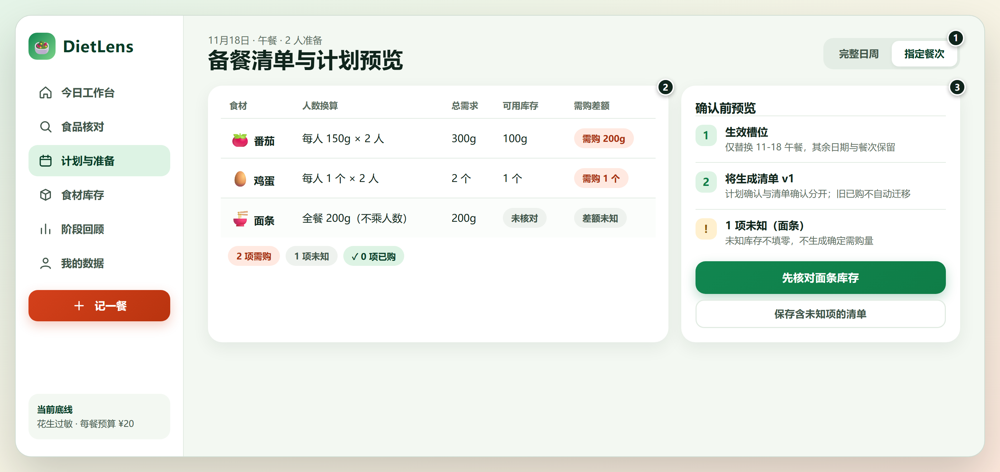<figcaption>图15 计划与备餐清单页。虚构数据，网页端设计稿。</figcaption></figure>

在表格中直观展示“每人 × 人数”与“全餐总量”两种换算方式，右侧固定展示确认影响范围与未知项规则。
<ol class="mks wide"><li>1
<b>计划模式切换</b>：支持“完整日周（检查 3/21 餐）”与“指定餐次”，按当前选择明确校验范围。
</li><li>2
<b>换算与未知透明</b>：“人数换算”单独成列；面条库存未核对时保持“差额未知”，绝不按 0 抵扣。
</li><li>3
<b>确认影响预览</b>：右侧清晰列出生效槽位、清单版本与未知提示，主按钮优先引导核对未知库存。
</li></ol>

| 输入 | 需求与差额 |
|---|---|
| 番茄每人150g，两人；库存100g | 需求300g，需购200g。 |
| 鸡蛋每人1个，两人；库存1个 | 需求2个，需购1个。 |
| 面条全餐200g；库存未核对 | 不再乘人数，需求200g；完整差额未知。 |

选择完整日周模式时提示缺少的3/21餐，指定模式只检查选定餐次。计划替换先展示受影响槽位和清单；已购、已准备不会自动迁移或改写库存。允许明确保存带未知项的清单，但未知项不生成确定需购量。

### 5.8 W04 食材库存：分批次与只读估算

<figure>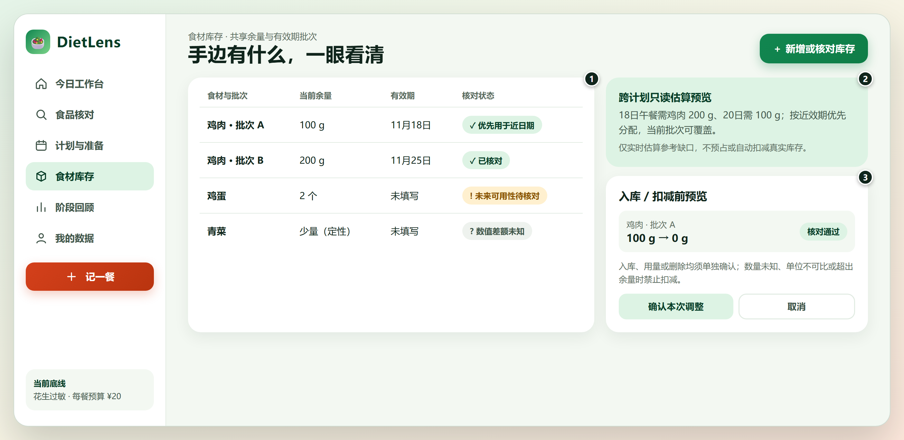<figcaption>图16 食材库存页。虚构数据，网页端设计稿。</figcaption></figure>

同食材不同有效期分批次管理，定性余量（少量）与未填有效期分别标注，跨计划只做只读估算而不隐式扣库。
<ol class="mks wide"><li>1
<b>分批与定性状态</b>：同一食材按有效期分列；未填有效期不强制补齐，标“未来可用性待核对”；定性“少量”不冒充精确克数。
</li><li>2
<b>跨计划只读估算</b>：从核对时点起按未来餐次顺序估算消耗，近效期批次优先抵扣，不修改真实库存。
</li><li>3
<b>调整前预览原新值</b>：任何入库或扣减均先展示原值与新值并由用户单独确认，禁止负库存。
</li></ol>

库存页支持数量、单位、可选有效期，以及“充足、少量、用完”的定性记录。不同批次分开核对；跨计划估算按未来餐次和近效期优先原则实时计算，不预占或自动扣减真实库存。任何入库或扣减先展示原值与新值并由用户单独确认，余额不足时拒绝扣减。

### 5.9 W05 个人实际记餐：一餐多种食物

<figure>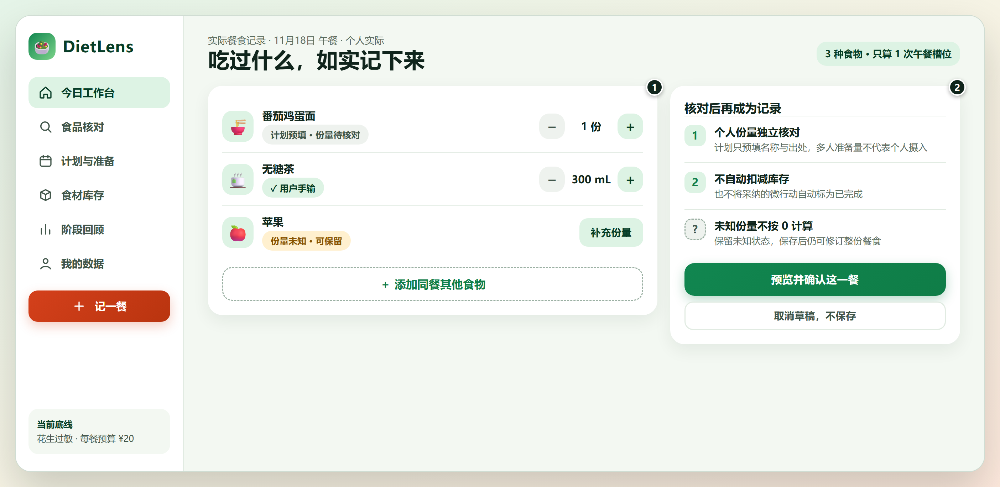<figcaption>图17 个人实际记餐页。虚构数据，网页端设计稿。</figcaption></figure>

一餐包含多种食物时统一在一个草稿内调整，步进器降低份量修改成本，未知份量无需强填即可保存。
<ol class="mks wide"><li>1
<b>同餐多食物与步进器</b>：三种食物同属一次午餐，覆盖率只计 1 个槽位；步进器让常见份量一键微调，计划预填项明确标注待核对。
</li><li>2
<b>确认边界提示</b>：保存前明示“不自动扣库存、不代写微行动完成、未知不按零计”，取消草稿绝不写入记录。
</li></ol>

从计划预填的是名称和出处，个人份量由用户另行核对。图示午餐包含1份面、300mL无糖茶和份量未知的苹果；预览后确认整份餐食，不因同一餐有三条食物而增加三次餐次覆盖。取消草稿不新增记录；修订同一用餐产生新有效版本，历史出处保留，相关回顾随之重算。

### 5.10 W06 微行动采纳：窗口由用户确认

<figure><figcaption>图18 微行动采纳页。虚构数据，网页端设计稿。</figcaption></figure>

左侧用时间线讲清“什么时候做、做什么、为什么推荐”，右侧由用户确认或修改行动窗口后再决定采纳、换一个或跳过。
<ol class="mks wide"><li>1
<b>时间线与资格核对</b>：线索、行为、依据三步清晰呈现，底部三个绿色标签证明已通过安全、预算和可获得性核对。
</li><li>2
<b>可修改行动窗口</b>：起止时间并排可改；采纳按钮下方明确写出“采纳不等于完成”。
</li></ol>

候选页包含线索、行为、努力量和依据，可修改起止、换一个或跳过。建议结束时间对应本次场景，采纳时由用户确认。修改行为提出新候选并重查约束，不会悄悄替换已采纳行动的含义。底部三个资格标签说明候选已通过过敏底线、预算和可获得性检查。

### 5.11 W07 执行反馈：三选一互斥核对

<figure>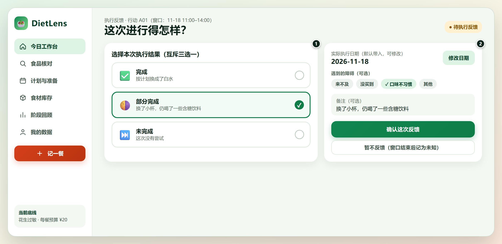<figcaption>图19 执行反馈页。虚构数据，网页端设计稿。</figcaption></figure>

互斥三选一卡片配默认带入的执行日期与可选障碍标签，让用户在 30 秒内、至多 3 次主要操作完成反馈。
<ol class="mks wide"><li>1
<b>互斥大卡片</b>：完成、部分完成、未完成互斥单选，用边框、底色和勾选图标三重区分；迟到补报沿原行动更新有效版本。
</li><li>2
<b>可选障碍与暂不反馈</b>：障碍标签与备注均可选填，用于改进下次同类建议；“暂不反馈”在窗口结束后记为未知，不代写未完成。
</li></ol>

| 状态或操作 | 可见结果 |
|---|---|
| 确认采纳 | 显示已采纳、具体窗口及待反馈；完成数不增加。 |
| 执行反馈 | 完成、部分、未完成互斥，确认实际日期；备注与障碍标签可选。 |
| 暂不反馈 | 窗口未结束为待反馈，结束后为未知，不代写未完成。 |
| 补报或修正 | 沿原行动更新有效修订及原队列，显示统计更新时间。 |

### 5.12 W08 阶段回顾：三个口径分开看

<figure>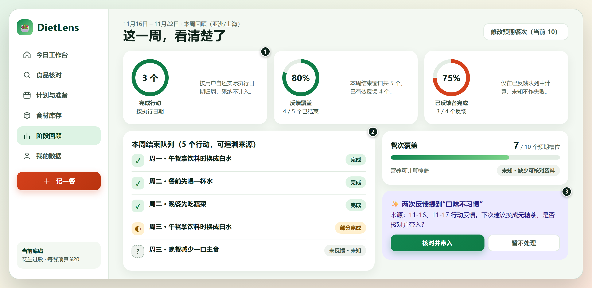<figcaption>图20 阶段回顾页。虚构数据，网页端设计稿。</figcaption></figure>

用三个独立环形指标分开统计口径，下方列表可追溯到具体行动与未知项，调整提案由用户核对后才带入下一次任务。
<ol class="mks wide"><li>1
<b>三口径分离</b>：完成行动按执行日归周，反馈覆盖和已反馈者完成比例基于结束窗口队列，分母与口径固定展示。
</li><li>2
<b>明细可追溯</b>：结束队列逐条列出，未反馈项保持“未知”而非失败，可随时点击补充迟到反馈。
</li><li>3
<b>待核对线索</b>：所有观察先展示来源记录与时间范围，只有用户确认后才预填到下一次建议中。
</li></ol>

图中结束队列5个行动，有效反馈4个，其中完成3个，因此反馈覆盖4/5=80%，已反馈者完成比例3/4=75%。完成数按实际执行日期归周，跨周时它可与结束队列中的完成数不同。餐次覆盖是本人已确认预期槽位的集合交集；预期分母未确认或为零时显示未知。营养缺口另列，调整提案须用户核对后才带入下一次任务。

### 5.13 W09 中断恢复：先核对，不重复保存

<figure>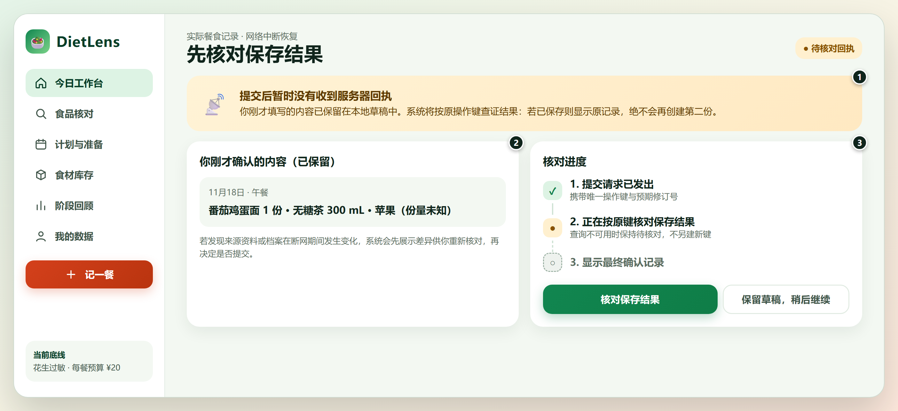<figcaption>图21 中断恢复页。虚构数据，网页端设计稿。</figcaption></figure>

断网或响应丢失后不要求重填，先给出“不重复保存”的承诺、完整回显原内容，并用三步进度条引导唯一查证动作。
<ol class="mks wide"><li>1
<b>温和提示与承诺</b>：明确说明内容已保留且不会重复创建记录，消除用户反复点击提交的焦虑。
</li><li>2
<b>原内容回显</b>：保留完整餐食草稿；若期间对象版本变化，先展示差异供重新核对。
</li><li>3
<b>三步核对进度</b>：按原操作键查证回执状态，主按钮直接触发查证，也可先保留草稿稍后恢复。
</li></ol>

确认后断网显示“先核对保存结果”，不引导创建新记录。同一提交只返回同一条记录；查询不可用时保持待核对，不用新键复制写入。若发现来源或档案在断网期间变化，先展示差异供用户重新核对。

### 5.14 W10 个人数据控制：开关与进度可见

<figure>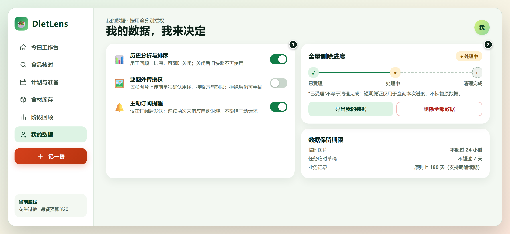<figcaption>图22 个人数据控制页。虚构数据，网页端设计稿。</figcaption></figure>

把用途授权做成互不干扰的独立开关，导出与全量删除提供三段真实进度与明确的数据保留期限。
<ol class="mks wide"><li>1
<b>分用途独立开关</b>：历史分析、逐图外传和提醒各自控制，关闭附加功能绝不阻断核心饮食管理任务。
</li><li>2
<b>三段删除进度与期限</b>：已受理 → 处理中 → 清理完成三段状态清晰可查，明确展示 24 小时、7 天、180 天保存期限。
</li></ol>

数据控制页分开历史分析、逐图外传及提醒用途。导出和删除显示受理、处理中、清理完成或失败；全量删除前签发的短期凭证只用于查询本次进度，不恢复原数据。界面不把受理回执当作清理完成。

### 5.15 可用性检查与验证安排

设计稿阶段已完成三类检查：配色对比度计算（见5.2）、状态表达核对和操作预算核对。状态表达核对逐页确认：已知、待核对、冲突、未知、待反馈、处理中均同时有图标和文字。操作预算按设计稿逐步计数：

| 任务 | 主要操作序列 | 主要操作数 |
|---|---|---|
| 采纳今日微行动 | 首页或采纳页确认窗口，点“采纳这个行动” | 2 |
| 提交执行反馈 | 选择完成情况，确认（日期默认带入） | 2 |
| 记录一餐（计划预填） | 点“记一餐”，核对份量，预览并确认 | 3 |
| 补充未知配料（手输） | 点“手输配料信息”，输入，保存 | 3 |
| 断网后核对 | 点“核对保存结果” | 1 |

执行反馈为2个主要操作，满足PoC-06中“至多3个主要操作”的目标。上述为设计值，实测数据待第三部分获得。网页端按1360像素工作台设计，辅助说明字号不小于13像素，按钮高度40至46像素，步进器视觉36像素、整行48像素以上，均高于WCAG 2.2对最小目标尺寸24像素的要求[5]。键盘焦点顺序、读屏、200%文字缩放与不同窗口宽度适配须在可运行原型中检查。

新增三项界面验证随PoC-06一并进行，均为候选方案：

| 验证问题 | 观察记录 | 候选判据 |
|---|---|---|
| 一句话入口与预填是否减轻录入 | 6名成年用户完成记餐，记录耗时、手输字段数和纠错次数 | 至少5/6独立完成，沿用PoC-06 |
| 状态表达是否被正确理解 | 用户复述“未知”“待核对”“待反馈”的含义 | 6人中至少5人正确 |
| 新网页端视觉是否更有吸引力且不增加负担 | 对比上一版与新版的首印象评分、完成时间 | 新版评分不低于上一版，完成时间不增加 |

## 6 开放问题、风险与Part III验证

验证顺序以核心价值为先：食品约束→录入减负与行动可行性→反馈驱动调整；状态一致性作为各阶段的共同通过条件。下列样本量和阈值为原SRS目标或本次候选验证方案，结果均待第三部分获得。

| 验证问题 | 方法与记录 | 决策用途 |
|---|---|---|
| 复用与提取能否降低负担 | 6名成年用户，平衡任务顺序，对比手工填写与复用预填；记录耗时、手输字段、纠错、放弃及求助 | 至少5/6独立完成主流程；同时报告每人的差异，若更省时但误录增多则修订预填。 |
| 情境化行动是否更可行 | 12类障碍情境比较固定模板与约束后排序；记录可获得性、感知努力、换选理由及执行自述 | 优先修正不可行建议与排序规则，不以采纳率单独判定收益。 |
| 反馈是否改善下一次建议 | 同一虚构情境注入不同障碍，检查调整方向；邀请用户复核理由，记录规则版本 | 调整须能对应已确认障碍；关闭历史或重置后不再使用该信号。 |
| 持续价值能否维持 | 形成性研究后开展自愿的2周探索，记录重复执行、反馈负担、退出原因和记录覆盖 | 用于调整行动库与提示频率；长期行为效果另设更长周期及适当对照研究。 |

| 关键不确定性 | 缓解与PoC | 判定依据 |
|---|---|---|
| 跨对象保存、并发与响应丢失 | PoC-01：在各写入点及提交后响应前注入失败；双账户交错操作。 | 同键100次仅一个有效提交；10个同版本竞争仅合法项成功；40越权负例零泄露。 |
| 食品来源不完整 | PoC-02：60个限制／未知案例，100项独立标注图文集；分来源报告覆盖。 | 安全关键未知全部拦截；普通字段匹配目标≥95%，不得用编码命中替代配料核对。 |
| 多人数量、计划和个人记录混淆 | PoC-03：30计划、30清单库存、40记录及40换算例。 | 完整与指定模式正确；未知不补零；勾选、预填和取消无跨事实隐式写入。 |
| 指标被录入时间或重复条目污染 | PoC-04：20个对抗回顾例，含跨周迟报、修订、窗口变更和删除。 | 同一行动唯一有效贡献；两个周口径及预期槽位分母与手算一致。 |
| 单体容量和外调费用 | PoC-05：2vCPU/4GB、50种子用户、20并发30分钟；再测峰值和慢依赖。 | 非模型读写P95≤2秒；每步预算和15秒停止生效；费用80%提示、100%停止。 |
| 交互负担和状态误解 | PoC-06：6名成年用户用虚构资料完成食品、计划、记餐、反馈和恢复。 | 至少5/6独立完成主流程；反馈30秒内、至多3个主要操作；另测无障碍。 |

食品覆盖、排序规则、模型型号与托管配置由PoC结果决定。性能与删除恢复按风险分阶段验证；未通过状态与授权检查时，不进入真实用户数据研究。

删除风险还包括派生物、原图和备份恢复。验证24小时原图到期、7天任务到期、业务180天保留及明确续期、主动删除24小时退出处理、备份30天到期；恢复前重放最小删除清单，避免旧备份使已删数据复活。

## 7 AI工具使用与批判性反思

本次AI实际参与了资料阅读、需求细化、领域和交互建模、架构备选比较、SQL与接口契约起草、界面稿、来源核对及报告整合。Structurizr、PlantUML和drawDB用于表达结构关系，Swagger Editor及专用校验器用于契约检查。它们加快了从自然语言到可审阅模型的转换，也留下可编辑来源和检查记录。

实际工作暴露出两类内容风险。其一，工程细化一度扩张到大量表和接口，挤压了摘要、参考注释等直接交付项；经审查后，重新按作业九项交付收敛，完整工程材料退居附件。其二，接口说明有几处用例编号对应不准确，本次重新按SRS修正。漂亮图稿和大量文件都不能代替正确的需求映射。

网页端界面重设计阶段，AI按设计系统生成HTML与CSS界面稿，用Edge渲染为图片，并以脚本按WCAG相对亮度公式计算配色对比度；配色、图标和层级取舍由团队评审。

工具检查也有边界。图稿生成曾因语法和空标签失败，修正后重新渲染；编辑器移除未使用定义后仍显示旧诊断，刷新并导出比较才确认最终状态。结构校验器不能证明业务不变量、真实鉴权或并发恢复，本稿把这些结论与未来PoC明确分开。

| 实际检查 | 能支持的结论 |
|---|---|
| 模型解析与渲染 | 图源可解析，中文可显示，保留可编辑来源。 |
| 数据库静态核对 | 字段、归属外键、目标键和索引结构一致；未执行DDL。 |
| OpenAPI规范与40个正反例 | 声明结构及示例符合契约；不代表服务行为已验收。 |
| 网页端界面渲染与对比度计算 | 10个网页端界面和4张规范/总览图渲染成功，十二组配色对比度均不低于4.5:1；可用性结果留待PoC-06。 |
| 编辑器往返和文件摘要 | 工具副本与权威文件一致；不能替代领域语义评审。 |

团队负责复核需求、确认设计取舍、检查样例并执行PoC。实验结论以实际测试记录为准。参考来源通过官方页面核对，来源陈述与本项目推导分开。

## 8 注释参考文献

### [1] C4模型：软件架构可视化

Simon Brown，C4 model。访问日期：2026-11-17。

[来源](https://c4model.com/)

该来源以系统、容器、组件及代码的分层抽象组织架构视图，并提供部署和动态等辅助图。它帮助本项目选择读者真正需要的粒度：先解释用户和外部依赖，再解释网页、后端与权威库，最后细化关键模块。报告没有把每张数据库表当成架构组件，也没有为展示复杂性而强制绘制代码层图。

对DietLens的具体影响是把业务职责、运行位置和技术选择分开表达。逻辑模块共用一个后端进程，部署图则说明本地演示与托管环境，避免从模块数量推断微服务数量。完整DSL留附件，正文采用同一责任边界的精简图，以控制阅读负担。C4本身不验证事务、权限或业务状态，因此关键用例另外使用时序和生命周期图，并用需求追踪检查模型是否回答真实问题。其价值在于沟通层次和一致术语，不能单凭图形层次证明架构优劣。

团队评审时将用同一场景检查各层：用户确认午餐，后端协调领域规则，部署节点执行一次同库提交。图的每个元素都须能说明职责或信任边界；若某细节不影响该层问题，就留在下层附件，避免重复命名引起责任混淆。

### [2] SQLite预写日志说明

SQLite官方文档。访问日期：2026-11-17。

[来源](https://www.sqlite.org/wal.html)

该文档解释WAL如何组织写入与检查点，以及读写并发的条件和限制。它支持本地演示选择，但也提醒设计不能把“读写可并行”理解为任意并发写入；写者数量、长读事务和检查点都需要纳入运行验证。文档对共享内存和同机运行的要求，使本设计将SQLite文件限制在本机，避免把网络共享文件当托管数据库。

DietLens据此采用短写事务和有界忙等待，外部模型与资料查询在事务之外完成；数据库繁忙时明确返回状态，不能切换到另一库继续写。未来PoC需要测量锁争用、检查点、延迟与恢复，而不是由WAL配置推断20并发目标已达成。本文档没有提供应用级幂等、用户授权或跨对象业务一致性保证；原子回执和版本守卫是本项目另行设计的机制。本地与托管适配器需执行同一组业务断言，性能和失败细节则分别测量。

例如模型查询耗时十秒，不应在这十秒内持有本地写事务。试验将同时记录读写请求延迟和锁等待；若容量不够，先核对事务长度及连接策略，再以观测结果决定是否需要改变本地演示边界。

### [3] PostgreSQL事务隔离

PostgreSQL官方文档，第13.2节。访问日期：2026-11-17。

[来源](https://www.postgresql.org/docs/current/transaction-iso.html)

该来源说明不同事务隔离级别与可见性语义，使本项目把“使用事务”和“业务不变量已经受保护”分开。设计不能只依赖默认隔离就假定两个同版本修订不会冲突，也不能把跨多条查询得到的分子分母自动当成同一统计截点。

具体应用是：确认写入先锁定同一用户的处理控制，再检查预期版本，业务变更和回执同库提交；回顾采用明确的只读一致快照，并在发送前复核当前授权。若未来缩小锁粒度或改用可串行化事务，需要补充完整重试和跨对象不变量测试。用户域串行化是当前项目降低复杂度的取舍，不是文档推荐的通用业务方案，其同用户吞吐代价仍须PoC评估。数据库隔离也不能撤回已经发送给外部模型的内容，因此外传仍须在发送边界检查用途，并最小化输入。

具体到行动迟报，读取当前执行修订和当前窗口必须形成一致视图；否则可能把新分子和旧分母放在一起。原子回执试验还将模拟提交完成但客户端未收到响应，用原提交标识核对最终状态。

### [4] OpenAPI 3.0.3规范

OpenAPI Initiative，2020年版本。访问日期：2026-11-17。

[来源](https://spec.openapis.org/oas/v3.0.3)

该规范提供描述路径、操作、参数、请求响应、认证方案和联合结构的统一格式。DietLens使用它把“核对一份餐食”或“修正一个行动反馈”落实成明确契约，同时用operationId和需求编号连接模块责任。契约区分已知与未知数量，确认请求仅引用已核对预览，避免客户端重传可修改正文造成确认内容不一致。

采用这一版本是因为当前所需结构可以表达，并有现成编辑器与校验工具；本报告不把版本选择描述为追求最新特性。规范校验能够发现引用、路径参数或结构问题，示例验证还能检查空食物、非法命令和未知量带零等错误输入。它不会自动证明跨字段数量关系、真实身份校验、同库提交或断网恢复。因此这些语义在正文和场景中单列，留待服务级PoC。机器可读契约的作用是减少边界歧义，并为未来实现与审查提供共同对象。

例如苹果份量未知时，联合结构允许保留单位并拒绝数值零；完成自述缺执行日期则结构不合法。这样的具体例子能被团队和未来实现共同复用，减少仅凭自然语言解释接口而产生的理解差异。

### [5] 网页内容无障碍指南2.2

W3C推荐标准。访问日期：2026-11-17。

[来源](https://www.w3.org/TR/WCAG22/)

该指南把可访问性转化为可检查的原则和成功准则，为本项目的标签、焦点、状态表达、键盘操作和视觉对比提供依据。DietLens面向日常饮食任务，用户可能在移动设备或注意力有限的环境中使用；关键操作不能只靠颜色、图标或悬停才能理解，错误原因应靠近需要修正的输入。

本次界面据此让未知、冲突、待反馈和完成都有文字表达，保留明确取消入口，并让结构化卡片承担数量和来源核对。移动稿采用单列及足够触控区域，正文不把静态图片称为通过无障碍验收。第三部分还须在可运行原型中检查键盘顺序、可见焦点、读屏状态、文字放大和窄屏溢出；对比度也应按实际颜色组合测量。指南提供的是设计与验收参照，不代表使用某个配色或组件库就自然达到目标。上述检查将与任务完成率一起评估，避免为形式合规增加不必要的用户负担。

形成性研究将同时观察用户能否完成、哪里求助及如何解释状态，而非只记录按钮点击成功。若某个确认步骤造成重复输入，应在保留必要核对的前提下复用已知字段，使访问性目标直接服务实际任务。

### [6] 构建有效的智能体

Anthropic工程团队，2024年12月。访问日期：2026-11-17。

[来源](https://www.anthropic.com/research/building-effective-agents)

该文章讨论可组合工作流与自主智能体的选择，强调从简单模式出发并理解工具接口。它对DietLens的影响是将自主性限制在需要语言理解、候选整理和表达的环节，同时让确定性模块承担约束、数值、状态和写入。模型不自由决定是否跳过用户确认，也不持有业务数据库凭据。

本项目据此把任务编排、工具执行与领域规则分开：编排维护当前步骤，执行器落实白名单、次数预算、截止和失败类别，领域模块校验可提交性。面对超时或缺失资料，提供已知部分和手动路径，而非让模型持续尝试。该文属于工程经验来源，其工具生态自发表后已有变化，本稿只借用模式层面的思路，不以其中服务能力或框架选择证明当前实现。DietLens的硬约束和反馈统计还需要自己的业务反例与PoC；更开放的自主循环只有在收益、成本及安全边界有具体证据时才重审。

例如模型提出替代饮品后，系统仍要核对约束和可获得性，用户再选择是否采纳；模型不能因为“更健康”的表述就将其保存为执行成功。这个例子将作为团队审查自主性边界和第三部分故障注入的共同场景。

### [7] Open Food Facts食品来源接口

Open Food Facts. Introduction to Open Food Facts API documentation. 访问日期：2026-11-17。

[来源](https://openfoodfacts.github.io/openfoodfacts-server/api/)

该官方文档介绍开放食品商品资料的接入方式，字段可包含配料和营养信息。对DietLens的作用是提供包装商品的来源适配参考：接入层负责查询及保留来源，业务层判断该记录是否适用于当前包装和用途。接口返回成功与关键字段足够支持建议是两个不同检查点。

本设计据此保留商品身份、规格、获取时间及字段来源，并将资料缺失、来源失败和无匹配分别呈现。同名菜单不自动继承商品配料，食材编码也不替代本次标签。合并前核对身份与计量基准；冲突保留差异，无法消解的安全关键字段进入人工核对。这样既利用多来源扩大查询机会，又避免拼接出实际不存在的完整食品。

验证采用代表性包装、食材和菜单样例，分别统计字段覆盖、身份误配与失败。来源接口是设计依据，具体覆盖和新鲜度由本地样例决定；缓存保留获取时间，模型不填造缺失配料。首轮优先验证证据能否贯通计划和微行动，再决定持久化粒度。

### [8] 即时自适应干预与决策规则

Nahum-Shani, I., et al. (2018). Annals of Behavioral Medicine, 52(6), 446–462. 访问日期：2026-11-17。

[来源](https://doi.org/10.1007/s12160-016-9830-8)

该研究讨论即时自适应干预的六类要素：远期结果、近期结果、决策点、干预选项、个性化变量与决策规则。DietLens借此将干预拆成可以审查的设计：当前一餐作为决策情境，时间、预算和障碍作为输入，小行动作为候选，资格与排序规则决定本次呈现。

本项目的近期关注点是建议可行性、感知努力和用户报告的执行；持续习惯改善是较长周期目标。反馈首先用于修正相同情境的建议，稳定偏好仍由用户确认。这种映射使“反馈驱动优化”具有明确输入和输出，也使规则版本可以与候选理由关联。采纳、执行和未知分别保留，避免把缺少反馈直接解释为建议失败。

该框架用于指导验证设计，未直接提供本项目的排序权重或冷却时长。第三部分先用障碍案例和形成性研究检查可理解性，再用自愿的短期探索观察重复使用与负担。若要评价持续行为改善，需要更长随访和适当比较设计；本次不把设计模型或静态界面视为干预效果数据。

### [9] 十项可用性启发式

Jakob Nielsen，Nielsen Norman Group，1994年发表，页面持续更新。访问日期：2026-11-17。

[来源](https://www.nngroup.com/articles/ten-usability-heuristics/)

该来源把界面评审概括为十项经验原则，包括系统状态可见、贴近真实世界、用户控制与自由、一致性与标准、错误预防、识别优于回忆、灵活高效、美观简约、帮助用户识别并从错误中恢复，以及帮助文档。本次网页端界面重设计把它们用作检查清单，而不是视觉风格的来源：证据状态行和三段进度对应系统状态可见，取消、跳过和“暂不反馈”对应用户控制，预览后保存和未知不补零对应错误预防，常驻底线与计划预填对应识别优于回忆。

对DietLens的具体影响是约定“精美”的使用方式：餐盘图形、渐变主卡和环形指标用于建立识别和降低阅读成本，每页只保留一个实心主按钮，装饰不占用状态与来源信息的位置。该来源是专家经验总结，评审结论来自设计者对照检查；新界面能否降低录入负担、能否被正确理解，由第三部分PoC-06的用户任务验证。

## 9 团队分工

小组按需求分析、架构决策、模型设计、交互与报告四个工作包平均分工，每人25%。

| 成员 | 比例 | 本次分工安排 |
|---|---|---|
| 薛毓哲 | 25% | 负责业务问题、作业一需求基线、需求细化与变更日志；复核14用例和20FR对应。 |
| 刘相成 | 25% | 负责架构三视图、技术备选与关键决策；复核质量属性及Agent边界。 |
| 颜泽霖 | 25% | 负责领域、结构及关键交互模型，数据/接口边界；复核数量、版本和统计样例。 |
| 韩昊苏 | 25% | 负责界面与用户流程、风险及PoC、AI反思和参考文献；统筹报告版式与交付检查。 |
