# DietLens 系统设计报告

## 1. 设计摘要

　　DietLens 面向希望结合现实饮食条件逐步调整习惯的用户。Part I 的 SRS 规定了食品识别与比较、菜单选择、日周计划、采购和库存、餐食记录、微行动与阶段回顾等功能。Part II 重点解决三个设计问题：计划改变后如何保留真实的历史记录；食品资料不完整时如何兼顾实用性与安全限制；零散记录如何形成有依据、可由用户核对的回顾与下一步建议。

　　系统采用模块化单体，由档案与偏好、食品、计划与清单、库存、餐食记录、微行动、回顾七个领域服务管理业务数据。计划按版本保存，实际用餐独立记录，采购进度与库存数量分开，行动采纳与执行结果分开。针对重叠计划，每个日期和餐次只保留一项当前有效安排，同时保留允许期限内的历史版本与来源引用。

　　食品服务接收文字及经用户授权的图片，支持身份核对、同口径营养比较和菜单筛选。它分别判断安全限制、价格证据和营养字段可计算性；计划与微行动服务进一步核对整餐预算。食品资料有缺失时，用户仍可如实记录实际餐食，但涉及关键过敏或配料信息未知的食品不能进入受影响的主动推荐。微行动结合当前情境，从平替、加法、进食顺序和时序四类行动中筛选可执行候选。用户决定、执行反馈及迟到修正分别记录，以免混淆采纳和完成。

　　回顾展示准备情况、已记录餐食及可计算营养、微行动选择和执行反馈，并说明统计期间、分母、数据覆盖范围与来源。对于资料不足的部分，系统保留未知；对于反复出现的困难，仅形成待用户核对的线索。用户确认后，可以把有关条件预填到下一次任务中。

　　用户既可通过侧栏直接操作，也可从首页用自然语言发起组合任务。Harness 负责组织草稿、调用受限工具、管理确认和恢复；领域服务负责资格判断与正式写入。外部模型调用与本地事务分开，超时或版本变化时保留已确认内容并提供手动操作。相较 Part I 的需求描述，本阶段进一步明确了重叠计划的生效与历史引用规则、食品证据的分项判断、微行动选择事件，以及复合任务的独立确认与恢复流程，以解决计划变更后的追溯、食品资料不完整和多项操作状态容易混淆的问题。目前已完成目标架构、领域模型、关键流程与交互设计，部分页面已有原型；这些细化设计及其跨模块协作将在 Part III 进一步验证。

## 2. 业务领域与关键用例设计

### 2.1 从用户问题确定业务边界

　　一次饮食任务可能同时涉及未来计划、眼前选择和事后记录。三者的确认时机与修改规则不同，因此 DietLens 分别保存相应对象，而不把它们混在同一张可覆盖的饮食表中。

| 用户遇到的问题 | 设计选择 | 可观察的效果与代价 |
| --- | --- | --- |
| 改了明天的计划，却仍需要看到昨天实际吃了什么 | `PlanVersion` 保存计划版本，`MealRecord` 独立保存自述与可选来源引用 | 历史记录不被计划修改覆盖；回顾需要解析版本化来源 |
| 食品名称相似、标签缺失或来源冲突 | 保存原始来源和字段证据，按当前用途分别判断安全、预算和可计算性 | 用户能知道哪些结论可靠；关键资料不足时可能需要多一步核对 |
| 用户愿意尝试一项改变，但执行结果可能很晚才报告 | `Action` 分开保存采纳决定与执行自述 | 避免把采纳算作完成，或把缺反馈算作失败；需要管理反馈窗口 |
| 用户既想记录午餐，又想获得晚餐建议 | 一个任务可以容纳多个草稿，但每项业务操作有独立确认含义 | 减少重复输入，同时不把“得到建议”误记为“已经采纳” |
| 希望回顾能帮助下一次选择，而不是只给分数 | 先计算事实、覆盖度与待核对线索，再提供用户可选择的下一步 | 结论范围受数据质量限制，不能自动诊断原因或健康效果 |

　　本章说明主要对象、业务规则及交互，通用权限、任务调度与恢复机制见第 3 章。

### 2.2 主要领域对象与关系

　　七个领域服务各自负责所属对象的写入，其他模块通过规定的读取入口取得数据。可修改对象用单调递增的修订号检查并发写入，`updatedAt` 记录更新时间；修订号与 `PlanVersion.version` 等用于追溯的业务版本不同。历史来源、迟到反馈和记录修正依据有效业务版本处理。

| 业务对象 | 主要信息 | 所属服务及使用边界 |
| --- | --- | --- |
| `ProfileVersion`、`PreferenceRule` | 用户确认的目标、预算、过敏与硬忌口、授权版本；可单独删除的情境校准回答、提醒订阅设置及偏好规则 | 档案与偏好服务；未经确认的情境回答不进入长期档案 |
| `FoodRecord`、`FieldEvidence` | 食品身份、来源原文、字段值、单位、时间、适用范围、未知或冲突 | 食品服务；来源数据不直接构成推荐许可 |
| `FoodEvidenceSummary` | 本次用途、约束版本、来源引用，以及食品安全、价格证据和营养可计算性的分别判断 | 食品服务；计划和微行动据此结合整餐条件核对候选 |
| `PlanVersion`、`PlanItem` | 日期、人数、餐次、食品与用量；每个 `PlanItem` 表示一次餐次安排，可包含多个食品或食材 | 计划与清单服务；保存未来安排，版本确认不代表全部条目当前生效 |
| `ActiveMealSlotRef` | 用户、日期、餐次对应的唯一当前有效 `PlanItem` 引用；生效和失效时间；保留期限内的变更记录 | 计划与清单服务；决定当前有效安排，并为历史回顾提供当时的关联依据 |
| `ShoppingList` | 计划版本及有效餐次范围、系统计算的食材需求和差额、用户手工调整、库存核对依据、采购与准备状态 | 计划与清单服务；手工修改不覆盖计划需求，也不自动改变库存 |
| `InventoryItem` | 库存条目 ID、食材、数量或未知、单位、可选有效期、确认时间 | 库存服务；同食材不同有效期分别记录，更新须用户确认 |
| `MealRecord` | 实际餐食自述、餐次、食品与份量、有效版本、可选计划来源；已知营养小计所采用的字段值、计量基准及来源时间/版本 | 餐食记录服务；只有用户确认才形成记录，来源更新不静默修改当时的计算依据 |
| `ContextSnapshot`、`Action`、`CandidateDecisionEvent` | 当前情境、正式采纳或跳过、执行反馈；明确修改、换候选及排序重置的精简事件 | 微行动服务；临时提案不等于正式采纳，重置只清除相关排序影响，不重写历史决定 |
| `Task` | 用户当前任务、草稿、恢复位置、操作键和预算 | Harness；负责交互进度，不拥有业务事实 |
| `Review` | 指定期间的来源、统计结果、覆盖度、线索和下一步入口 | 回顾服务；从当前授权范围内的有效对象生成，可重算 |

　　统一的 `taskId` 用于关联可恢复操作与业务写入；页面 `draftId` 只标识该任务下的临时草稿，自然语言任务另外由 Harness 管理 `Task`。`sourcePlanRef={planId,version,itemId}` 是餐食记录指向历史计划的版本引用，并非整份食品内容的副本。`ActiveMealSlotRef` 记录餐次安排的生效和失效时间，便于查询当前安排及允许期限内的历史关系。计划版本的确认状态与餐次是否生效分别判断。引用对象删除或到期后显示“来源不可用”，不恢复已删除资料。`ContextSnapshot` 保存生成行动时采用的条件，后续档案变化不改写这份历史依据。

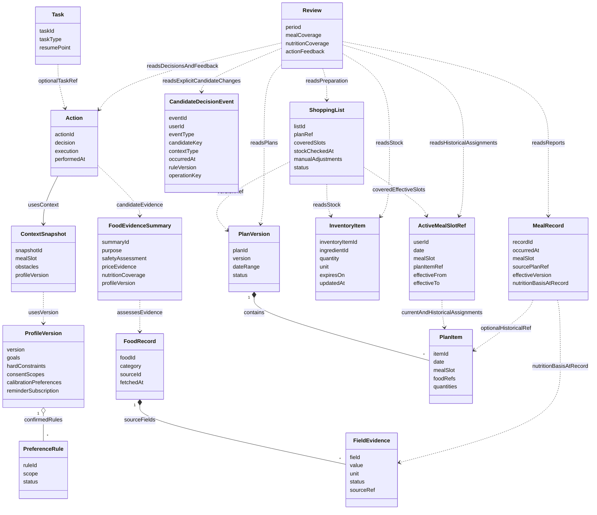

　　图中表示领域对象之间的主要关系；服务调用见第 3 章。回顾读取其他对象，不取得其写入权。

### 2.3 食品核对：来源不完整时如何支持不同用途

　　食品查询、实际餐食记录与主动推荐需要不同程度的信息确认。例如，用户可以记录配料不详的番茄鸡蛋面；但若用户有芹菜过敏，系统不能根据菜名或常见做法推定其适合推荐。因此，食品服务保留未知信息，并在关键证据不足时拦截受影响的推荐（SRS：BR-002、UC-04、NFR-006/007；来源字段设计参考 [R4]、[R5]）。

| 食品类别 | 确认身份的主要依据 | 必须保留的界限 |
| --- | --- | --- |
| 包装商品 | 条码、品牌、规格、配方版本、标签时间 | 相似包装或旧标签不能自动代替当前商品 |
| 通用食材 | 来源编码、名称、生熟和加工状态 | 参考成分不能直接当作某个品牌的实际标签 |
| 非标准菜品 | 菜单原文、商家或用户描述、可核对的具体配料 | 菜名和常见配方不能证明完整配料或交叉接触情况 |

　　来源适配器保留原始响应和获取时间，食品服务逐字段核对身份、规格、单位及适用范围。来源冲突时分别列示，不取平均值；质量与体积之间缺少密度或可靠换算依据时保留未知。

**对一次食品使用请求，分别作出三类判断：**

| 判断维度 | 状态或输出 | 对业务的影响 |
| --- | --- | --- |
| 安全限制 | `blocked`：适用证据明确命中硬约束；`needs_confirmation`：相关配料、过敏原、身份或限制仍不清楚；`no_detected_conflict`：在已核对的适用证据范围内未发现冲突 | 前两者不能进入受影响的主动推荐；第三种不等于保证绝对安全 |
| 食品价格与可获得性 | 保存单品价格、单位、时间及 `known` / `unknown` / `conflicted` 状态，可获得性另行确认 | 单品价格不能直接证明整餐符合预算；由计划或微行动服务按具体餐次计算总费用 |
| 营养计算 | 按字段标注 `available`、`unknown`、`conflicted` 及计量基准 | 只能汇总可计算部分；缺失不能按零计，也不自动推导完整营养量 |

　　食品价格由食品服务提供来源与计量依据，计划或微行动服务再按人数和完整餐次核对预算。食品服务按用途返回判断：`meal_record` 允许保存实际自述及未知信息；`food_exploration` 展示资料和待核对项；`meal_recommendation`、`plan_candidate`、`micro_action_candidate` 必须满足相应安全要求，并经所属服务确认整餐预算与可获得性。非标准菜品的配料证据不足时只能继续浏览或记录，不得凭常见做法取得推荐资格。补充标签或商家说明时保存其来源和确认时间。

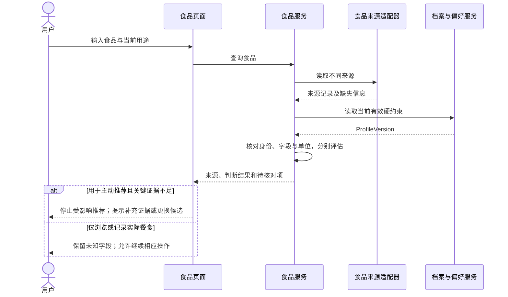

下例中用户有牛奶过敏，而某包装饮品的过敏原信息尚未核实，因此不能进入主动推荐。热量字段也存在来源冲突，无法用于可靠计算。

```json
{
  "foodEvidenceSummary": {
    "summaryId": "fes_001",
    "foodRef": "food_oat_001",
    "purpose": "micro_action_candidate",
    "identity": {"category": "packaged_product", "barcode": "6900000000000", "status": "matched"},
    "fieldEvidence": {
      "ingredients": {"status": "available", "value": ["燕麦", "水"], "sourceRef": "label_001"},
      "allergens": {"status": "unknown", "value": null, "sourceRef": "source_001"},
      "energy": {"status": "conflicted", "values": [42, 55], "unit": "kcal/100mL"}
    },
    "safetyAssessment": {"status": "needs_confirmation", "reason": "allergen_evidence_unknown"},
    "priceEvidence": {"status": "unknown", "price": null, "unit": null},
    "nutritionCoverage": {"energy": "conflicted"},
    "profileVersion": "profile_v7",
    "ruleVersion": "food-rule-v2",
    "allowedUses": ["food_exploration", "meal_record"],
    "blockedUses": ["meal_recommendation", "plan_candidate", "micro_action_candidate"]
  }
}
```

　　`allowedUses` 表示当前可进行的操作，并非全面安全认证。食品证据、用户限制或候选内容发生变化后，相关预览应重新核对；历史餐食记录保持原有自述。

#### 食品识别、营养比较与菜单选择

　　食品识别、营养比较与菜单推荐分别对应 SRS 的 UC-02、UC-03、UC-04，三者共享食品证据，但处理结果和确认要求不同。

| 用户任务 | 主要处理顺序 | 展示给用户的结果及停止条件 |
| --- | --- | --- |
| 识别食品与核对标签（UC-02） | 接收文字，或在用户单独同意图片外传后解析所选标签、餐食或菜单图片；提取名称、规格、配料、营养单位等**待核对字段**；匹配食品身份，逐项让用户检查 | 字段原文、来源、单位、未知与冲突；模糊图片不得猜测，用户可改为手输；确认字段后才能复用到其他任务 |
| 查询并比较食品（UC-03） | 用户选至少两项食品及**每 100g、每 100mL 或已确认每份量**的统一口径；只对单位兼容、份量已知的字段进行确定性换算 | 并列显示能量、营养字段、价格及各自来源；缺某字段则该字段显示未知且不参与对应排名；不无依据地将 100g 换算为 100mL |
| 解析菜单与推荐餐食（UC-04） | 识别菜品或套餐及其组成、份量与价格；核对当前供应情况和每一相关成分的安全限制；按完整餐次计算**每人每餐总费用**并筛除超预算项，再对合格候选按已确认偏好排序 | 给出候选餐食、组成、价格依据、排序原因和待核对项；关键配料未知、价格无法证明预算合规或没有可靠候选时，不将其列为可推荐项，解释原因并允许用户继续核对或手动选择 |

　　食品比较不创建餐食记录。例如，每 100g 含 180 kcal、份量为 150g 的食品，每份能量为 270 kcal；份量未知则无法计算每份数值。菜单、计划和微行动采用相同的每人每餐费用口径：有可靠套餐总价时计算套餐价及明确的附加费用，单品分别购买时才逐项求和。价格、配料或供应情况不足以核对的候选留在“待核对”区；用户选中后只能预填后续任务，正式保存仍需对应业务确认。

　　图片是可选输入。系统经多模态模型适配器提取文字与图片中的字段候选，再由食品服务核对；不另设独立 OCR 服务。上传前须告知接收方、用途和保存期限，并取得本次图片授权；拒绝外传时可使用本地预览或手动输入。照片解析不直接证明真实摄入或完整配料。当前原型只提供本地图片预览，外部图文解析留待 Part III 验证。模型和工具调用均计入步骤预算；菜单过长时先缩小核对范围，必要时保存已确认结果并由用户另行发起下一步，达到上限后转为手动核对。


### 2.4 微行动：从当前条件到用户自主选择

　　微行动针对用户某次饮食选择中遇到的具体困难。用户提供餐次、可选食品、时间、预算或当前障碍即可请求建议，不要求先上传照片或填写完整日志。系统展示一个主候选，备选可展开，同次最多更换两项（SRS：UC-09；参考 [R1]、[R2]、[R3]）。

　　首次使用微行动时，系统提供最多三道可选情境题，用户可以逐题跳过。问题涉及疲惫或压力时自述的饮食变化、计划中断后的恢复偏好，以及喜欢的反馈方式。每题确认后才保存，用户可单独修改、删除或关闭校准；全部跳过仍能使用全部核心功能。回答只调整建议呈现方式，不用于医学或心理判断，也不改变过敏和硬忌口等限制（SRS：5.6.1、AT-21）。

| 行动维度 | 适合的情境 | 候选示例及边界 |
| --- | --- | --- |
| 平替（substitution） | 现有饮品或餐食与预算、可获得性或用户意图不匹配 | 将准备购买的含糖饮品换成已确认可获得的白水；替代食品仍需核对限制 |
| 加法（addition） | 当前餐食能够保留，增加一个容易做到的选择 | 在已安排的午餐旁增加一份可获得、符合限制的蔬菜；不因此推断原餐食已经吃完 |
| 进食顺序（sequence） | 用户已有可接受的同餐食物，愿意尝试调整餐内顺序 | 先吃已准备的蔬菜，再吃同餐其他食物；仅作为可选行为，不宣称治疗或控糖效果 |
| 时序（timing） | 障碍发生在准备时间、日程或提醒时机 | 晚归前预留一份低准备负担的晚餐选项；需有可执行时间和必要授权 |

　　候选类别取决于障碍出现的时间和实际条件。例如，正在点午餐时遇到时间不足，可能适合当场平替；为明天准备晚餐时，则可能适合提前安排。外食和共同用餐也应考虑用户希望保留的选择。具体处理如下：

| 步骤 | 处理内容 | 不满足时如何处理 |
| --- | --- | --- |
| 1. 确认情境 | 用户确认目标、餐次、当前或未来时间、可选项、相关限制和授权 | 只追问会改变当前决策的缺失信息 |
| 2. 生成有限候选 | 根据四维规则和真实可选项生成候选，不把模板直接视为可推荐结果 | 无明确候选则说明原因，保留手动选择 |
| 3. 核对资格 | 检查食品安全证据、**调整后的整餐费用**、可获得性和执行前提 | 涉及新增或替换食品且总费用无法核对的候选进入待核对；安全冲突、预算超限或不能执行则排除；不新增食品及费用的行为可独立核对 |
| 4. 排序解释 | 在合格候选中按本次意图、障碍匹配度、步骤负担和已确认偏好排序 | 不能用偏好提高被排除候选的资格 |
| 5. 用户决定 | 展示主候选、可选备选、触发线索、努力量、理由与操作 | 采纳、修改、更换或跳过分别记录，不能自动当成执行结果 |

　　微行动服务根据食品价格证据计算**调整后的整餐费用**。平替需要替换尚可取消的购买费用，加法在原餐费上增加新食品费用；已支付且无法退款的部分仍计入实际支出。涉及新增或替换食品时，价格、份量、人数或原餐费不足以核对的候选标为 `unknown`，暂不进入合格排序。若只是调整已确认食品的进食顺序或提醒时机，且不增加采购费用，则可按自身条件单独判断，但不能据此认定原餐符合预算或营养目标。

　　候选进入排序前，须分别通过安全、预算、可获得性和执行前提检查。档案、食品或时间条件变化时，原有资格需要重新核对。

#### 决定、反馈和偏好调整

| 用户操作或事件 | 决定状态 `decision` | 执行状态 `execution` | 后续处理 |
| --- | --- | --- | --- |
| 初次预览候选 | `proposed`（临时提案） | `null` | 仅保留为不超过七天的短期草稿；自然语言任务随 `Task` 恢复，确定性页面可凭会话草稿标识恢复；关闭页面不算跳过 |
| 明确点击跳过 | `skipped`（正式决定） | `null` | 微行动服务保存一次跳过决定；不计为执行失败，不影响其他行动 |
| 用户明确修改或点击“换一个” | 旧临时 `proposed` 标为 `superseded`，新提案仍为 `proposed` | `null` | 微行动服务保存精简的 `CandidateDecisionEvent`；“换一个”另触发七天冷却，均不计入采纳或执行统计 |
| 已采纳后希望调整下一次行动 | 原行动仍为 `adopted`，另建新的 `proposed` 提案 | 保留原执行状态 | 不覆盖既有采纳和反馈；执行记录有误时通过原 `actionId` 明确修正 |
| 明确采纳 | `adopted`（正式决定） | `pending_feedback` | 微行动服务持久保存所选行动、快照与反馈窗口，不增加完成数 |
| 窗口结束仍无自述 | `adopted` | `unknown` | 计入相应反馈覆盖率分母，不推断成败 |
| 提交有效自述 | `adopted` | `complete` / `partial` / `not_done` | 同一 `actionId` 更新有效执行版本，允许迟到修正 |

　　未采纳的候选是短期提案，不是正式 `Action`。自然语言入口将提案保存在 Harness 的 `Task` 草稿中；确定性页面通过统一业务入口取得 `taskId`，再用关联该任务、带用户归属和期限的 `draftId` 保存会话草稿，最多七天。两种入口均可按 `taskId` 查询已确认写入及恢复位置；恢复后仍须重新检查条件与对象版本，正式写入采用操作键防重复。明确采纳或跳过才生成正式行动记录，关闭页面不算跳过。用户明确修改候选或点击“换一个”时，微行动服务仅保存必要的 `CandidateDecisionEvent`（事件 ID、用户、时间、操作类型、稳定候选标识、情境、规则版本和操作键）；事件可在合法授权及保存期限内供回顾使用，短期冷却单独到期。

　　`candidateId` 标识某次临时提案；`candidateKey` 根据行动规则、行为及对象类别形成，用于识别同类候选，并结合 `contextType` 判断七天冷却是否适用。冷却期间默认降低同类候选的排序，但用户主动指定该类型时仍可重新请求，系统须重新检查安全、预算与执行条件；主动请求不自动清除冷却。重复操作按操作键去重。冷却到期不会删除仍在合法保存期限内的用户选择事件。

　　**订阅提醒退避**只针对用户主动订阅的提醒：连续两次未响应后静默 24 小时；后续仍未响应时，间隔按 `min(24×2^k, 168)` 小时递增（`k` 从 0 开始，最长七天）。用户可关闭订阅或重置。未回应提醒不等于未完成行动，也不妨碍用户主动请求建议（SRS：5.6.3、AT-23）。

　　**排序回放**需固定初始偏好、当时的情境与合格候选、规则及档案版本、计算时点，并依次应用当时仍获授权的采纳、跳过、明确换候选或修改、偏好确认和重置事件。冷却是否有效由事件时间与计算时点确定；重置以 `eventType=reset`、`candidateKey=null` 记录并按操作键去重，清除此前相应的排序权重，但保留历史行动与执行记录。撤权或删除后不得再用相关资料计算，缺少历史依据时也不声称能准确重放。相同条件和有效事件序列应得到一致排序（SRS：5.6.3、AT-23）。

　　长期偏好只由用户确认。初期规则是：最近 14 天内，同类行动至少采纳三次、且有至少两次有效执行自述时，系统可询问用户是否希望继续看到这类建议；未完成或部分完成较多时，应先询问是否降低难度。反复出现的时间、库存等障碍只作为近期情境线索。上述观察窗口和次数是 Part III 待验证的初始参数，拒绝提案不会改变历史记录或已有偏好。

　　下图展示核心业务处理。确定性页面直接调用统一业务入口，自然语言任务的进度由 Harness 管理；两者采用相同的资格与写入规则。

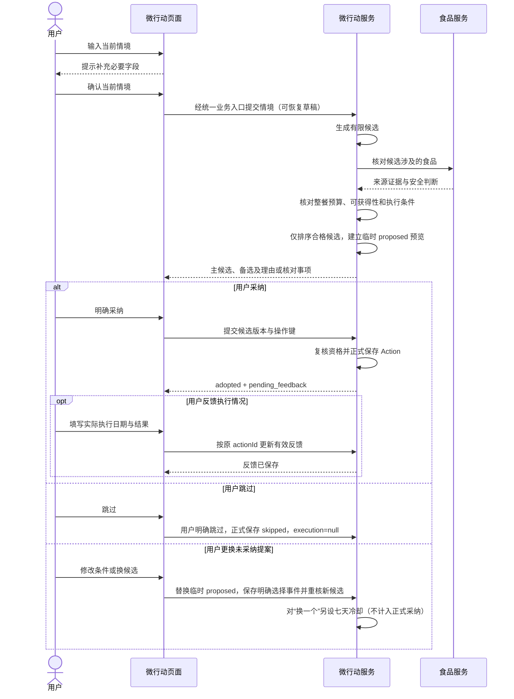

```json
{
  "action": {
    "actionId": "act_001",
    "contextSnapshotRef": "ctx_001",
    "dimension": "substitution",
    "triggerCue": "点午餐饮品时",
    "behavior": "把含糖饮品换成已确认可获得的白水",
    "effort": "low",
    "candidate": {
      "candidateId": "cand_001",
      "candidateKey": "drink_substitution_to_water",
      "qualification": "eligible",
      "foodEvidenceRefs": ["fes_water_001"],
      "profileVersion": "profile_v7"
    },
    "decision": "adopted",
    "execution": "pending_feedback",
    "decisionAt": "2026-11-17T04:00:00Z",
    "feedbackWindow": {"endsAt": "2026-11-18T04:00:00Z", "timezone": "Asia/Shanghai"},
    "performedAt": null,
    "feedbackHistory": [],
    "ruleVersion": "action-rule-v2"
  }
}
```

　　示例反馈窗口仅用于展示字段，实际时间由行动时机决定。系统分别保存用户自述的执行时间和反馈提交时间，以支持第 2.6 节的统计。

### 2.5 计划、清单、库存与实际餐食

　　计划保存未来安排，清单记录采购与准备进度，库存表示用户确认的余量，餐食记录保存实际发生的自述。四者可以关联，但不互相代替（SRS：BR-017～021、NFR-024）。

#### 计划版本与当前有效餐次

　　`PlanItem` 表示一天中的一餐，可包含多种食品。`PlanVersion` 被确认不意味着所有餐次都生效；计划与清单服务通过 `ActiveMealSlotRef` 为每位用户的每个“日期＋餐次”保存唯一当前安排及生效、失效时间。预览仅展示已知的预计营养及其覆盖范围。**确认或启用计划前**，系统重新核对当前档案约束、食品证据、整餐预算、可获得性和重叠餐次；条件发生变化时保留草稿，提示用户核对后再确认。

| 操作 | 当前有效餐次及历史处理 | 清单影响 |
| --- | --- | --- |
| 保存一日或七日计划草稿 | 不改变当前有效映射 | 不变 |
| 确认无冲突的计划 | 重新校验当前档案、食品和整餐预算后，用户确认激活相应餐次引用 | 可按有效餐次生成清单 |
| 确认与已有计划重叠的条目 | 展示重叠日期和餐次，由用户逐项选择替换或保存备选；不会默认覆盖 | 仅被替换餐次涉及的清单失效 |
| 修改同一份计划 | 追加版本；用户确认后将原版本仍生效的对应餐次绑定到新版本，并明确处理删除或变化的条目 | 相关清单重新核对；旧版本按保存规则留作历史引用 |
| 保存但不启用的备选计划 | 保存前须通过本次计划确认校验；可为 `confirmed` 但不进入有效映射，启用时按最新条件再次核对 | 未启用条目不生成当前需购量 |
| 删除当前有效计划 | 不自动恢复曾被替换的旧安排；相应餐次暂时无当前安排，待用户重新选择 | 相关清单不再有效 |

　　`PlanVersion.status` 表示版本确认状态，实际生效餐次由 `ActiveMealSlotRef` 决定。餐食有明确的历史 `sourcePlanRef` 时优先按它解释来源，不受事后计划换版影响；历史映射及版本仍遵循数据保存期限。

#### 采购清单与共享库存

　　单计划清单保存采购与准备进度，跨计划采购则依据当前有效餐次和库存生成**只读实时汇总**，不另存第二份清单。跨计划差额必须从去重后的食材需求重新计算，不能相加各清单已扣过库存的差额。用户只选择部分采购日期时，还需先估算更早、尚未执行的有效计划对共享库存的预计使用。以下公式适用于所选范围覆盖相关未来需求、且库存均能用于对应餐次的简单情况：

\[
\text{总需购量}_i=\max\left(\sum_{s\in\text{期间内去重有效餐次}}\text{食材 }i\text{ 的需求量}_s-\text{可用库存量}_i,\ 0\right)
\]

　　例如，两餐各需鸡肉 200 g，现有库存 250 g 且到两餐时均有效，则总缺口为 `max(400−250,0)=150 g`。若只查询后一餐，须先考虑前一餐预计使用 200 g，此时后一餐可用余量约 50 g，参考缺口仍为 150 g。较早餐次的需求只影响库存估算，**不计入本次采购量**；实际库存不因计划而扣减。食材、数量或单位未知时不生成精确差额。

　　同种食材的不同有效期批次分别记录。从库存核对时点起，按未来餐次顺序估算使用，每餐优先使用当时尚有效且更早到期的批次；同一批次只能抵扣一次。例如 18 日、20 日分别需鸡肉 200 g、100 g，库存 100 g 于 18 日到期、200 g 于 25 日到期，则两餐均可覆盖。此过程只估算缺口，不预占或扣减真实库存。有效期未知时可展示数量参考，但应提示核对未来日期的可用性。

| 库存信息 | 清单计算与显示 | 用户操作 |
| --- | --- | --- |
| 已确认数量、单位兼容，且在相应计划用餐日期仍可用 | 对适用日期需求汇总后计算非负差额，记录核对库存版本或 `updatedAt` | 可确认或编辑 |
| 数量未知或单位不可比 | 受影响数量差额保持未知；已知部分不冒充全量 | 核对数量或单位 |
| 有效期未填写（SRS 允许留空） | 可展示**仅依据数量计算的参考差额**，同时标注“未来餐次可用性未核对”；不得称为已确认需购量 | 用户按预计使用日期核对；不强制为所有库存补有效期 |
| 已知在计划使用前过期 | 不抵扣该餐次需求；跨日期汇总时不重复抵扣其他餐次 | 核实日期或调整计划 |
| 用户标记“充足”（`sufficient`） | 只表示用户的定性判断，不自动覆盖计划需求 | 可确认“足以覆盖这些具体需求”，但不产生精确库存量 |
| 用户标记“少量”（`low`） | 提示偏少，数值差额仍未知 | 核对或手动加入采购项 |
| 用户确认“用完”（`empty`） | 可将已确认可用余量视为 0 | 按已知需求显示需购量 |

　　已保存的单计划清单记录所覆盖餐次、计划版本和库存核对时间或版本。计划、需求或库存变更后，旧差额标为待重算；跨计划页面每次重新计算。“已购”和“已准备”只代表进度，入库必须由用户另行确认品种、数量与单位。

　　单计划清单允许用户新增项目、改数量或移除项目。系统保留原建议需求和用户手工调整，不能将编辑清单等同于修改计划或库存。重算时展示“原建议—新建议—手工调整”的差异，保留已购和已准备状态，由用户处理冲突。库存记录删除后不再抵扣原数量，无法核对的余量标为待确认；跨计划汇总仍为只读（SRS：UC-06、FR-018/019）。

　　用户确认实际用餐后保存 `MealRecord`，默认不扣库存。可计算的营养小计保存当时使用的份量、字段值、计量基准、来源及版本，来源更新不改写旧估计；用户修正记录时生成新有效版本。依据删除、到期或撤权后，相应历史营养字段改为不可计算。用户另行确认扣库存时，须核对单位、库存版本和可用数量；数量未知、单位不可比或拟扣量超出库存时停止扣减，餐食自述仍然有效。后续修正或删除餐食，不自动撤销用户此前单独确认的库存调整。

| 用户动作 | 计划与有效餐次 | 清单 | 库存 | 实际餐食 |
| --- | --- | --- | --- | --- |
| 编辑或保存备选计划 | 未确认替换前不影响当前映射 | 不变 | 不变 | 不变 |
| 确认激活或替换餐次 | 更新映射及可追溯时间 | 受影响差额待重算 | 不变 | 历史来源不改写 |
| 勾选已购、已准备 | 不变 | 更新进度 | 不变 | 不变 |
| 用户确认采购入库 | 不变 | 进度独立保留 | 核对数量后更新 | 不变 |
| 从计划预填 | 不变 | 不变 | 不变 | 仅形成可取消草稿 |
| 确认实际用餐 | 不变 | 不变 | 默认不扣减 | 新增用户确认的实际记录 |
| 用户另行确认扣减 | 不变 | 相关差额待重算 | 数量和单位校验通过后更新，禁止负库存 | 不变 |

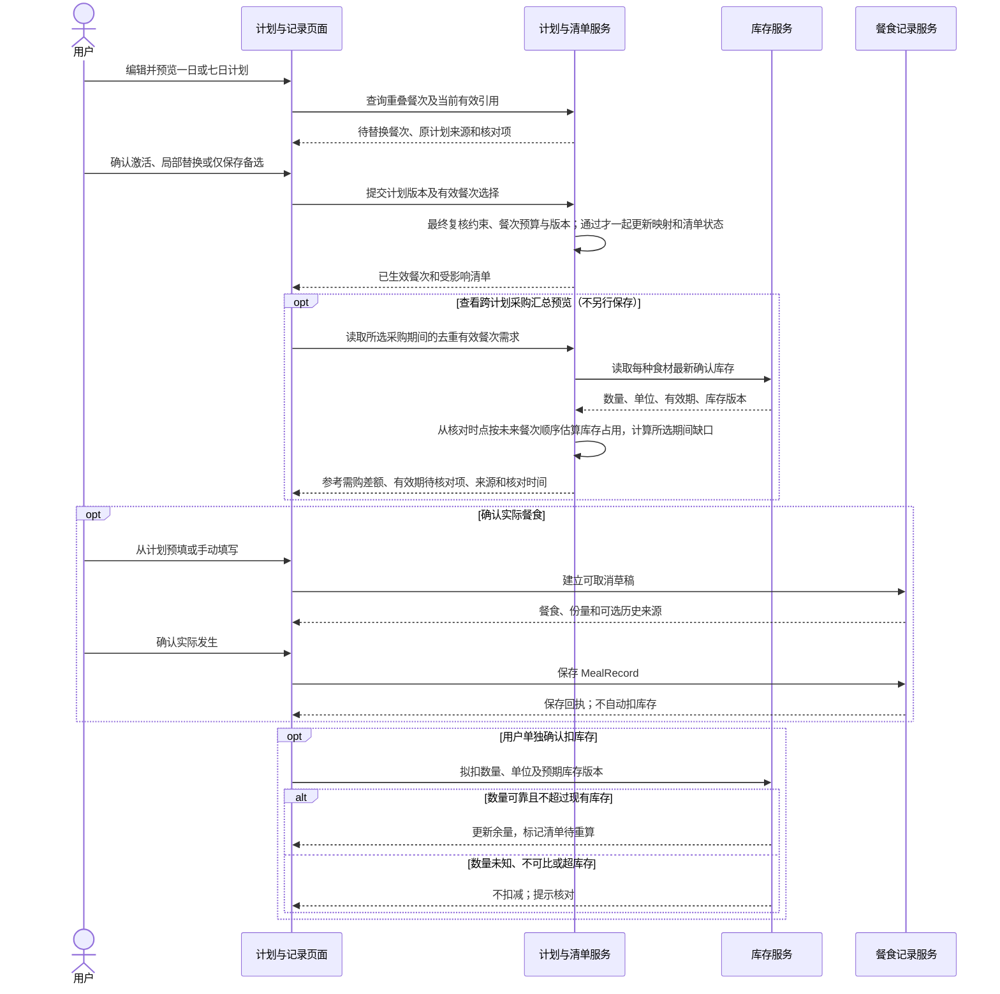

　　下面是尚未手工调整的单计划清单示例。鸡肉库存可用于该餐次，燕麦饮的数量仍待确认。同一 `PlanItem` 可以包含多种食材，因此多个食材条目可引用相同的 `sourcePlanItemId`。此处计算的是单计划范围内的参考差额。

```json
{
  "shoppingList": {
    "listId": "list_001",
    "planRef": {"planId": "plan_12", "version": 2},
    "coveredSlots": ["2026-11-18:dinner"],
    "stockCheckedAt": "2026-11-17T03:00:00Z",
    "items": [
      {
        "ingredientId": "chicken",
        "required": {"value": 300, "unit": "g"},
        "confirmedInventory": {"inventoryItemId": "stock_chicken_01", "value": 200, "unit": "g", "expiresOn": "2026-11-20", "updatedAt": "2026-11-17T02:30:00Z"},
        "gap": {"value": 100, "unit": "g", "status": "available"},
        "sourcePlanItemIds": ["plan_item_1"],
        "purchaseStatus": "todo", "preparationStatus": "todo"
      },
      {
        "ingredientId": "oat_milk",
        "required": {"value": 500, "unit": "mL"},
        "confirmedInventory": {"inventoryItemId": "stock_oat_01", "value": null, "unit": "mL", "quantityBand": "low", "updatedAt": "2026-11-17T02:40:00Z"},
        "gap": {"value": null, "unit": "mL", "status": "unknown"},
        "sourcePlanItemIds": ["plan_item_1"],
        "purchaseStatus": "needs_confirmation", "preparationStatus": "todo"
      }
    ],
    "status": "active",
    "ruleVersion": "shopping-rule-v2"
  }
}
```

### 2.6 阶段回顾：在可靠范围内帮助用户决定下一步

　　阶段回顾帮助用户了解已有的餐食记录、计划与准备情况、微行动决定和执行反馈，并据此选择下一步。每项观察都能查看来源、统计范围和未知信息，用户可以确认、修改或跳过建议。

　　回顾服务依照用户时区和读取授权，汇总各服务的最新有效记录，计算事实与覆盖度后生成待核对线索。记录修改、删除或撤权后，相关结果需要重新计算。历史营养优先采用餐食确认时保存且仍可合法使用的计算依据；依据失效时，相应字段转为不可计算。

　　回顾服务依据获授权的记录形成情境线索：聚餐前后的变化可提示用户核对是否属于特殊用餐；较长记录间隔需询问是漏记还是确实误餐；多日进食时间变化可询问近期作息是否调整。页面展示相关记录、时间范围和未知项，由用户确认、否认、标记“仅本次”或删除；确认过的信息才可预填下一次任务，不自动改写长期偏好或硬约束（SRS：5.6.1、AT-21）。

#### 四类回顾内容及其用途

| 回顾内容 | 用户看到的事实 | 典型下一步及所需依据 |
| --- | --- | --- |
| 手边的余地 | 当前有效计划的食材需求、已确认库存、可计算差额与未知项 | 对有据可查的差额进入清单；对库存未知项进入核对 |
| 日常的节奏 | 已报告餐食、与计划的关系、已知营养汇总及字段覆盖度 | 记录缺失时补记；对重复时间障碍先询问原因，再提供低准备负担候选 |
| 小行动的尝试 | 期间内的正式采纳、跳过和精简的明确换候选/修改事件；不将采纳称为完成 | 由 `Action` 和 `CandidateDecisionEvent` 分别提供统计来源；可继续一个自选行动或调整候选类型 |
| 执行与调整 | 已反馈的完成、部分和未完成，以及反馈未知、反馈覆盖率 | 查看原行动、补充迟到反馈或修改下次的执行条件 |

　　原型中后两张卡片仍使用“一起吃的关系”“正在变好的方向”。目标界面将分别改为“小行动的尝试”“执行与调整”，使名称与实际内容对应；图片仍保留原样。

#### 统计范围与计算规则

　　下表分别定义餐次、营养和行动反馈的统计范围及时间口径。

| 指标 | 计算与展示规则 | 关键边界 |
| --- | --- | --- |
| 餐次记录覆盖率 `C` | **用户确认的预期槽位集合中**有至少一条有效自述的去重槽位数 ÷ 预期槽位数 | 预期集合未确认、为 0 或不可得时 `C=unknown`；额外加餐单列，不加入分子，比例不会超过 100%；缺记录不代表没吃 |
| 营养可计算覆盖率 `N` | 该期间**纳入该营养字段汇总的已报告食品条目**中，份量与记录时保留且当前仍可用的字段依据均可计算的条目数 ÷ 所有相关已报告食品条目数 | 分母包含份量未知、字段缺失、冲突或历史依据已失效的条目；分母为 0 时标记“不适用”，不显示 0%；不同字段分别算，未知不按 0，已知小计不冒充全天摄入 |
| 计划与实际关联 | 已记录餐次优先为 `explicit_source`（可解析的明确历史引用）；无引用时可依**餐食发生时的映射历史**标记 `same_slot_unlinked`；当时可确定无计划才标 `record_only`；另列 `plan_only` | 历史映射或引用已删除、不可追溯时标 `unverifiable`，不把当前计划当过去计划，也不推断用户没有吃饭；预期槽位两者都无则只算未记录 |
| 每周自述已完成行动数 | 按用户时区自然周、用户自述**执行日期**统计最新有效 `complete`，按用户和 `actionId` 去重 | 采纳、部分完成、未知均不增加该数；迟到反馈按执行日修正相应周 |
| 反馈覆盖率 | `R/E`：`E` 为**反馈窗口在本周结束**的已结束去重采纳行动，`R` 为其中已有有效执行自述的行动 | `unknown` 留在分母但不在分子；未结束窗口不进入本周队列 |
| 已反馈者完成比例 | `D/R`：`D` 为同一结束窗口队列中自述完成的行动 | 与反馈覆盖率共享 `E` 队列，不与按执行日归周的完成数直接比较 |
| 候选修改与更换次数 | 仅统计 `CandidateDecisionEvent` 中明确的 `switched`、`modified` 事件，按操作时间及唯一事件 ID 去重；采纳、跳过仍由正式 `Action` 统计 | 排序重置事件不计入换候选次数；不读取过期草稿或冷却状态反推历史，关闭页面不计数 |

　　连续完成周以用户自述执行日期为准：某周至少有一项有效完成行动，才计为完成周。经用户确认的特殊情境可按 SRS 规则冻结连续周显示，但不补造完成记录。只有偏离及恢复时间均可追溯时，才展示恢复周期；缺少依据时保持未知。

　　用户选择回顾期间后确认或修改预期餐次槽位。未确认时只展示已记录事实，不计算覆盖率。展示档位沿用 SRS 第 5.6.2 节：`C<40%` 或未知时仅列事实，`40%≤C<70%` 时描述已记录范围，`C≥70%` 时可展示该范围内的周期观察。任何档位都须显示来源和数据范围，不据此推断未记录餐次或健康改善。

　　同一餐次有多条记录时，覆盖率仍只计一个槽位。来源不一致则列出各自引用并提示核对，不强行合并。行动分别保存采纳、执行、反馈窗口结束和反馈提交时间：完成数按执行日归周，反馈覆盖按窗口结束日归周；执行日期未知时不能用提交日期代替。

#### 从观察到下一步：有限规则与用户确认

| 可核对的条件 | 应向用户表达什么 | 下一步如何产生 |
| --- | --- | --- |
| 两次已记录晚餐的相关行动均明确自述“时间不足” | “这两次晚餐都报告了时间困难；是否需要减少准备步骤？” | 用户确认后预填下一次低准备负担候选；不推断计划发生过变化或用户身心状态 |
| 已结束的三次采纳行动都未报告执行结果 | “目前无法判断这些行动是否完成” | 显示相关 `actionId`，允许逐项补充迟到反馈；调整提醒时机须用户选择 |
| 某食材有已购标记，当前清单仍显示未知或低库存 | “采购进度与库存记录可能尚未对齐” | 跳转库存核对，确认数量后再重算清单，不自动补库存 |
| 用户明确反复选择同一类行动 | “你似乎更愿意尝试这种做法，是否作为以后候选偏好？” | 只产生待确认 `PreferenceRule`，不能修改硬约束或历史执行状态 |

　　每条线索包含来源记录、期间与规则版本。用户可以查看依据、接受并预填、修改条件或暂不处理。预填只涉及时间、准备负担等任务条件；新任务仍须核对过敏、硬忌口、授权及食品证据。

```json
{
  "review": {
    "sourceVersions": {"profileVersion": "profile_v7", "ruleVersion": "review-rule-v2"},
    "period": {"start": "2026-11-09", "end": "2026-11-15", "timezone": "Asia/Shanghai"},
    "mealCoverage": {"recordedExpectedSlots": 6, "confirmedExpectedSlots": 10, "extraRecordedSlots": 0, "ratio": 0.6, "displayLevel": "recorded_scope_only"},
    "nutritionCoverage": {"energy": {"calculableEntries": 5, "relevantEntries": 8, "ratio": 0.625, "knownSubtotalKcal": 1420}},
    "planAlignment": {"explicit_source": 3, "same_slot_unlinked": 1, "record_only": 2, "unverifiable": 0, "plan_only": 1, "neither_recorded_nor_planned": 3},
    "completedActionsByPerformedWeek": 2,
    "actionFeedbackByWindowEndWeek": {
      "closedAdoptions": 8,
      "validFeedback": 5,
      "complete": 3,
      "partial": 1,
      "notDone": 1,
      "unknown": 3,
      "feedbackCoverage": 0.625,
      "completionAmongFeedback": 0.6
    },
    "adoptedActionsByDecisionWeek": 6,
    "candidateChangesByDecisionWeek": {"switched": 2, "modified": 1, "sourceEventIds": ["change_001", "change_002", "change_003"]},
    "insights": [
      {
        "rule": "repeated_time_obstacle",
        "evidence": [
          {"mealRecordId": "meal_003", "mealSlot": "2026-11-11:dinner", "actionId": "action_004", "reportedObstacle": "time_shortage"},
          {"mealRecordId": "meal_004", "mealSlot": "2026-11-12:dinner", "actionId": "action_005", "reportedObstacle": "time_shortage"}
        ],
        "text": "已记录的两次晚餐都提到时间困难，是否需要减少准备步骤？",
        "nextStep": {
          "targetTask": "micro_action",
          "prefill": {"mealSlot": "dinner", "effortPreference": "low_prep_time"},
          "requiresUserConfirmation": true
        }
      }
    ],
    "sourceRecordIds": ["meal_001", "meal_002", "meal_003", "meal_004", "meal_005", "meal_006"],
    "sourceActionIds": ["action_001", "action_002", "action_003", "action_004", "action_005", "action_006", "action_007", "action_008"],
    "sourceCandidateDecisionEventIds": ["change_001", "change_002", "change_003"]
  }
}
```

　　示例有 10 个已确认预期槽位：其中 6 个有记录（3 个明确计划来源、1 个历史同槽位匹配、2 个当时无计划），另有 1 个仅有计划、3 个未记录且无计划。两次晚餐的时间困难分别关联 `meal_003`、`meal_004` 及对应行动记录。完成、反馈覆盖和采纳按各自时间口径归周；营养 1420 kcal 是 5 个可计算食品条目的已知小计，不代表一周全部摄入。

## 3. 系统架构与关键设计选择

### 3.1 逻辑架构与职责

　　DietLens 采用模块化单体：七个领域服务在同一应用中运行，各自维护业务规则，经统一接口协作并使用本地事务完成相关写入。这适合当前团队规模，也能保持对象归属与历史数据的一致性；跨服务的读取不授予其他模块写入权限。

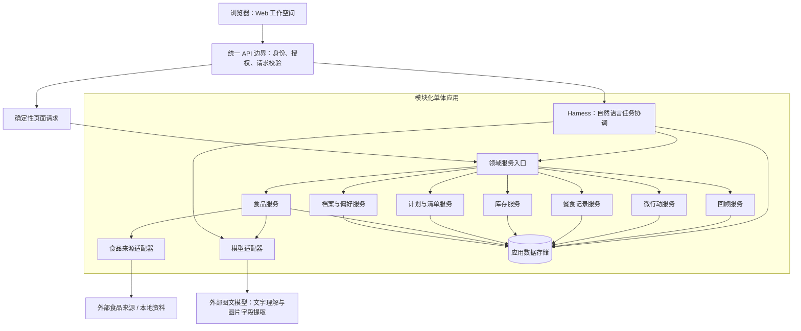

　　文字与经用户单独授权的图片通过统一 API 进入系统。模型适配器提取图片字段候选，再交由食品服务核对；现有原型只支持图片本地预览。侧栏页面直接发起确定性业务请求，自然语言入口由 Harness 组织任务和草稿；两者最终使用相同的业务检查与确认规则。

　　食品服务提供证据，计划与微行动结合具体餐次作决定；计划与清单服务读取库存，库存修改仍由库存服务负责；餐食记录保存用户自述；回顾在授权范围内读取这些记录。Harness 管理任务步骤和工具调用，业务服务承担安全、计算和写入。

### 3.2 Agent、工具与用户确认

　　Agent 主要用于处理跨功能任务。例如，“午餐吃了牛肉面，帮我想想今晚怎么调整”可被解析为餐食记录草稿与晚餐建议两项操作。图文模型可提取用户授权图片中的待核对字段，食品身份、安全、预算及正式写入仍由领域服务判断；解析失败时提供手动输入。

| 工具或操作 | 性质 | 关键输入和返回 | 用户确认与边界 |
| --- | --- | --- | --- |
| `profile.read` | 只读 | 授权用途、约束版本 → 允许读取的档案字段 | 仅返回该任务需要的授权信息 |
| `food.parse` / `food.search` / `food.assess` | 解析/查询/计算 | 文字或获授权的图片、用途、档案版本 → 待核对字段、来源与各维度判断 | 图片解析不自动视为事实；关键安全信息不足时，不产生受影响推荐 |
| `food.compare` / `menu.preview` | 只读计算 | 至少两个食品与比较口径，或菜单组成、整餐预算及可获得性 → 并列比较或合格菜单候选 | 同口径换算；套餐按整餐计算，未知或超限不进入合格排序；不自动写计划或记录 |
| `plan.preview` / `plan.confirm` | 预览/写入 | 日周计划及重叠餐次 → 草案、有效安排及保存回执 | **最终确认前**复核当前档案、食品证据、整餐预算及重叠餐次，变化则重新确认 |
| `shopping_list.preview` / `confirm` / `edit` | 预览/写入 | 单计划或跨计划的有效餐次、库存与需求 → 计算差额；单计划清单及预期版本 → 手工新增、改量、移除的回执 | 跨计划**仅实时预览**；保存和编辑仅作用于单计划清单，重算需展示差异，不自动修改库存 |
| `inventory.update` | 写入 | 食材、数量、单位、预期版本 → 更新结果 | 不因采购勾选或餐食记录隐式入库、扣库 |
| `meal_record.preview` / `confirm` | 预览/写入 | 用户自述或计划预填 → 草稿或实际记录 | 草稿不增加实际记录；确认后才写入 |
| `action.preview` / `decide` / `feedback` | 预览/写入 | 情境、候选、决定或自述 → 行动状态 | 候选生成、采纳与执行反馈是不同操作 |
| `review.read` | 只读 | 期间、时区、授权 → 结构化回顾结果 | 不允许模型补造事实、分母或健康结论 |

#### 复合意图的一次交互、多项业务决定

　　`Draft Bundle` 用于暂存一次自然语言请求涉及的多项草稿，例如待确认的午餐记录和晚餐候选。页面分别显示两项操作及其确认含义：

1. 用户核对并确认午餐自述，系统才保存 `MealRecord`；取消时不产生记录。
2. 晚餐建议只产生随临时任务草稿保存的 `proposed` 候选预览（`execution=null`），**不产生正式的采纳或跳过记录**。
3. 用户另外点击“采纳”或明确“跳过”时，才由微行动服务保存相应的正式 `Action` 决定；采纳后进入 `pending_feedback`。此时仍不表示已经完成。

　　用户可只保存午餐、只请求晚餐建议或分别完成两项。Harness 负责接收用户确认和业务写入结果，更新 `Task` 的进度及恢复位置。餐食保存与相应任务进度、回执在同一本地事务内提交；随后生成建议是独立、可重试的步骤。候选生成失败不撤销已保存的餐食，恢复时先按原操作键查询回执。侧栏的确定性页面使用同一业务规则，但不必建立 Harness 任务。

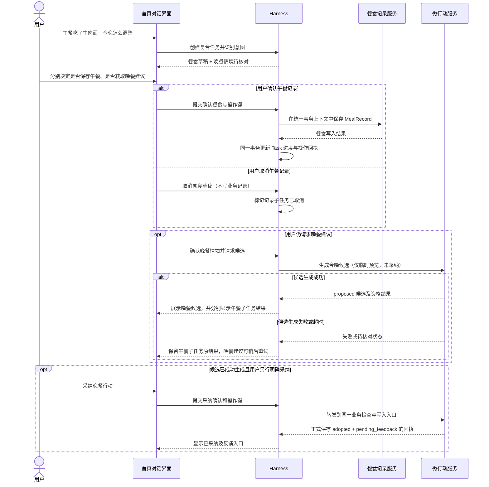

#### 记忆与护栏

| 记录类别 | 保存内容 | 使用限制 |
| --- | --- | --- |
| 已确认档案 | `ProfileVersion`、硬约束、授权和用户确认的长期偏好 | 按当前授权和用途读取；变更须重新核对受影响候选 |
| 当前情境 | `ContextSnapshot`、当前障碍与可选项 | 只在相应任务或用户授权的历史分析中使用 |
| 行动决定、选择与重置事件、短期冷却 | 正式 `Action`、精简 `CandidateDecisionEvent`（含换候选和重置）及独立的七天冷却信号 | 稳定 `candidateKey` 按情境识别同类候选；重置使旧派生权重失效，不删历史执行；授权和期限分别约束回顾与排序 |
| 临时任务或会话状态 | 自然语言任务的 `Task` 草稿；确定性页面关联统一 `taskId` 的 `draftId`、用户归属、期限和恢复位置 | 两种入口的已确认写入都能按 `taskId` 查询；草稿不等于正式 `Action`，恢复后重新核对，最长七天清理 |

　　模型结果先检查字段格式、对象归属和当前授权；图片外传须提前确认用途、接收方与期限。食品任务较复杂时，先限定核对范围，再按步骤预算调用模型和工具，超过上限转为手动处理。模型请求开始后，界面应在 **1 秒内显示处理状态**，15 秒内返回结果、部分结果或手动路径。调用日志记录 `taskId`、模型、计费量、费率版本、耗时、状态及费用，未获准确数据时标注未知或估计（SRS：NFR-004/009）。每步骤工具调用最多 3 次、模型最多 2 次、瞬时只读重试最多 1 次，时限 15 秒；周计划最多 3 步、45 秒。会话付费预算达 80% 时提示，达 100% 时停止付费调用；无有效费率或预算配置也不发起付费调用（SRS：NFR-010、第 7.4 节）。写入、删除、图片外传、计划替换和行动采纳均须用户明确确认；失败时保留已确认内容。

### 3.3 一致性、失败恢复与数据生命周期

　　本地事务按照需要同时保存的业务对象划分：

| 业务情境 | 必须保持的关系 | 设计处理 |
| --- | --- | --- |
| 确认或替换计划餐次 | 新计划版本、当前有效餐次及受影响清单状态一致 | 在一个本地事务中更新相关引用并标记清单过期；旧来源版本保留 |
| 保存餐食记录 | 一条自述记录、任务进度及唯一操作回执一致 | 取消不写入；重试同一操作键不重复创建 |
| 采纳或修正行动 | 同一 `actionId` 的最新有效状态和反馈历史一致 | 采纳不增加完成数；迟到反馈更新原行动而非新建行动 |
| 更新或删除库存 | 用户确认的数量、版本与受影响清单的计算依据一致 | 先校验单位和旧版本；入库、调整、删除后使旧差额失效，重新计算时保留手工调整并显示差异 |
| 复合意图只请求建议 | 推荐候选不构成业务采纳写入 | 仅提交用户确实确认的事实；失败时仍可重做候选生成 |

　　外部模型和食品来源调用在数据库事务之外进行。计算结果先进入可恢复草稿；用户确认后，相关领域对象、任务进度和操作回执在同一 ACID 事务中提交。`Unit of Work` 用于组织这类本地写入。

　　每次写入记录 `userId`、`taskId`、业务对象、预期修订号 `expectedVersion`、`operationKey` 和操作时间；页面草稿另保留对应 `draftId`。服务在一个事务中比较对象当前修订号与 `expectedVersion`，匹配才更新并递增修订号；同一修订号的并发修改只能有一次成功，其余返回冲突并展示新值。`PlanVersion.version` 用于历史引用，不替代并发修订号。回执不明时先按原 `operationKey` 查询，避免重复写入；对象已变化则保留草稿供用户重新核对。

| 失败或异常 | 用户能够看到的结果 |
| --- | --- |
| 食品来源部分失败 | 保留已经取得的字段，标明“无匹配”“未知”或“暂时无法读取”；关键未知仍不能推荐 |
| 模型超时或预算用完 | 说明失败，返回手动填写或确定性规则路径，保留已确认内容 |
| 计划与库存并发修改 | 提示对象发生变化、展示当前值，原草稿可重新核对 |
| 采纳后一直没有反馈 | 反馈窗口结束后记为 `unknown`，后续仍允许提交迟到自述 |
| 撤回历史分析或删除对象 | 停止受影响的读取及派生推荐，重算或移除相应回顾；不把已经外传的数据说成可自动收回 |

　　数据按 SRS 的 NFR-014 清理：临时图片不超过 24 小时、任务临时状态不超过 7 天，计划、清单、库存变更、餐食、行动及反馈等业务记录原则上不超过 180 天（用户续期除外）。候选冷却到期不影响仍在合法期限内的选择事件。为解释历史结果，在允许期限内保留必要的计划版本、餐次映射及营养计算依据；来源删除或撤权后，不再利用该资料推导回顾。外部调用日志与任务草稿分别按其保存和脱敏要求处理。

### 3.4 部署方式与技术选择

　　演示阶段采用浏览器前端、FastAPI 模块化服务和 SQLite；共享部署时计划迁移到 PostgreSQL/Supabase，并加入服务端身份认证、数据归属控制和 TLS。外部模型凭据只保存在服务端。数据库迁移属于后续工作，仍需验证并发、事务和数据迁移。

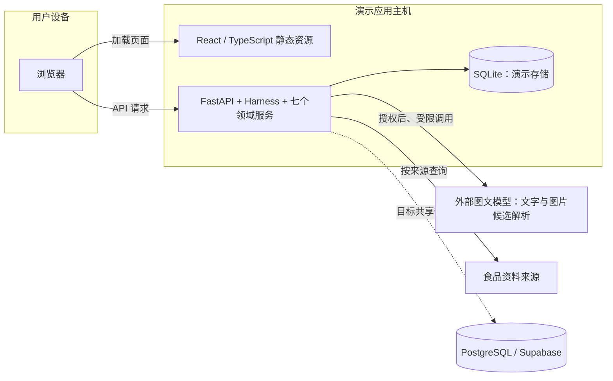

| 技术位置 | 选择及用途 | 当前需要承担的代价 |
| --- | --- | --- |
| 前端 | React、TypeScript、Vite；管理草稿、业务页面和交互状态 | 需维护表单状态与重新确认路径 |
| 服务端 | Python、FastAPI；同一应用中的领域服务及 Harness | 模块共享发布和故障域，应隔离慢调用的资源消耗 |
| 存储 | 演示 SQLite；共享使用时考虑 PostgreSQL/Supabase | 迁移时需验证事务、并发控制和数据迁移，不宣称无需修改 |
| 模型 | 通过可替换适配器进行意图理解、可选图片字段提取和有限解释 | 图片须分项授权；解析结果仅为待核对字段，必须有手动回退 |
| 食品资料 | Open Food Facts 与可用的本地食品资料 | 本地菜单和非标准菜品覆盖有限，字段缺失不可伪造 |

### 3.5 关键架构选择与取舍

| 设计选择 | 考虑过的替代方式 | 为什么采用当前方案 | 代价及待验证点 |
| --- | --- | --- | --- |
| 模块化单体与七个领域服务 | 将每项业务拆为独立微服务，或全部逻辑集中在一个大模块 | 业务相关操作较多，团队规模有限；模块化单体同时保留职责边界和本地一致写入能力 | 模块共享故障域；需验证慢调用不会拖慢普通任务 |
| 模型负责图文理解，领域服务负责判断与写入 | 让模型直接决定食品资格、计算统计并调用写入 | 图文解析只能生成候选，安全、预算、统计口径和授权需可复核，用户还需核对字段与草稿 | 增加部分确认操作；需验证图片解析错误、文字和手动回退 |
| 来源记录与字段证据分开 | 只保存一个合并食品对象，或直接依赖当前接口响应 | 不同食品版本和来源可能冲突；分层后可追溯每条判断的依据 | 证据保存和更新较复杂；需确定最小保存字段及期限 |
| 计划、库存、实际餐食和行动独立保存 | 一张综合饮食表同时承担计划和执行 | 不同事实的确认人、修改时机和统计含义不同，分开可避免互相覆盖 | 查询必须解析引用；需处理重叠计划和历史版本 |
| 业务回顾使用规则计算、模板呈现 | 直接让模型阅读历史并生成总结 | 分母、覆盖度、来源和状态能够固定复核；模型可选用于解释语言 | 初期规则可能简单或过于保守，需要用户研究检验其价值 |

　　设计优先保证安全与授权，其次是状态正确、恢复能力、响应时间和操作负担。非模型读写按 SRS 的 20 并发、P95 不超过 2 秒验证；模型步骤按 15 秒内返回结果或手动路径验证。

## 4. 需求细化与应对变更

### 4.1 从 Part I 到 Part II 的变化

　　Part I 已提出主要业务和安全要求。下表区分原需求的设计落实、进一步细化和 Part II 新作出的设计选择，并说明原因及影响。

| 编号及性质 | Part I 依据 | Part II 的处理及原因 | 影响范围 |
| --- | --- | --- | --- |
| C1 · 设计落实 | UC-02～04、BR-001～003、FR-012/015/016、NFR-006～008 | 用可选图片的待核对字段、同口径比较、菜单整餐筛选及来源与分维度判断落实食品用例；关键未知拦截，事实记录独立 | 食品、计划、微行动、模型适配器、UI |
| C2 · 设计落实与细化 | UC-01/09/10/12、FR-005、SRS 5.6.1/5.6.3 | 可跳过的首次情境校准及回顾中需用户核对的情境线索；区分临时提案与正式采纳，保留明确选择和重置事件；冷却、提醒退避与可回放排序分开处理 | 微行动、档案、回顾、UI |
| C3 · 新增设计选择 | UC-05/06/07、BR-017～022 | 引入带变更时间的唯一有效餐次引用，区分计划确认与局部生效；按历史映射解释过去，避免重叠计划与清单歧义 | 计划、清单、餐食、回顾 |
| C4 · 设计落实与细化 | UC-06/14、FR-018/019、NFR-024 | 清单支持手工编辑、重算时保留修改并预览差异；定性余量只作提示，跨计划采购实时预览按未来餐次估算共享库存，核对版本并阻止负库存 | 库存、清单 |
| C5 · 设计落实 | UC-07/08、BR-013/024、SRS 5.6.2 | 计划来源采用历史版本引用，餐食覆盖度分母须用户确认，营养字段覆盖单独统计 | 餐食记录、回顾 |
| C6 · 设计细化 | SRS 3.4、UC-08/10 | 分别采用执行日期、反馈窗口结束日期和采纳日期，明确各统计所用时间及用户时区 | 微行动、回顾 |
| C7 · 新增交互细化 | UC-11/12、NFR-011/026 | 复合意图采用组合草稿，写入与生成候选分步处理；Harness 接收回执并恢复任务，侧栏直接调用统一业务服务 | Harness、记录、行动、UI |
| C8 · 架构落实 | BR-014/015、NFR-004/009/010～016/026 | 通过适配器、对象所有权、操作键、恢复点以及外部调用状态与成本记录管理外部变化和本地写入 | API、数据层、全业务 |

　　新增设计选择与原 SRS 的要求分别标注；Part III 若发现初始选择不成立，应同步修订相关规则与模型，并记录变更原因。

### 4.2 未来需求变化如何影响系统

| 可能的变化 | 预留的边界 | 预计需要调整的地方 |
| --- | --- | --- |
| 增加食品来源 | 每个来源通过适配器给出身份与字段证据 | 增加来源映射、冲突处理和验证样例；若新数据超出当前格式，仍需改食品服务 |
| 改变候选排序或回顾规则 | 规则版本与来源引用随结果保存 | 主要修改规则及对应验证；若改变判断语义，也需同步修改 UI 和数据字段 |
| 更换图文模型或增加语音输入 | 本次已支持可选图片解析，图文模型经适配器接入 | 更换模型或新增语音时调整输入转换；字段核对及确认边界仍需复核 |
| 增加新的行动维度或回顾内容 | 行动与回顾读取已有领域事实，不直接写入其他对象 | 扩充候选规则、必要字段和页面，并检查整餐预算、历史来源与旧统计能否解释 |
| 从本地演示转为共享使用 | 业务对象按用户归属，接口与数据库访问集中 | 需要补齐认证、并发、备份、权限和数据库迁移的验证 |

　　新需求先明确所属业务对象、数据格式和授权范围，再评估受影响的模块及界面。

## 5. UI 与 UX 设计

### 5.1 信息架构与任务入口

　　首页通过文字输入发起食品、计划、记录、微行动和回顾任务；食品工作台还支持授权后的图片识别。侧栏提供食品、计划与准备、库存、实际记录、回顾和设置入口。用户可以单独记录餐食，也可以直接请求微行动。

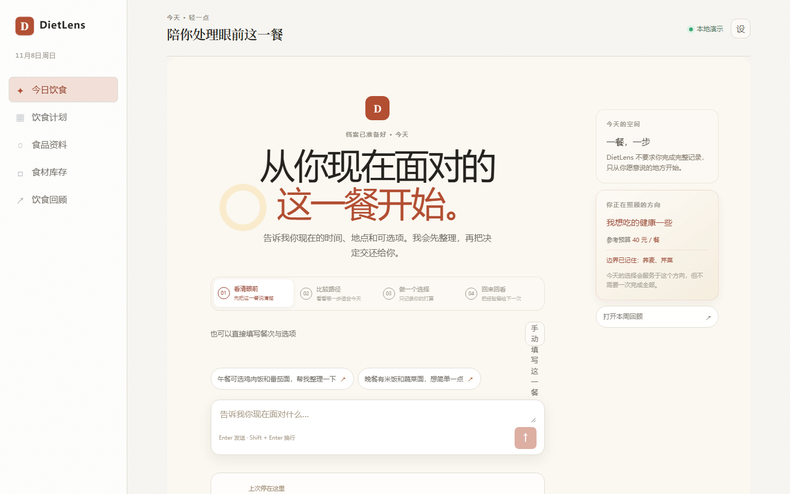

图 5-1：已有首页原型展示自然语言和手动输入入口。复合任务的目标界面应分别标明待确认记录与建议候选。

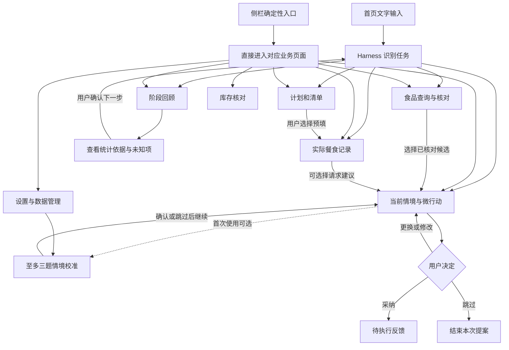

### 5.2 食品、计划和库存的交互

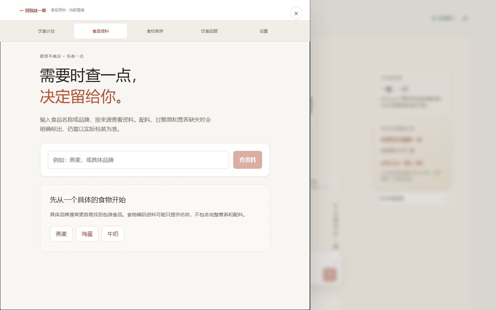

　　食品工作台设“识别食品”“比较食品”“选择菜单”三个入口。图片上传前说明授权事项，识别字段由用户核对；比较页显示统一计量口径、已知数值和不可比项；菜单页展示套餐组成、整餐价格、可选候选及待核对信息。点击结果只预填后续任务。食品详情按安全限制、价格与可获得性、营养字段分组展示来源和未知项；无法核实关键安全字段时提供补充信息或更换候选的入口。

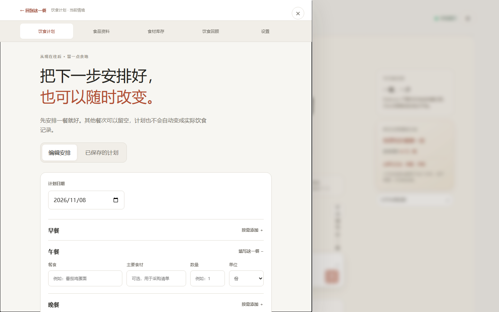

　　计划页分别展示已确认版本和当前有效餐次。确认前重新核对食品、预算和重叠安排；冲突时可逐项替换或保存为备选。单计划清单支持新增、改量、移除采购项及进度记录，跨计划采购提供只读汇总。计划或库存变化后显示建议差额与用户调整之间的变化，由用户确认如何处理。

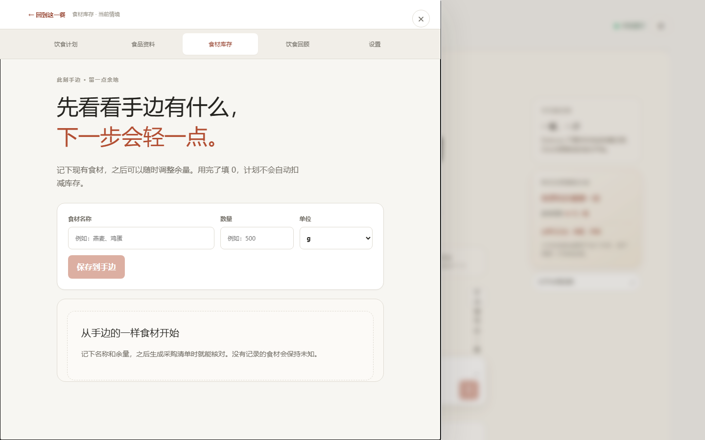

　　库存页支持数量、单位、可选有效期，以及“充足、少量、用完”的定性记录。不同批次分开核对；清单估算按未来餐次和有效期计算，未知有效期显示待核对。采购进度与入库、扣减是独立操作；扣减前显示数量及结果，余额不足时拒绝扣减。

### 5.3 回顾、记录和个人数据控制

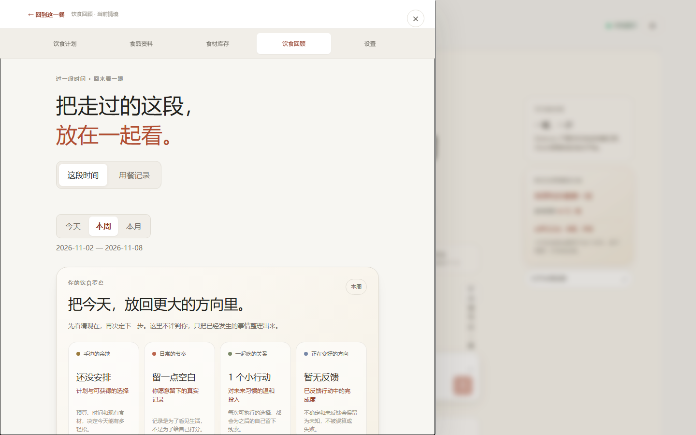

　　回顾页展示“手边的余地、日常的节奏、小行动的尝试、执行与调整”四类信息。原型中的旧卡片名称保留在图片里，目标界面按此更新。用户可确认预期餐次分母，查看记录来源及未知范围，并对特殊用餐、疑似误餐和节律变化等线索选择确认、否认或“仅本次”；确认后才能预填下一项任务。

　　餐食记录支持手动输入或由计划预填，确认后才保存。行动反馈允许填写实际执行日期；记录修正、删除及授权变化后，受影响的回顾随之更新。

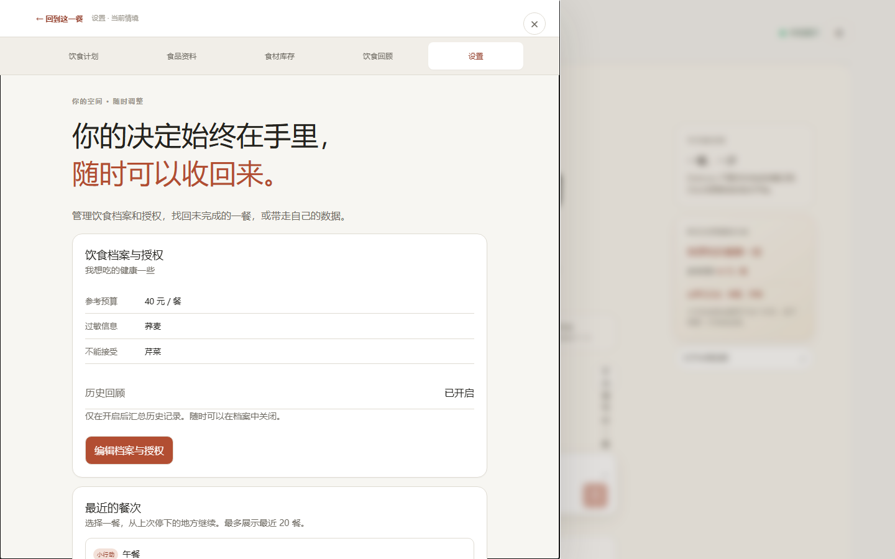

　　首次使用微行动时，可回答最多三道情境题或逐题跳过；确认后才保存。设置页支持修改或删除回答、提醒订阅及退避重置、授权管理、数据导出与删除。任务与页面草稿在授权和期限允许时可恢复，确认前需核对最新条件。

| 页面状态 | 需要展示的内容 | 允许的操作 |
| --- | --- | --- |
| 空数据或首次进入 | 当前可完成的任务、最少必要输入 | 手动填写、查询、创建记录 |
| 请求处理中或超时 | 模型请求发起后 1 秒内显示步骤状态；超时说明已保存内容、失败原因 | 返回、重试只读请求、手动继续 |
| 待确认 | 草稿、来源、可能改变的对象 | 编辑、确认、取消 |
| 食品或图片字段待核对 | 来源、未知/冲突、图片解析字段、受影响用途 | 核对标签或手输、换候选；关键未知时不直接推荐 |
| 微行动待决定或已采纳 | 临时候选与正式采纳分开；明确换候选/修改留精简事件；显示稳定候选类别与冷却说明，采纳后显示反馈窗口 | 草稿可在期限内恢复，关闭不算跳过；可更换、采纳、跳过或稍后反馈 |
| 回顾线索 | 事实依据、分母、未知和建议用途 | 查看来源、确认问题、预填下一步或跳过 |
| 保存结果不明或旧版本 | 原操作回执状态、最新对象信息 | 查询回执、重新核对并确认 |

### 5.4 可访问性与后续界面修订

　　界面沿用暖白背景与深色文字。交互状态同时使用文字和图标说明，主要点击区域目标不小于 44 像素；关键功能支持键盘访问，并提供输入标签与清晰的焦点顺序。按 NFR-021，在 320、390、1440 像素宽度检查横向溢出，并核对键盘操作、标签及对比度是否达到 **WCAG AA** 目标。

　　六张图片对应当前原型。正文新增的交互属于目标设计，后续应按第 2 章规则更新原型并验证。

## 6. 开放问题、风险与 Part III 验证安排

　　Part III 将优先验证与安全、状态一致性及关键用户任务有关的假设，并据结果调整业务规则、交互或数据模型。

| 优先级 | 尚需确认的设计问题 | 可能带来的影响 | Part III 验证方式及判断依据 | 若不成立的调整方向 |
| --- | --- | --- | --- | --- |
| P0 | 食品证据判断能否可靠阻止受影响推荐 | 关键未知被误放行，或正常查询被无谓阻断 | 使用 SRS 的 60 个限制、冲突、未知案例，要求正确处理且无不安全放行；另外核对浏览、记录和推荐的用途区别 | 收紧受影响推荐的证据要求，减少允许的候选用途，完善核对界面 |
| P1 | 图文识别、同口径比较及菜单筛选是否落实 UC-02～04 | 图片字段错误被直接当事实、不同计量口径误比、套餐总价或配料漏检 | 按 SRS 的 AT-12/15/16 验证：250mL×3.6g/100mL=9.0g、150g×180kcal/100g=270kcal，未知不可排名；菜单预算 12 元排除 16 元候选，花生过敏相关未知拦截；拒绝图片外传后仍可手输 | 调整待核对字段、比较单位和整餐资格展示，必要时缩小菜单自动推荐范围 |
| P0 | 计划换版、重叠与历史自述能否保持边界 | 生效餐次、计划版本与事后历史匹配发生混淆 | 覆盖日周重叠、局部替换、预览后食品证据/预算变化、删除备选或当前计划、餐后改计划、来源过期和取消预填；确认前必须重新核对当前条件 | 进一步限制可同时生效的计划范围，缺历史依据时保留未知 |
| P0 | 采纳、换候选、执行、未知和迟到反馈能否准确统计 | 把换候选当采纳，或重置后仍沿用旧权重，或跨周重复计数 | 按 SRS AT-23 固定初始情境、候选、规则版本及计算时点回放；检查跨次稳定候选标识、换一个后七天冷却、排序重置、撤权及重复操作键，并核对执行日与反馈窗口跨周、迟到反馈 | 区分正式行动、选择/重置事件、派生权重和反馈统计，缺历史依据不强行回放 |
| P1 | 微行动四维分类、首次校准与提醒是否易理解 | 候选虽合规则却不适用，或可选问题与提醒给用户造成负担 | 用 SRS 的 12 类障碍情境和 AT-21/23：三题全跳过仍可用；单题删除后不再参与排序；两次已订阅提醒未响应先静默 24 小时，后续间隔不超过七天，用户主动请求仍可用；按 NFR-002，至少 5/6 人在打开反馈后 30 秒内、至多 3 次主要操作提交；照片和笔记可选 | 简化提问与提示，不因无回答推断执行失败，必要时减少主动提醒 |
| P1 | 回顾是否让用户真正理解事实并自主决定 | 统计准确但无实际帮助，或误将线索当成原因；来源更新后历史营养小计静默变化 | 6 人形成性任务中检查能否说出一项观察的来源、未知范围及下一步；覆盖 40%/70% 档位、营养缺失、特殊用餐/疑似误餐/节律线索的用户核对、来源更新及删除后营养依据失效 | 减少无用卡片与规则，按当前合法有效的记录依据重算，不用新来源静默覆盖旧估计 |
| P0 | 多清单共享库存与扣减是否正确 | 各清单重复抵扣库存，或只看较晚日期时忽略较早计划对库存的预计使用 | 按 SRS 的 30 个清单库存场景，覆盖两餐 200+200 g、库存 250 g 的汇总 150 g，以及只查询后一餐时仍估算缺口 150 g；测试近效期批次、未知有效期、定性余量、禁止超额扣减，以及清单新增/改量/移除、计划或库存删除后的差异预览与手工调整保留 | 从库存核对时点按未来餐次模拟分配，只显示所选期间缺口，必要时要求手动核对 |
| P1 | 整餐预算检查是否合理 | 加法或平替单品价格合规但整餐超限，或套餐价与单品标价重复累加 | 检查原餐 35 元、加法 10 元、预算 40 元，以及套餐总价、单品另购、未知价格、已支付不能退费等案例 | 不满足整餐费用证据时仅提供待核对建议，减少自动排序 |
| P1 | 复合意图与确定性页面恢复是否不混淆确认 | 任务回执丢失后重复写入，或把候选恢复当成已采纳 | 测试确认午餐、候选失败、取消午餐继续建议；确定性页面按 `taskId` 关联 `draftId` 恢复，过期七天不再恢复；同键重试不重复保存，10 次同版本并发修改只允许一次成功（NFR-015） | 两种入口按任务标识追溯业务回执，恢复草稿不新增业务事实；版本冲突时重新核对 |
| P1 | 权限、删除与故障恢复是否保持一致 | 旧资料在撤权后仍影响建议，或失败时丢失草稿 | 按 SRS 的 40 个越权负例和 20 个中断恢复案例验证；外部超时测试手动路径 | 缩小历史读取范围、减少跨任务自动恢复内容 |
| P2 | 模型、食品数据源的时效性及成本观测 | 用户等待过长，或计费与数据状态不清楚 | 100 个食品样例、40 个换算案例；清晰标签关键字段准确率核对 SRS 的 ≥95% 要求；验证复杂菜单分步与实际工具调用计数、一秒状态反馈、15 秒回退、图文解析计费及 NFR-009 任务/用量/费率/费用记录，并检查 80% 预警和 100% 停止付费调用；按 NFR-018 压测 100 并发持续 5 分钟、过载明确拒绝且无重复写入，回落至 20 并发后 2 分钟内 P95≤2 秒 | 减少外部调用，保留来源状态；计费信息不可得时标明未知或估计 |

　　还需通过原型研究比较局部替换重叠计划与先关闭旧计划的理解成本，验证长期偏好提案门槛，以及回顾四类卡片是否都能帮助用户作决定。

　　现有图片用于说明交互入口；Part III 应记录原型实际覆盖的设计、测试结果与后续调整。

## 7. AI 工具使用与反思

　　设计稿整理中使用了 Codex 辅助对照 SRS、梳理领域对象、绘制 Mermaid 图和调整文字结构，并以原 SRS 与界面原型复核相关内容。工具提高了资料整理效率，但具体业务判断仍需人工核对。

　　此前草稿出现过三类具体偏差：非标准菜品在关键配料未知时仍可能进入主动推荐；微行动中的“顺序”曾被理解为决策步骤，而非进食顺序；回顾曾混淆“没有记录”和“没有计划”的餐次。这些偏差表明，局部解释看似合理，也可能与 SRS 和其他章节冲突。修订时逐项回到需求、统计定义和业务场景，再同步调整模型、流程和示例。

　　另一个问题是生成内容容易堆叠名词、状态及重复说明，使关键规则被淹没。本次保留与用户操作、计算依据或架构取舍直接相关的设计，压缩无新信息的解释。计划重叠方式、长期偏好门槛与回顾的实际价值仍需在 Part III 检验；团队对最终设计、资料引用和验证结论负责。

## 8. 注释参考资料

### [R1] Fogg, B. J. (2020). *Tiny Habits: The Small Changes That Change Everything*. Houghton Mifflin Harcourt.

　　这本书提供了从小行为开始培养习惯的思路，尤其强调提示线索、行为本身和即时感受之间的关系。对本项目的启发是：如果一次建议要求用户同时改变很多饮食安排，即使方向正确，也可能因为准备成本或情境限制而难以执行。因此 DietLens 在微行动中采用“一个主候选、一次只改变一个维度”的方式，并为候选保存触发线索、具体行为和努力量。用户在饭前选择饮品时，可以看到容易执行的替代方案，而无需先填写完整日志；他也可以跳过或提出新的条件。食品能否被推荐仍取决于证据与个人限制；采纳行为也不能当作执行完成。Part III 将通过任务研究观察用户是否理解候选、是否能找到修改与跳过入口，以及低努力方案是否确实降低了操作负担。若用户需要更多灵活性，系统应优先改善候选与情境的匹配，而不是增加鼓励打卡的机制。

### [R2] Nahum-Shani, I., Smith, S. N., Spring, B. J., Collins, L. M., Witkiewitz, K., Tewari, A., & Murphy, S. A. (2018). Just-in-Time Adaptive Interventions (JITAIs) in Mobile Health: Key Components and Design Principles for Ongoing Health Behavior Support. *Annals of Behavioral Medicine*, 52(6), 446–462. https://doi.org/10.1007/s12160-016-9830-8

　　这项研究讨论即时适应性干预，强调在适当的决策点，依据当时能够观察到的状态决定是否给出干预以及给出什么干预。它为 DietLens 的 `ContextSnapshot` 和候选选择提供了组织方法：餐次、时间、可获得性、预算、已报告障碍和用户授权都属于本次决策应核对的条件，但不是所有条件都需要每次重新询问。设计据此采用先确认影响当前选择的字段、再生成并筛选候选的流程；在用户主动提出当下选择时，系统回应当前情境，而在用户为明天做准备时，才考虑提前安排。论文关注的是干预设计原则，并不直接证明某个具体提示频率或冷却天数适用于本项目，也不能代替食品过敏原核对。因此我们把七天冷却视为原 SRS 的产品规则，把新的长期偏好观察门槛视为待验证参数。Part III 需要同时检查干预是否及时、是否让用户感到负担，以及在取消提醒或关闭历史分析后系统是否仍能完成主动任务。

### [R3] Michie, S., van Stralen, M. M., & West, R. (2011). The behaviour change wheel: A new method for characterising and designing behaviour change interventions. *Implementation Science*, 6, 42. https://doi.org/10.1186/1748-5908-6-42

　　该研究以能力、机会和动机等条件分析行为改变，提醒设计者不要只根据目标本身提供同一种建议。DietLens 借鉴了这种先识别阻碍再选择低负担行动的思路：没有时间准备、食材暂时不可获得、预算紧张与不愿改变共同用餐内容，虽然都可能导致计划难以执行，但适合的下一步并不一样。微行动服务把用户明确报告的条件写入情境快照，先生成可行的平替、加法、进食顺序或时序候选，再按照实际可获得性和食品限制筛选，最后才考虑个人偏好。报告因此把重复情境作为需要询问的线索，而不是直接给用户贴上原因标签。Part III 将检验障碍分类是否遗漏常见现实条件，并观察用户能否理解候选理由、接受或修改行动；如果四类行动不足以解释某些情境，应先修正任务规则，而不是机械增加一个复杂的干预算法。

### [R4] U.S. Department of Agriculture, Agricultural Research Service. (n.d.). *FoodData Central API Guide*. https://fdc.nal.usda.gov/api-guide.html

　　FoodData Central 的接口资料说明了利用食品标识、数据类型和营养字段获取食品信息的方式，也体现出食品资料需要同时关注计量口径与数据来源。对 DietLens 而言，关键设计不是把所有查询结果合并成一个看似完整的食品档案，而是保存每个来源对应的食品身份、字段值、单位和取得时间，再根据具体用途检查哪些字段能够采用。例如某项营养数据以每 100 克表示，只有食用份量明确时才能换算为本餐数值；如果只有体积而没有密度依据，就不能直接转换为质量。来源之间的热量数值发生冲突时，也不能简单取平均并假装不存在争议。参考数据库的数据范围和标准化口径不等于某家餐馆的真实配方，更不能据此断定存在过敏原未知的菜品可以安全推荐。系统因此把食品来源记录与当前约束判断分开，分别呈现已知、未知和冲突。Part III 将以固定食品样例检验身份匹配、单位换算、历史标签和缺字段时的表现，确认已知信息能被利用，同时不会从未知信息生成无依据的完整结论。

### [R5] Open Food Facts. (n.d.). *Introduction to Open Food Facts API documentation*. https://openfoodfacts.github.io/openfoodfacts-server/api/

　　Open Food Facts 提供按商品标识查询包装食品资料的接口，适合用来验证条码、品牌、规格、配料和营养字段之间的关联。DietLens 将它作为可接入的数据来源之一，并采用食品来源适配器隔离接口差异：原始响应保留来源及抓取时间，食品服务再核对条码与包装规格，提取与当前用途相关的字段。设计不能假设开放资料始终完整或最新；不同包装、旧配方、不同市场的商品可能存在字段不一致，来源返回失败也不意味着食品本身不存在。对过敏原等关键字段，接口没有给出信息时必须如实表示未知；若这一未知会影响用户已有硬约束，就停止相关主动推荐。该接口对食堂菜单、临时菜品和本地采购价格的覆盖有限，因此不能把包装食品的处理方式直接套用到非标准菜品。后续要测试条码匹配、旧标签、来源失败和用户补充包装信息的流程，并检查候选是否在证据变化后重新核对。对于同名但规格不同的饮品，系统应该展示各自对应的商品，不能仅靠相似名称合并。

### [R6] World Health Organization. (2026, January 26). *Healthy diet*. https://www.who.int/news-room/fact-sheets/detail/healthy-diet

　　世界卫生组织的健康饮食资料概括了膳食多样化、适量、均衡和安全等一般原则，并指出饮食选择受到个人情况、食物环境及可获得性的影响。DietLens 参考这些原则确定产品的表达边界：系统帮助用户比较食品资料、安排能够落实的计划、记录实际选择，并通过低负担微行动支持用户自己决定下一步，而不是根据少量记录生成疾病诊断或健康改善结论。回顾部分也只汇总明确发生的用户自述和可计算字段，对缺失的餐次和营养数据保留未知，不把较高的记录覆盖率说成健康状况变好。该资料为产品目标和非惩罚性表达提供背景，却不能给出微行动的最佳提醒时间、反馈覆盖率分母或有效计划选择规则。因此这些具体规则仍需以 SRS、清晰的设计假设和 Part III 的验证结果为依据，并在发现用户难以理解或实际场景不适用时予以调整。

## 9. 团队成员贡献

　　本节记录四名团队成员在 Part II 中的实际设计分工、产出及复核工作。

| 成员 | Part II 实际负责的设计内容 | 主要产出与复核工作 | 工时或贡献比例 |
| --- | --- | --- | --- |
| 薛毓哲 | 待团队确认 | 待团队按实际设计与讨论记录补充 | 待确认 |
| 刘相成 | 待团队确认 | 待团队按实际设计与讨论记录补充 | 待确认 |
| 颜泽霖 | 待团队确认 | 待团队按实际设计与讨论记录补充 | 待确认 |
| 韩昊苏 | 待团队确认 | 待团队按实际设计与讨论记录补充 | 待确认 |
